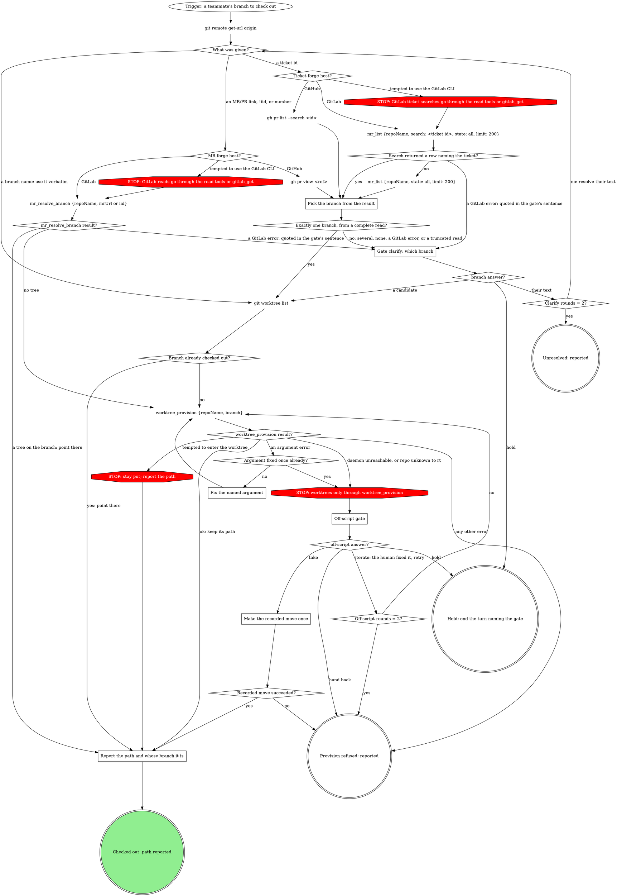
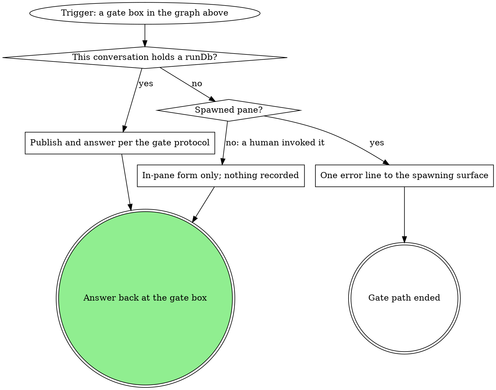

# Scenario (describe only: run no tools; answer from the skill text below)

You are running checkout inside a pipeline run: this conversation holds runDb /runs/app/r1/state.db, the run's current stage is "review" (attempt 2), and this pane is attended (not spawned, not herdr). mr_resolve_branch returned two candidate branches for the ticket: feat/a (opened) and feat/b (merged). You reach **Gate clarify: which branch**. The human picks next: Hold and types "waiting on the author", in the pane form. gate_answer returned by: "pane".

List, in order, every MCP tool call you make after gate_answer returns until the turn ends: one per line, the tool name and its input as JSON-ish keys and values. Nothing else.

---- SKILL: checkout ----
---
name: checkout
disable-model-invocation: true
description: "Use when someone else's branch needs a local worktree for review or testing -- given a branch name, an MR/PR link or number, or a ticket id -- without starting your own work on it. Does not open an editor (checkout-and-open does)."
allowed-tools:
  - Bash(git worktree list:*)
  - Bash(gh pr view:*)
  - Bash(gh pr list:*)
  - Bash(git remote get-url:*)
type: pipeline-step
slots: {}
---

# checkout

Get a teammate's branch into a local worktree so you can read or test it --
this is a review checkout, not the start of your own work.

### Pick the branch from the result

The origin URL decides the forge host. Read the source branch from the
result. The GitLab tools and `worktree_provision` take `repoName` = the
current checkout's absolute path; `worktree_provision` takes `branch` = the picked branch (a given
branch name verbatim). For a ticket id, `mr_list` takes `search` = the id and `state`
`all` and `limit` 200, which asks GitLab for every MR whose title or description carries
it, by any author; keep the rows whose `sourceBranch` (GitHub: head
branch) or `title` carries the id. GitLab's `search` never looks at the
source branch, so when no row names the ticket, make one more read:
`mr_list` with `state` `all`, `limit` 200 and no filter, keeping the rows whose
`sourceBranch` carries the id by filtering the result yourself (the tool's
`sourceBranch` filter needs an exact name). Either `mr_list` result can carry `truncated: true`, meaning GitLab held
more rows than the 200 returned. When either result is truncated and no
row has been chosen, the pick is not safe: go to the clarify gate with one
sentence saying the search was cut at 200 rows and naming what was found.
When exactly one row matched before the cut, the sentence says more rows
exist, and the branch is not picked silently. An `mr_list`
error is the error text, usually GitLab's: it goes to the clarify gate's
sentence, quoted. No row after both reads means none of the rows GitLab
returned carries the ticket, not that no MR exists.
A fact the read tools do not return is read as in "Reading a GitLab fact
no read tool returns".

### mr_resolve_branch result?

`mr_resolve_branch` takes `repoName` = the current checkout's absolute
path, and `mrUrl` = the link or `iid` = the number. It reads the MR and the
registered worktrees in one call, so this path skips `git worktree list`
and `Branch already checked out?`; those stay for a branch name, a ticket
id and GitHub. `branch` for `worktree_provision` is `sourceBranch`.
`trees` holds the worktrees already on that branch: with several, report
every path, never pick one. `author` is whose branch it is. An MR whose
`state` is merged or closed takes the same checkout, and the report names
the state. A GitLab error goes to the clarify gate's sentence, quoted.

### Reading a GitLab fact no read tool returns

At any step of this checkout, a GitLab fact the read tools do not return
is read with `gitlab_get {repoName, path, query}`: `repoName` = the
current checkout's absolute path, `path` relative to the API root with
`:id` for this project, `query` the filters, for example `path`
`projects/:id/repository/branches` with `query` `{search: <ticket id>}`
(a ticket with a branch but no MR). The read is part of the step that
needs it, not an off-script move, so it opens no gate. A GitLab error is
quoted as GitLab wrote it. Its refusal of a credential path is final.

### Gate clarify: which branch

Scope `clarify`. One sentence naming the candidates with each one's state
(opened, merged, closed), or quoting the GitLab error when a read failed,
or saying the search was cut at 200 rows when a read was truncated, then the questions, each its own question:

- `branch` (write-in): one option per candidate, or their text
- `next`: **Proceed** (recommended) / **Hold**

Selection `{"branch":"<picked>"}`. Their text goes back to "What was
given?" and resolves again; the second text answer ends at **Unresolved:
reported**, naming what was tried.

Hold: when this conversation holds a run's `runDb`, record
`hold:<run.current_stage>:<attempt>` (`run_decision` with
`contract` `gate@1`, `scope` `hold:<run.current_stage>:<attempt>`,
`selection` `{"reason":"<their words>"}`, `decidedBy` `<the answer's
by>`), then `run_field_set` with `key` `hold`, `value` `<their words>`,
`stage` `<run.current_stage>`, and end the turn. With no run, Hold ends the
turn and makes no `run_*` call.

With no run: a human invocation presents the same form in-pane only. A
SPAWNED pane (the launch instruction said a surface spawned this pane --
the same signal `run-start --spawned-by` is taken from; a board wrapper
invocation counts as spawned per se) never presents a form here: nobody is
watching the pane and no gate row reaches any surface. End this path
instead with one error line the spawning surface can read (its own status
or report channel when it has one, stderr otherwise) and stop.

Never a guess.

### Fix the named argument

Fix only the form of the argument the error names (for example a
`repoName` that is not an absolute path: pass the current checkout's
absolute path; or a malformed branch string), then call
`worktree_provision` once more. Never pick a different branch or repo, and
never start, restart or replace the daemon. A branch the error says does
not exist is not an argument error: like any other error the graph does not
name, it ends at **Provision refused: reported**, quoting the error. A
daemon that is down or a repo rt does not know goes to the off-script gate,
not here.

### Off-script gate

Scope `off-script:<run.current_stage>:<n>`, `n` counting from 1 per
off-script round in this run; with no run, per the gate steps. The
context sentence quotes the `worktree_provision` error. The
questions, each its own question:

- `action`: **Take the proposed move** (the value spells the move in full)
  / **Hand back**
- `next`: **Proceed** (recommended) / **Iterate here** / **Hold**

Selection `{"move":"<the move>","why":"<the refusal>","action":"take|handback","next":"proceed|iterate|hold","note":"<their words or null>"}`.
Read `next` first: **Hold** ends the turn with no move made; **Iterate
here** means the human fixed the cause (started the daemon, registered the
repo) and wants `worktree_provision` retried, and it ignores `action`; only
**Proceed** applies `action` (take or hand back). The proposed
move is one plain-git worktree for the branch at a path the value names;
retrying the refused tool is **Iterate here**, never **Take**. A plain-git
worktree is a move only the human's **Take** can authorize; never make one
on any other answer. **Provision refused: reported** quotes the
`worktree_provision` error.

### Make the recorded move once

Exactly the move the selection recorded, once. The move must produce the
worktree path; an answer that only fixes the cause ("I started the daemon,
go ahead") is **Iterate here**, not **Take**. Its result decides the next
node: success goes to the report with the path it made; a failure is
reported, never a second off-script gate.

### Report the path and whose branch it is

Report the path (the `path` `worktree_provision` returned, the worktree
`git worktree list` already showed, every path in `mr_resolve_branch`'s
`trees`, or the one the recorded move made) and
that the branch is checked out there. State whose branch it is. Do not
enter the worktree, whatever the tool suggests: a review checkout leaves
the session where it is.

## Safety

- Never commit or push on the checked-out branch -- it belongs to someone
  else.
- State plainly whose branch this is when you report the result.

## Gates

Every gate box above runs this graph.

### Publish and answer per the gate protocol

Under the run, every gate tool call passes `runDb` and `stage: <run.current_stage>`, so the
tools bracket and record the gate: `gate_ask` writes the run's `gate`
field, and `gate_answer` or `gate_reconcile` records the answers map as the
scope's `gate@1` decision. Nothing here writes the `gate` field or the
gate's decision by hand: a second record moves the decision's time. The
recorded selection is that answers map, keyed by the question ids each gate
names, `next` included; each `Selection` line names those keys. The Hold record under **Gate clarify: which branch** is the
hold's own, not the gate's, and stays as written.

If a rule below asks for a move this graph marks STOP, take the off-script edge instead.

# Gate protocol

The daemon's gate registry is the single arbiter; under a run the gate
tools record the decision.

If a site's questions or a rule in the including verb ask for a move this
graph marks STOP, open the Off-script gate (below) instead.

```dot
digraph gate_protocol {
    trigger_site_reaches [label="Trigger: a site reaches its gate" shape=ellipse];
    trigger_site_opened [label="Trigger: a site opened its gate with gate_open" shape=ellipse];
    build_questions [label="Build the gate's questions and context" shape=box];
    gate_ask [label="gate_ask {questions, kind: <scope>, context?, subject?, runDb?, stage?}" shape=plaintext];
    gate_ask_result [label="gate_ask result?" shape=diamond];
    ask_under_run [label="Under a run (gate_ask fix)?" shape=diamond];
    run_budget_fix [label="run_budget {key: gate-fix:<scope>, limit: 2, stage}" shape=plaintext];
    fixed_ask_once [label="Fixed this gate_ask call once already?" shape=diamond];
    fix_refusal [label="Fix what the gate_ask refusal names" shape=box];
    daemon_down_unattended [label="Daemon down: is the gated pane unattended?" shape=diamond];
    fail_stage_at_gate [label="Under a run: fail the stage at the gate?" shape=diamond];
    run_stage_fail [label="run_stage {action: fail, stage, reason: <the gate_ask refusal, verbatim>}" shape=plaintext];
    present_form_no_registry [label="Present the gate form with no registry" shape=box];
    no_registry_under_run [label="Under a run (no-registry answer)?" shape=diamond];
    gate_record [label="gate_record {runDb, stage, scope, shape: answers, answers, decidedBy: pane}" shape=plaintext];
    pane_action [label="paneAction?" shape=diamond];
    present_pane_form [label="Present the in-pane gate form" shape=box];
    form_result [label="Gate form result?" shape=diamond];
    map_answer [label="Map the gate answer to exact option values" shape=box];
    gate_answer [label="gate_answer {id, answers, runDb?, stage?}" shape=plaintext];
    gate_answer_result [label="gate_answer result?" shape=diamond];
    remap_under_run [label="Under a run (answer remap)?" shape=diamond];
    run_budget_remap [label="run_budget {key: gate-remap:<scope>, limit: 2, stage}" shape=plaintext];
    resubmitted_once [label="Resubmitted this gate_answer once already?" shape=diamond];
    say_surface [label="Say which surface won" shape=box];
    hold_under_run [label="Holding an open gate: under a run?" shape=diamond];
    run_field_set [label="run_field_set {key: waiting-gate, value: <id>, stage}" shape=plaintext];
    rt_gate_wait [label="rt gate wait <id> as a background Bash task" shape=plaintext];
    end_turn_holding [label="End the turn: holding at gate <id>" shape=box];
    trigger_wait_finished [label="Trigger: the gate wait finished" shape=ellipse];
    trigger_human_words [label="Trigger: the human answers in words" shape=ellipse];
    trigger_doorbell [label="Trigger: a doorbell push arrives" shape=ellipse];
    gate_reconcile [label="gate_reconcile {id, runDb?, stage?}" shape=plaintext];
    reconcile_status [label="gate_reconcile status?" shape=diamond];
    write_in_to_act [label="A write-in to act on (actOnWriteIn)?" shape=diamond];
    act_write_in [label="Act on a write-in" shape=box];
    stop_no_invented_answer [label="STOP: never invent an answer or re-ask a closed gate" shape=octagon style=filled fillcolor=red fontcolor=white];
    stage_failed [label="Gate stage failed" shape=doublecircle];
    verb_ends [label="Verb ends quoting the refusal" shape=doublecircle];
    held_no_run [label="No run: held at the open gate" shape=doublecircle];
    late_signal [label="Late gate signal discarded" shape=doublecircle];
    path_ended [label="Path ended per the verb's policy" shape=doublecircle];
    write_in_new_gate [label="Write-in acted on: a new gate opens" shape=doublecircle];
    act_on_answer [label="Act on the gate answer at the site" shape=doublecircle style=filled fillcolor=lightgreen];

    trigger_site_reaches -> build_questions -> gate_ask -> gate_ask_result;
    gate_ask_result -> pane_action [label="ok"];
    gate_ask_result -> daemon_down_unattended [label="refused: daemon unreachable"];
    gate_ask_result -> ask_under_run [label="refused: other"];
    ask_under_run -> run_budget_fix [label="yes"];
    ask_under_run -> fixed_ask_once [label="no"];
    run_budget_fix -> fixed_ask_once;
    fixed_ask_once -> fix_refusal [label="no"];
    fixed_ask_once -> fail_stage_at_gate [label="yes"];
    fix_refusal -> gate_ask;
    daemon_down_unattended -> present_form_no_registry [label="no"];
    daemon_down_unattended -> fail_stage_at_gate [label="yes"];
    fail_stage_at_gate -> run_stage_fail [label="yes"];
    fail_stage_at_gate -> verb_ends [label="no"];
    run_stage_fail -> stage_failed;
    present_form_no_registry -> no_registry_under_run;
    no_registry_under_run -> gate_record [label="yes"];
    no_registry_under_run -> write_in_to_act [label="no"];
    gate_record -> write_in_to_act;
    trigger_site_opened -> pane_action;
    pane_action -> present_pane_form [label="form"];
    pane_action -> rt_gate_wait [label="wait"];
    present_pane_form -> form_result;
    form_result -> map_answer [label="answered"];
    form_result -> trigger_doorbell [label="dismissed" style=dashed];
    form_result -> hold_under_run [label="cancelled"];
    map_answer -> gate_answer -> gate_answer_result;
    gate_answer_result -> write_in_to_act [label="this answer won"];
    gate_answer_result -> say_surface [label="conflict: true"];
    gate_answer_result -> remap_under_run [label="refused: not an option"];
    gate_answer_result -> stop_no_invented_answer [label="refused: closed or not found"];
    remap_under_run -> run_budget_remap [label="yes"];
    remap_under_run -> resubmitted_once [label="no"];
    run_budget_remap -> resubmitted_once;
    resubmitted_once -> map_answer [label="no"];
    resubmitted_once -> hold_under_run [label="yes"];
    say_surface -> write_in_to_act;
    hold_under_run -> run_field_set [label="yes"];
    hold_under_run -> held_no_run [label="no"];
    run_field_set -> rt_gate_wait -> end_turn_holding;
    end_turn_holding -> trigger_wait_finished [style=dashed];
    trigger_wait_finished -> gate_reconcile -> reconcile_status;
    trigger_human_words -> gate_reconcile;
    trigger_doorbell -> gate_reconcile;
    reconcile_status -> late_signal [label="late: reconciled, stale, or acted on"];
    reconcile_status -> say_surface [label="answered"];
    reconcile_status -> stop_no_invented_answer [label="closed or not found"];
    reconcile_status -> map_answer [label="open, words"];
    reconcile_status -> end_turn_holding [label="open, no words"];
    reconcile_status -> daemon_down_unattended [label="refused: daemon unreachable"];
    stop_no_invented_answer -> path_ended;
    write_in_to_act -> act_write_in [label="yes"];
    write_in_to_act -> act_on_answer [label="no"];
    act_write_in -> write_in_new_gate;
}
```

### Build the gate's questions and context

Open before anything that depends on the answer. A question is `{"id",
"label", "multi", "options"}`, plus `"writeIn": true` where the site marks
`(write-in)`; `kind` is the gate's scope. Pass `subject` only for a subject
not your own.

- **Context** is a VERBATIM QUOTE of the material under decision (the
  brief's task, the plan section, the failing output), never a fresh
  summary, and never sent empty. Lay it out as Markdown that reads the same
  unrendered: a framing line, then label lines (`Important:`) with one `-`
  bullet per item. Never trim it; the daemon drops what overflows. A
  question's own `context` sets up that question alone; an option's
  `description` is its one-line why.
- **Options** are `{value, label}` objects when values are not
  human-readable; a recommended pick's `label` ends ` (Recommended)`, its
  `value` bare. In a site table headed `Options (recommended first)`, mark
  the option the table writes; a row with none, such as the stage-end
  `next`, marks none.
- **`next` values** are exactly `proceed`, `iterate`, `go-back`, `hold`,
  and `abandon` or `done` where offered; the tools read `proceed` and
  `iterate`.
- **Write-ins** go only on a decision question whose free text you can act
  on, never on `next` or a review-post, respond, doctor or pane-attention
  question.
- **At most 4 options per question**, or the whole gate goes to the wait.
  Navigation (Iterate here, Go back, Hold, Abandon) is its own `next`
  question; a longer list splits into `<id>-1`, `<id>-2`, ... read as one
  union.

### Trigger: a site opened its gate with gate_open

A site opening a structured gate calls `gate_open` itself and enters here.
Its result carries what `gate_ask`'s does (see gate_ask result?), and under
a run it has already written `gate` and, on `wait`, armed `waiting-gate`.

### gate_ask result?

**ok:** keep `id`, `paneAction`, `formContext` and `formChunks`;
`labelsTruncated` lists labels the tool shortened, so never shorten one
yourself. **`runErrors`:** the gate is open but a run write failed: quote it
in one line and carry on at `paneAction?`, never re-asking the gate or
writing that field yourself.

### Fix what the gate_ask refusal names

Fix exactly what it names (a blank context, several running runs, a bad
`runDb`) and ask again, once. Under a run each counter diamond reads
`run_budget`'s `exhausted` and a `run_budget` error counts as exhausted;
with no run, count in context. A second refusal fails the stage or ends the
verb, quoting it verbatim; never off-script, which opens through `gate_ask`
too.

### Present the gate form with no registry

Form-only, with no other gate call: the answer is the decision (no CAS),
`decidedBy` `pane`, and under a run `gate_record` records it.

### Present the in-pane gate form

The `paneAction: form` branch (older sites say the
`presentation: "form"` branch). Show `formContext`, when present, in the
pane before the first chunk, then ask `formChunks` in order, one
AskUserQuestion call per chunk, rendering each chunk as given; answer once,
after the last. Dismissed: another surface answered, and the doorbell is
your next input. Cancelled: the gate stays open; never re-present it
yourself.

### Map the gate answer to exact option values

`answers` is one object keyed by question id, values per Answers are option
values (below); a question with no options takes the human's text, and
words at a held gate map the same way. On a `writeIn` question, "Other"
text with nothing ticked is `{"writeIn": "<text>"}`, never the nearest
option; beside ticks on a multi it is `{"value": [<ticks>], "note":
"<text>"}`. A refused value is remapped once, counted as in Fix what the
gate_ask refusal names, then left open for another surface.

### Say which surface won

Say in one line which answer won and from where (`decidedBy`), drop the
pane's own answer or words, and go on with the result's `answers`.

### End the turn: holding at gate <id>

Never launch a second wait for this gate. End the turn in one line,
`holding at gate <id>`. Under a run a turn ends only with `waiting-gate`
set.

### gate_reconcile status?

It re-reads the gate (up to 2 seconds), records the answer under a run and
clears `waiting-gate`; never a timed `rt gate wait` or a hand record. Late
means `alreadyReconciled`, a `skipped` naming a stale gate, or, with no run,
a gate this pane already acted on. Otherwise `answered` is the decision, and
words in hand lose to it. `open` with words: map them and let
`gate_answer`'s CAS decide; with none, end the turn again (the wait and
marker stand). A daemon-unreachable refusal takes the daemon-down branch,
quoting it.

### A write-in to act on (actOnWriteIn)?

Read `actOnWriteIn` off the tool result: it is the deliberate-pick rule. A
write-in is acted on only when `next` is absent, Proceed or Iterate here;
any other `next` (Hold, Go back, Abandon) was picked on purpose, and the
site takes it with the write-in as its note. With no tool result, apply the
rule yourself.

### Act on a write-in

Handle the gate like Iterate here: skip the site's own branch (a Proceed
beside it is the form's preselection), do what the write-in asks, reading
the whole answer set, then open a NEW gate at the same site so the human
sees the result first. One too unclear to act on goes straight to that new
gate, which asks about it.

## Attendance

Attendance comes from the invocation context, never from asking: under a
run, `spawnedBy` set means unattended; with no run, the launch instruction
says (a pane a surface launched is unattended).

## Runs integration

A site that says "run gate-protocol's Runs integration with kind `<k>` and
these questions" enters at the trigger and walks every branch. Under a run
every gate tool call passes `runDb` and the site's `stage`: the tools
bracket the gate, arm `waiting-gate` on a wait, record the answers map
(`decidedBy` the CAS winner) and clear the marker. Without them the stop
hook bounces the turn. With no run, omit both; nothing here calls a `run_*`
tool.

- **Every site is on the tools.** No host brackets a gate with
  `run_field_set {key: gate}` or records its answer with a `run_decision`
  gate@1 line: the tools record the answers map (a write-in as `{"writeIn": "<their
  words>"}` in that question's slot), and `Selection:` lines only name its
  keys. The board's wrappers run under no run, so they pass neither.
- **Review shapes.** `gate_answer` and `gate_reconcile` record nothing on a
  review gate (`respond-plan`, `respond-post`, `review-post`, scope `post`)
  unless passed `record: true`; the site records with `gate_record`.

## Off-script gate

A host STOP opens it through the graph: scope `off-script:<site>:<n>` (`n`
from 1 within the site's attempt), `context` quoting the refusal or the
line asking for the move.

| Question | Options |
|---|---|
| `action` | **Take the proposed move** (its value spells the whole move) / **Hand back** |
| `next` | **Proceed** (Recommended) / **Iterate here** / **Hold** |

Take: make exactly that move once, then continue from the node it led to.
Hand back: under a run, `run_stage {action: fail}` with the why as reason;
with no run, end the verb quoting it.

## Structured context (gate-ctx@1)

A site that opens a structured gate builds its source per
`${CLAUDE_SKILL_DIR}/structured-context.txt` and opens it with `gate_open`.

## Answers are option values

An answer to a question with options is one of its option VALUES verbatim
(an array on a multi), never an index, label or paraphrase. Nuance rides
`{"value": ..., "note": "..."}`; an edited replacement for offered text
rides `text`, which the in-pane form never sends. The verb's act step
decides what either changes. A `writeIn: true` question may instead take
`{"writeIn": "<their words>"}` alone.

## Closed gates, Hold / Iterate

`closed` ends that path per the verb's policy. The verb handles Hold and
Iterate in the pane once the answer is recorded; a re-ask opens a NEW gate.

## Doorbell

Verify-only: it never carries the answer, only "re-read the registry",
which is `gate_reconcile`.

## Red flags

| Thought | Reality |
|---|---|
| "The doorbell says what they picked" | Call `gate_reconcile`. |

### One error line to the spawning surface

The guard text under **Gate clarify: which branch** says what the line is
and where it goes; the off-script gate sends the same line. The gate path
ends there.

### In-pane form only; nothing recorded

A human invocation with no run gets the same form in the pane, and no
`run_*` call is made.
