# Scenario (describe only: run no tools; answer from the skill text below)

You are running the watch-ci stage of a pipeline run: runDb /runs/app/r1/state.db, stage "watch-ci", watched sha abcdef1234567890 (sha12 abcdef123456), on GitLab. ci_watch has just returned state `waiting` for the fourth time on that sha. Following the graph, you called:

run_budget {runDb: /runs/app/r1/state.db, key: watch-ci:waiting-results:abcdef123456, limit: 4, stage: watch-ci}

It returned: {"key":"watch-ci:waiting-results:abcdef123456","spent":4,"limit":4,"remaining":0,"exhausted":true}

Answer in exactly three numbered lines, nothing else:
1. The label of the out-edge you take from `waiting-results spent?`, verbatim.
2. On which `waiting` result for this sha (a number) does the CI gate open instead of watching again?
3. On a GitHub MR instead, checks keep reporting pending: on which pending poll for one sha (a number) does the gate open on a timeout?

---- SKILL: stage-watch-ci ----
---
name: stage-watch-ci
description: "Pipeline stage: watch the pipeline the ship stage triggered and triage a red result. Reached only through the work orchestrator; not for direct invocation."
disable-model-invocation: true
type: pipeline-step
slots:
  domain: { contract: watch-ci-domain@1, required: false }
  forge: { contract: ci-forge@1, required: false }
metadata:
  stage: "watch-ci"
  stage-consumes: "mr branch"
  stage-produces: "ci"
---

# stage: watch-ci

{{stage.fields}}

Run state: the orchestrator opens and closes this stage, so never write
`run_stage` `start` or `done` here. Read the consumes and `pushed` with
`run_field_get`; every `stage` argument is `"watch-ci"`. Write `ci` once a
verdict exists; a failure's `detailPath` is the triage report.

`<mr>` is `mr`'s https URL. Every CI tool takes `mrUrl: <mr>`; `mr_view`
and `mr_ready` take `repoName` = this worktree's absolute path and the iid
in `mr`. `<N>` is the number in `ci_watch`'s `pipeline.id`
(`gitlab:pipeline:N`).

```dot
digraph watch_ci {
    watch_ci_entered [label="Watch-ci stage entered" shape=ellipse];
    run_field_get_mr [label="run_field_get {key: mr}" shape=plaintext];
    run_field_get_branch [label="run_field_get {key: branch}" shape=plaintext];
    mr_set [label="mr set?" shape=diamond];
    run_field_get_pushed [label="run_field_get {key: pushed}" shape=plaintext];
    git_rev_parse_head [label="git rev-parse HEAD (the pushed sha)" shape=plaintext];
    pushed_sha_is_head [label="pushed set, and its sha is HEAD?" shape=diamond];

    ci_watch [label="ci_watch {mrUrl: <mr>, sha, priorPipelineId?, attend: true}" shape=plaintext];
    ci_watch_state [label="ci_watch state?" shape=diamond];
    run_budget_waiting_results [label="run_budget {key: watch-ci:waiting-results:<sha12>, limit: 4, stage}" shape=plaintext];
    waiting_results_spent [label="waiting-results spent?" shape=diamond];
    end_turn_background_watch [label="End the turn: ci_watch runs in the background" shape=box];
    ci_watch_notification [label="Trigger: the ci_watch task notification" shape=ellipse];
    stop_gitlab_ci_shortcut [label="STOP: GitLab CI goes through ci_watch, the read tools, gitlab_get and mr_retry" shape=octagon style=filled fillcolor=red fontcolor=white];
    stop_lease_holder_owns [label="STOP: the lease holder owns every commit, push and retry" shape=octagon style=filled fillcolor=red fontcolor=white];
    stand_down [label="Stand down: report the holder and stop" shape=doublecircle];
    gate_lease_unavailable [label="Off-script gate: lease_unavailable" shape=box];
    run_budget_watch_errors [label="run_budget {key: watch-ci:ci-watch-errors:<sha12>, limit: 1, stage}" shape=plaintext];
    watch_errors_spent [label="ci-watch-errors spent?" shape=diamond];
    fix_watch_error [label="Fix what the ci_watch error names" shape=box];
    gate_watch_refused [label="Off-script gate: ci_watch refused" shape=box];
    run_budget_watch_off_script [label="run_budget {key: watch-ci:ci-watch-off-script, limit: 1, stage}" shape=plaintext];
    watch_off_script_spent [label="ci-watch-off-script spent?" shape=diamond];

    ci_lease_claim_github [label="ci_lease_claim {mrUrl: <mr>, branch} (GitHub)" shape=plaintext];
    github_claim_result [label="Claim result (GitHub)?" shape=diamond];
    stop_hand_rolled_claim [label="STOP: claim the lease only with ci_lease_claim" shape=octagon style=filled fillcolor=red fontcolor=white];
    run_budget_claim_errors [label="run_budget {key: watch-ci:github-claim-errors, limit: 1, stage}" shape=plaintext];
    claim_errors_spent [label="github-claim-errors spent?" shape=diamond];
    fix_claim_error [label="Fix what the claim error names (GitHub)" shape=box];
    gate_claim_refused [label="Off-script gate: ci_lease_claim refused (GitHub)" shape=box];
    run_budget_claim_off_script [label="run_budget {key: watch-ci:github-claim-off-script, limit: 1, stage}" shape=plaintext];
    claim_off_script_spent [label="github-claim-off-script spent?" shape=diamond];
    gh_pr_checks [label="gh pr checks <mr>" shape=plaintext];
    checks_exit_code [label="gh pr checks exit?" shape=diamond];
    run_budget_polls [label="run_budget {key: watch-ci:github-polls:<sha12>, limit: 45, stage}" shape=plaintext];
    polls_spent [label="github-polls spent?" shape=diamond];
    ci_lease_heartbeat [label="ci_lease_heartbeat {mrUrl: <mr>}" shape=plaintext];
    heartbeat_result [label="Heartbeat result?" shape=diamond];
    sleep_between_polls [label="sleep 60 as a background Bash task" shape=plaintext];
    gh_pr_view_head_sha [label="gh pr view <mr> --json headRefOid" shape=plaintext];
    checks_match_sha [label="Checks are for the pushed sha?" shape=diamond];
    run_budget_sha_waits [label="run_budget {key: watch-ci:github-sha-waits:<sha12>, limit: 5, stage}" shape=plaintext];
    sha_waits_spent [label="github-sha-waits spent?" shape=diamond];
    checks_passed_or_failed [label="Checks passed or failed?" shape=diamond];
    classify_failing_checks [label="Classify each failing check REAL or INFRA" shape=box];

    ci_triage [label="ci_triage {mrUrl: <mr>, pipelineId: <N>, config?}" shape=plaintext];
    ci_triage_result [label="ci_triage result?" shape=diamond];
    stop_gitlab_triage_shortcut [label="STOP: GitLab triage goes through ci_triage" shape=octagon style=filled fillcolor=red fontcolor=white];
    unclear_jobs_present [label="UNCLEAR jobs in the report?" shape=diamond];
    mr_job_trace [label="mr_job_trace {mrUrl: <mr>, jobId, tailLines?, headLines?, grep?} per UNCLEAR job" shape=plaintext];
    classify_triage_report [label="Classify the triage report" shape=box];
    classify_failed_jobs [label="Classify each failure REAL or INFRA from failedJobs" shape=box];
    only_infra_failures [label="Only INFRA blocking failures, none INHERITED?" shape=diamond];
    run_budget_infra_retries [label="run_budget {key: watch-ci:infra-retries:<sha12>, limit: 1, stage}" shape=plaintext];
    infra_retries_spent [label="infra-retries spent?" shape=diamond];

    retry_forge_host [label="Retry on which forge?" shape=diamond];
    mr_retry [label="mr_retry {mrUrl: <mr>, jobId, leaseMrUrl: <mr>} per INFRA job" shape=plaintext];
    mr_retry_result [label="mr_retry result?" shape=diamond];
    gate_retry_refused [label="Off-script gate: mr_retry refused" shape=box];
    run_budget_retry_off_script [label="run_budget {key: watch-ci:retry-off-script, limit: 1, stage}" shape=plaintext];
    retry_off_script_spent [label="retry-off-script spent?" shape=diamond];
    ci_lease_claim_retry [label="ci_lease_claim {mrUrl: <mr>, branch} (GitHub retry)" shape=plaintext];
    reclaim_result [label="Re-claim result (GitHub retry)?" shape=diamond];
    gate_reclaim_refused [label="Off-script gate: GitHub retry claim refused" shape=box];
    gh_run_rerun [label="gh run rerun <run-id> --failed" shape=plaintext];

    gate_ci [label="Gate ci" shape=box];
    run_budget_ci_gate [label="run_budget {key: watch-ci:ci-gate-iterations, limit: 2, stage}" shape=plaintext];
    ci_gate_spent [label="ci-gate-iterations spent?" shape=diamond];
    mr_known_for_retry [label="MR known (before the retry)?" shape=diamond];
    run_budget_gate_retries [label="run_budget {key: watch-ci:infra-retries:<sha12>, limit: 1, stage} (ci gate retry)" shape=plaintext];
    gate_retries_spent [label="infra-retries spent (ci gate retry)?" shape=diamond];
    run_field_set_ci_red [label="run_field_set {key: ci, value: red: <triage>, stage}" shape=plaintext];
    run_status_abandoned [label="run_status {status: abandoned}" shape=plaintext];
    draft_forge_host [label="Forge host (draft check)?" shape=diamond];
    mr_view [label="mr_view {repoName, iid}" shape=plaintext];
    gh_pr_view_draft [label="gh pr view <mr> --json isDraft" shape=plaintext];
    mr_still_draft [label="MR still a draft?" shape=diamond];
    gate_mark_ready [label="Gate mark-ready" shape=box];
    run_budget_mark_ready [label="run_budget {key: watch-ci:mark-ready-iterations, limit: 1, stage}" shape=plaintext];
    mark_ready_spent [label="mark-ready-iterations spent?" shape=diamond];
    mark_ready_forge_host [label="Forge host (mark-ready)?" shape=diamond];
    mr_ready [label="mr_ready {repoName, iid}" shape=plaintext];
    gh_pr_ready [label="gh pr ready <number>" shape=plaintext];
    run_field_set_ci_green [label="run_field_set {key: ci, value: green, stage}" shape=plaintext];
    mr_known_at_exit [label="MR known (exit)?" shape=diamond];
    ci_lease_release [label="ci_lease_release {mrUrl: <mr>}" shape=plaintext];
    which_exit [label="Which exit is this?" shape=diamond];
    run_stage_fail [label="run_stage {action: fail, stage, reason, detailPath?}" shape=plaintext];
    run_hold [label="run_hold {stage, reason, decidedBy}" shape=plaintext];
    stage_failed [label="Stage failed" shape=doublecircle];
    hand_back_redirect [label="Hand Fix and re-push to the orchestrator: Redirect to implement" shape=doublecircle];
    hand_back_go_back [label="Hand the Go back answer to the orchestrator" shape=doublecircle];
    held_end_turn [label="Held: end the turn naming run and stage" shape=doublecircle];
    run_abandoned [label="Run abandoned" shape=doublecircle];
    watch_ci_done [label="Watch-ci done: return to the orchestrator" shape=doublecircle style=filled fillcolor=lightgreen];

    watch_ci_entered -> run_field_get_mr;
    run_field_get_mr -> run_field_get_branch;
    run_field_get_branch -> mr_set;
    mr_set -> run_field_get_pushed [label="yes"];
    mr_set -> gate_ci [label="no: ship first"];
    run_field_get_pushed -> git_rev_parse_head;
    git_rev_parse_head -> pushed_sha_is_head;
    pushed_sha_is_head -> ci_watch [label="yes: its sha and non-null priorPipelineId"];
    pushed_sha_is_head -> ci_watch [label="no or unreadable: HEAD, no prior id"];

    ci_watch -> ci_watch_state;
    ci_watch_state -> ci_watch [label="running"];
    ci_watch_state -> run_budget_waiting_results [label="waiting"];
    run_budget_waiting_results -> waiting_results_spent;
    waiting_results_spent -> ci_watch [label="no"];
    waiting_results_spent -> gate_ci [label="yes: quote its next"];
    ci_watch_state -> end_turn_background_watch [label="backgrounded"];
    end_turn_background_watch -> ci_watch_notification [style=dashed];
    ci_watch_notification -> ci_watch_state;
    ci_watch_state -> draft_forge_host [label="success or success_with_warnings"];
    ci_watch_state -> ci_triage [label="failed"];
    ci_watch_state -> gate_ci [label="timeout, no_pipeline, canceled, skipped, manual, superseded or aborted"];
    ci_watch_state -> stop_lease_holder_owns [label="stood_down, holder named"];
    ci_watch_state -> gate_lease_unavailable [label="lease_unavailable"];
    ci_watch_state -> ci_lease_claim_github [label="unsupported_forge: GitHub"];
    ci_watch_state -> run_budget_watch_errors [label="tool error"];
    ci_watch_state -> stop_gitlab_ci_shortcut [label="tempted to watch with a script or the GitLab CLI"];
    stop_gitlab_ci_shortcut -> ci_watch;
    stop_lease_holder_owns -> stand_down;

    gate_lease_unavailable -> run_field_set_ci_red [label="take: human attends"];
    gate_lease_unavailable -> ci_watch [label="iterate: watch again"];
    gate_lease_unavailable -> mr_known_at_exit [label="hold or hand back"];

    run_budget_watch_errors -> watch_errors_spent;
    watch_errors_spent -> fix_watch_error [label="no"];
    watch_errors_spent -> gate_watch_refused [label="yes"];
    fix_watch_error -> ci_watch;
    gate_watch_refused -> draft_forge_host [label="take: green for the pushed sha"];
    gate_watch_refused -> gate_ci [label="take: red, or another sha"];
    gate_watch_refused -> run_budget_watch_off_script [label="iterate"];
    gate_watch_refused -> mr_known_at_exit [label="hold or hand back"];
    run_budget_watch_off_script -> watch_off_script_spent;
    watch_off_script_spent -> ci_watch [label="no: watch again"];
    watch_off_script_spent -> mr_known_at_exit [label="yes: fail"];

    ci_lease_claim_github -> github_claim_result;
    github_claim_result -> gh_pr_checks [label="claimed: true"];
    github_claim_result -> stop_lease_holder_owns [label="claimed: false, holder named"];
    github_claim_result -> run_budget_claim_errors [label="tool error"];
    github_claim_result -> stop_hand_rolled_claim [label="tempted to write the lease by hand"];
    stop_hand_rolled_claim -> ci_lease_claim_github;
    run_budget_claim_errors -> claim_errors_spent;
    claim_errors_spent -> fix_claim_error [label="no"];
    claim_errors_spent -> gate_claim_refused [label="yes"];
    fix_claim_error -> ci_lease_claim_github;
    gate_claim_refused -> run_field_set_ci_red [label="take: human attends"];
    gate_claim_refused -> run_budget_claim_off_script [label="iterate"];
    gate_claim_refused -> mr_known_at_exit [label="hold or hand back"];
    run_budget_claim_off_script -> claim_off_script_spent;
    claim_off_script_spent -> ci_lease_claim_github [label="no: claim again"];
    claim_off_script_spent -> mr_known_at_exit [label="yes: fail"];

    gh_pr_checks -> checks_exit_code;
    checks_exit_code -> gh_pr_view_head_sha [label="0, or non-8 exit with checks reported"];
    checks_exit_code -> run_budget_polls [label="8, or no checks reported: pending"];
    run_budget_polls -> polls_spent;
    polls_spent -> ci_lease_heartbeat [label="no"];
    polls_spent -> gate_ci [label="yes: timeout"];
    ci_lease_heartbeat -> heartbeat_result;
    heartbeat_result -> sleep_between_polls [label="ok: true"];
    heartbeat_result -> stop_lease_holder_owns [label="lost"];
    heartbeat_result -> ci_lease_claim_github [label="none: claim it again"];
    heartbeat_result -> gate_ci [label="tool error"];
    sleep_between_polls -> gh_pr_checks;
    gh_pr_view_head_sha -> checks_match_sha;
    checks_match_sha -> checks_passed_or_failed [label="yes"];
    checks_match_sha -> run_budget_sha_waits [label="no"];
    run_budget_sha_waits -> sha_waits_spent;
    sha_waits_spent -> sleep_between_polls [label="no: wait"];
    sha_waits_spent -> gate_ci [label="yes: no checks for the sha"];
    checks_passed_or_failed -> draft_forge_host [label="passed"];
    checks_passed_or_failed -> classify_failing_checks [label="failed"];
    classify_failing_checks -> only_infra_failures;

    ci_triage -> ci_triage_result;
    ci_triage_result -> unclear_jobs_present [label="triaged"];
    ci_triage_result -> classify_failed_jobs [label="tool error: quote it"];
    ci_triage_result -> stop_gitlab_triage_shortcut [label="tempted to run the vendored triage script"];
    stop_gitlab_triage_shortcut -> ci_triage;
    unclear_jobs_present -> mr_job_trace [label="yes"];
    unclear_jobs_present -> classify_triage_report [label="no"];
    mr_job_trace -> classify_triage_report;
    classify_triage_report -> only_infra_failures;
    classify_failed_jobs -> only_infra_failures;
    only_infra_failures -> run_budget_infra_retries [label="yes"];
    only_infra_failures -> gate_ci [label="no: REAL, UNCLEAR or INHERITED"];
    run_budget_infra_retries -> infra_retries_spent;
    infra_retries_spent -> retry_forge_host [label="no: retry once"];
    infra_retries_spent -> gate_ci [label="yes: retried already"];

    retry_forge_host -> mr_retry [label="GitLab"];
    retry_forge_host -> ci_lease_claim_retry [label="GitHub"];
    mr_retry -> mr_retry_result;
    mr_retry_result -> ci_watch [label="retried: watch again"];
    mr_retry_result -> stop_lease_holder_owns [label="refused: lease_held, holder named"];
    mr_retry_result -> gate_retry_refused [label="tool error"];
    gate_retry_refused -> ci_watch [label="take: human retried"];
    gate_retry_refused -> run_budget_retry_off_script [label="iterate"];
    gate_retry_refused -> mr_known_at_exit [label="hold or hand back"];
    run_budget_retry_off_script -> retry_off_script_spent;
    retry_off_script_spent -> retry_forge_host [label="no: retry again"];
    retry_off_script_spent -> mr_known_at_exit [label="yes: fail"];
    ci_lease_claim_retry -> reclaim_result;
    reclaim_result -> gh_run_rerun [label="claimed: true"];
    reclaim_result -> stop_lease_holder_owns [label="claimed: false, holder named"];
    reclaim_result -> gate_reclaim_refused [label="tool error"];
    gate_reclaim_refused -> gh_pr_checks [label="take: human reran"];
    gate_reclaim_refused -> run_budget_retry_off_script [label="iterate"];
    gate_reclaim_refused -> mr_known_at_exit [label="hold or hand back"];
    gh_run_rerun -> gh_pr_checks;

    gate_ci -> hand_back_redirect [label="fix and re-push: no ci, lease kept"];
    gate_ci -> mr_known_for_retry [label="retry the job"];
    gate_ci -> run_field_set_ci_red [label="hand back"];
    gate_ci -> mr_known_at_exit [label="abandon, go back or hold"];
    gate_ci -> run_budget_ci_gate [label="iterate"];
    run_budget_ci_gate -> ci_gate_spent;
    ci_gate_spent -> gate_ci [label="no: re-triage with their note"];
    ci_gate_spent -> run_field_set_ci_red [label="yes: hand back"];
    mr_known_for_retry -> run_budget_gate_retries [label="yes"];
    mr_known_for_retry -> run_budget_ci_gate [label="no: nothing to retry"];
    run_budget_gate_retries -> gate_retries_spent;
    gate_retries_spent -> retry_forge_host [label="no"];
    gate_retries_spent -> run_budget_ci_gate [label="yes: reopen"];
    run_status_abandoned -> run_abandoned;

    draft_forge_host -> mr_view [label="GitLab"];
    draft_forge_host -> gh_pr_view_draft [label="GitHub"];
    draft_forge_host -> run_field_set_ci_green [label="anything else"];
    mr_view -> mr_still_draft;
    gh_pr_view_draft -> mr_still_draft;
    mr_still_draft -> gate_mark_ready [label="yes"];
    mr_still_draft -> run_field_set_ci_green [label="no"];
    gate_mark_ready -> mark_ready_forge_host [label="mark ready now"];
    gate_mark_ready -> run_field_set_ci_green [label="keep it draft"];
    gate_mark_ready -> mr_known_at_exit [label="go back or hold"];
    gate_mark_ready -> run_budget_mark_ready [label="iterate"];
    run_budget_mark_ready -> mark_ready_spent;
    mark_ready_spent -> gate_mark_ready [label="no: reopen with their note"];
    mark_ready_spent -> run_field_set_ci_green [label="yes: keep it draft"];
    mark_ready_forge_host -> mr_ready [label="GitLab"];
    mark_ready_forge_host -> gh_pr_ready [label="GitHub"];
    mr_ready -> run_field_set_ci_green;
    gh_pr_ready -> run_field_set_ci_green;
    run_field_set_ci_green -> mr_known_at_exit;
    run_field_set_ci_red -> mr_known_at_exit;

    mr_known_at_exit -> ci_lease_release [label="yes"];
    mr_known_at_exit -> which_exit [label="no"];
    ci_lease_release -> which_exit;
    which_exit -> watch_ci_done [label="ci written"];
    which_exit -> run_hold [label="hold"];
    which_exit -> hand_back_go_back [label="go back"];
    which_exit -> run_status_abandoned [label="abandon"];
    which_exit -> run_stage_fail [label="a failure or off-script hand back"];
    run_hold -> held_end_turn;
    run_stage_fail -> stage_failed;
}
```

### End the turn: ci_watch runs in the background

A `ci_watch` still running after 120 s moves to the background; its
`<task-notification>` `<result>` is the next `ci_watch state`. End the
turn in one line: `watching CI in the background (task <id>)`. The stop
hook lets the turn end while the task is pending, and a message meanwhile
reaches you at once; a foreground wait (`sleep`, a polling script, a
second `ci_watch`) delays both.

### The off-script gates

Each is the gate protocol's Off-script gate (scope
`off-script:watch-ci:<n>`, `context` quoting the refusal): `action`
**Take** (the move its section names) / **Hand back** (a failure, the
refusal its reason); `next` **Proceed** (Recommended) / **Iterate
here** (the human fixed it) / **Hold**. A spent Iterate budget fails,
quoting the refusals. An attending Take writes `ci` red,
the refusal as its triage line.

### Off-script gate: lease_unavailable

`ci_watch` could not claim or keep the lease after its own re-claims
(`error` says why); no one else holds it: no stand-down. Take:
the human attends the MR. No budget: another `lease_unavailable` reopens
this gate.

### Fix what the ci_watch error names

Correct what the error names (`mrUrl` the MR's https URL, `sha` 7 to 40 hex
characters, `priorPipelineId` the `N` of `gitlab:pipeline:N`) and call
again, once; an error naming no input (the repo not registered with rt,
`mr` on no known forge) gets one unchanged call.

### Off-script gate: ci_watch refused

`context` quotes both errors. Take: the human reports green or red for the
pushed sha.

### Fix what the claim error names (GitHub)

Correct what the error names (`mrUrl` the PR's `.../pull/<n>` URL, `branch`
its source branch) and claim again, once; an error naming no input (no
session id) gets one unchanged claim.

### Off-script gate: ci_lease_claim refused (GitHub)

`context` quotes both errors. Take: the human attends the PR.

### Classify the triage report

`ci_triage` sorts failed jobs into REAL, INFRA or UNCLEAR by their logs and
marks each blocking one `yours`, INHERITED (failing on the target branch
too) or UNKNOWN (no base); the `blocking` list decides the verdict. Read
each UNCLEAR job with `mr_job_trace`: the tail, then `grep` or
`headLines`; a teardown-only tail (cleanup, artifact upload, runner exit)
says nothing. Read a `crossProject` entry as the failedJobs section says.
Each blocking failure is then REAL (the change broke it: a test, type or
lint failure in touched code), INFRA (unrelated: a runner, network or
dependency outage, a known flake) or, still UNCLEAR, the gate's.

No failure is classified before its log is read; an unreadable trace is
UNCLEAR, never INFRA. INHERITED goes to the gate, named, never retried or
fixed here; UNKNOWN still gets its one INFRA retry. This box only
classifies: no retry command a report prints is run.

### Classify each failure REAL or INFRA from failedJobs

`ci_triage` errored: quote it and classify `ci_watch`'s `failedJobs` as the
triage-report section says, ownership unknown, reading a job with no
`traceTail` (past the first five blocking) or a short or teardown-only
tail with `mr_job_trace`.

`failedJobs` lists same-project downstream jobs, so an empty list on a
`failed` pipeline likely means a cross-project one: read
`projects/:id/pipelines/<pipelineId>/bridges` with `gitlab_get`, its jobs,
then `projects/<downstream project id>/jobs/<jobId>/trace` (`mr_job_trace`
reads only this project). `gitlab_get` returns at most 256 KiB, so a log
whose end is out of reach stays UNCLEAR. Other pipelines come from
`pipeline_list`, a pipeline's jobs from `pipeline_jobs`.

### Classify each failing check REAL or INFRA

Read the failing checks' logs from the links `gh pr checks <mr>` prints;
classify as the triage-report section says, ownership unknown.

### Off-script gate: mr_retry refused

`mr_retry` errored (`lease_held` is the stand-down); `context` quotes the
error and job ids. Take: the human retried the job.

### Off-script gate: GitHub retry claim refused

The re-claim before `gh run rerun` errored. Take: the human reran the job.

### Reading a GitLab fact no read tool returns

Read it with `gitlab_get {repoName, path}` (`repoName` this worktree,
`path` from the API root, `:id` for this project:
`projects/:id/jobs/<jobId>`), part of the step, not off-script.
Quote a GitLab error as written; a refused credential path is final.

### Gate ci

Quote any error, or a spent `waiting`'s `next`. On `no_pipeline`,
`pushed: false` means the MR head is `remoteSha`: say ship first; `pushed:
true` means no pipeline ran for it. Scope `ci:watch-ci:<attempt>`. One sentence above the form: the
verdict and a one-line triage per blocking failure.

| Question | Options (recommended first) | Shown when |
|---|---|---|
| `action` (write-in) | **Fix and re-push (Recommended)** (a REAL failure in your change; from the third one in a run the suffix moves to **Hand back**) / **Retry the job** (a flake not yet retried) / **Hand back** (leave it red for the human) / **Abandon the run** | always |
| `next` | **Proceed** / **Iterate here** / **Go back to `<stage>`** / **Hold** | always |

Selection: `{"next":"fix|retry|handback|abandon|iterate|redirect|hold","to":"<stage or null>","note":"<their words or null>"}`.
An `action` write-in adds `"action": {"writeIn": "<their words>"}`, and
`next` records `iterate`, or the Hold or Go back that won.

### Gate mark-ready

One sentence above the form: CI is green for the MR's head, and whether
`evidence` is set.

| Question | Options (recommended first) | Shown when |
|---|---|---|
| `ready` (write-in) | **Mark ready now (Recommended)** (when `evidence` is set and not `-`) / **Keep it draft** | always |
| `next` | **Proceed** / **Iterate here** / **Go back** / **Hold** | always |
| `to` | one option per earlier stage | Go back, with more than one earlier stage row |

Selection: `{"ready":true|false,"next":"proceed|iterate|redirect|hold","to":"<stage or null>","note":"<their words or null>"}`.

## What the graph cannot show

- **The pushed sha.** The ship stage writes `pushed` = `{"sha",
  "priorPipelineId"}`; `<sha12>` is the sha's first 12 characters.
  A `priorPipelineId` a result carries goes on the next call; the watched
  pipeline's own `pipeline.id` never does. Both `pushed set` edges say what to pass.
- **The watch window.** `ci_watch` owns `timeout`
  (`ci.watch.budgetMinutes`) and `no_pipeline` (10 minutes with no pipeline,
  or one proved not this commit's): pass no budget arguments. An unprovable
  `waiting` (a merge train with no prior id, an unread commit) gets neither:
  `waiting-results` counts it.
- **The sha guard.** `ci_watch` counts only a pipeline for `sha` and
  returns `superseded` when the head moves on. On GitHub `headRefOid` must equal it, "no checks reported" is
  pending, and `gh run rerun` takes the run id from the failed check's link.
- **Hold.** `run_hold` takes the gate as `reason` and `decidedBy` as the
  answer recorded it.

## The attendant lease

One actor attends an MR's CI at a time: this stage, a standalone watch-ci,
or the board's doctor. On GitLab only `ci_watch {attend: true}` claims: it
heartbeats every poll, re-claims a vanished lease twice per commit, and a
keepalive holds it between calls (a waiting gate included) until
`ci_lease_release`, another owner, or 60 minutes with no attending CI call.
Another owner's fresh lease, the doctor's included, returns `stood_down`
with `holder`. Never pass `underBoardLease`. `mr_retry {leaseMrUrl: <mr>}`
takes a lapsed lease back or refuses with `lease_held` and `holder`.

Every exit that knows the MR releases, except Fix and re-push, which keeps
it for the re-run. The stand-down never releases and writes no
`ci`: report the `holder` and stop; that lease is someone else's.

| Thought | Reality |
|---|---|
| "The doctor's on it, but I can fix or retry faster" | A repair is the lease holder's. Stand down and stop. |
| "On GitLab I'll heartbeat or claim by hand" | The keepalive and the `leaseMrUrl` guard cover it; only `ci_watch` claims. |
| "A ci_watch error, so a script or the GitLab CLI" | Fix the input once, then the off-script gate. |

## Budgets in this stage

Each `run_budget` counts one as its loop is entered; a `<sha12>` key
counts per watched commit. Its `spent?` diamond reads `spent > limit`;
ignore `remaining` and `exhausted` (`spent >= limit`, one round early).
`infra-retries` counts just before the retry it allows, so an unchosen
retry is never spent.

## Domain rules

If a rule below asks for a move this graph marks STOP, take the off-script edge instead.

The domain supplies triage (reading a red, REAL or INFRA, which jobs block,
noise, ownership), judged at `Classify the triage report`, where it may
move a job between REAL and INFRA; it never watches, claims, releases,
retries or pushes. A rule that runs `<scripts>/ci-triage.sh` is the move
`STOP: GitLab triage goes through ci_triage` redirects: call `ci_triage`
with `pipelineId: <N>` (never the ref's newest pipeline) and the rule's
`--config` file's keys as `config`, its only source (the file sits under
`parts/domain/`). `<forge> jobs` goes to `pipeline_jobs`;
`ci-attendant.sh` or `ci-watch.sh` to `ci_watch`.

{{slot:domain}}

With nothing inlined, the graph's other flows apply.

## Forge

If a rule below asks for a move this graph marks STOP, take the off-script edge instead.

`<scripts>` is `{{stage.dir}}/scripts/` and `<forge>` is
`{{stage.dir}}/parts/forge/scripts/ci-forge.sh`, vendored for the fills
that name them; this stage calls neither.

{{slot:forge}}

## Gate protocol


# Gate protocol

The daemon's gate registry is the single arbiter; under a run the gate
tools record the decision.

If a site's questions or a rule in the including verb ask for a move this
graph marks STOP, open the Off-script gate (below) instead.

```dot
digraph gate_protocol {
    trigger_site_reaches [label="Trigger: a site reaches its gate" shape=ellipse];
    trigger_site_opened [label="Trigger: a site opened its gate with gate_open" shape=ellipse];
    build_questions [label="Build the gate's questions and context" shape=box];
    gate_ask [label="gate_ask {questions, kind: <scope>, context?, subject?, runDb?, stage?}" shape=plaintext];
    gate_ask_result [label="gate_ask result?" shape=diamond];
    ask_under_run [label="Under a run (gate_ask fix)?" shape=diamond];
    run_budget_fix [label="run_budget {key: gate-fix:<scope>, limit: 2, stage}" shape=plaintext];
    fixed_ask_once [label="Fixed this gate_ask call once already?" shape=diamond];
    fix_refusal [label="Fix what the gate_ask refusal names" shape=box];
    daemon_down_unattended [label="Daemon down: is the gated pane unattended?" shape=diamond];
    fail_stage_at_gate [label="Under a run: fail the stage at the gate?" shape=diamond];
    run_stage_fail [label="run_stage {action: fail, stage, reason: <the gate_ask refusal, verbatim>}" shape=plaintext];
    present_form_no_registry [label="Present the gate form with no registry" shape=box];
    no_registry_under_run [label="Under a run (no-registry answer)?" shape=diamond];
    gate_record [label="gate_record {runDb, stage, scope, shape: answers, answers, decidedBy: pane}" shape=plaintext];
    pane_action [label="paneAction?" shape=diamond];
    present_pane_form [label="Present the in-pane gate form" shape=box];
    form_result [label="Gate form result?" shape=diamond];
    map_answer [label="Map the gate answer to exact option values" shape=box];
    gate_answer [label="gate_answer {id, answers, runDb?, stage?}" shape=plaintext];
    gate_answer_result [label="gate_answer result?" shape=diamond];
    remap_under_run [label="Under a run (answer remap)?" shape=diamond];
    run_budget_remap [label="run_budget {key: gate-remap:<scope>, limit: 2, stage}" shape=plaintext];
    resubmitted_once [label="Resubmitted this gate_answer once already?" shape=diamond];
    say_surface [label="Say which surface won" shape=box];
    hold_under_run [label="Holding an open gate: under a run?" shape=diamond];
    run_field_set [label="run_field_set {key: waiting-gate, value: <id>, stage}" shape=plaintext];
    rt_gate_wait [label="rt gate wait <id> as a background Bash task" shape=plaintext];
    end_turn_holding [label="End the turn: holding at gate <id>" shape=box];
    trigger_wait_finished [label="Trigger: the gate wait finished" shape=ellipse];
    trigger_human_words [label="Trigger: the human answers in words" shape=ellipse];
    trigger_doorbell [label="Trigger: a doorbell push arrives" shape=ellipse];
    gate_reconcile [label="gate_reconcile {id, runDb?, stage?}" shape=plaintext];
    reconcile_status [label="gate_reconcile status?" shape=diamond];
    write_in_to_act [label="A write-in to act on (actOnWriteIn)?" shape=diamond];
    act_write_in [label="Act on a write-in" shape=box];
    stop_no_invented_answer [label="STOP: never invent an answer or re-ask a closed gate" shape=octagon style=filled fillcolor=red fontcolor=white];
    stage_failed [label="Gate stage failed" shape=doublecircle];
    verb_ends [label="Verb ends quoting the refusal" shape=doublecircle];
    held_no_run [label="No run: held at the open gate" shape=doublecircle];
    late_signal [label="Late gate signal discarded" shape=doublecircle];
    path_ended [label="Path ended per the verb's policy" shape=doublecircle];
    write_in_new_gate [label="Write-in acted on: a new gate opens" shape=doublecircle];
    act_on_answer [label="Act on the gate answer at the site" shape=doublecircle style=filled fillcolor=lightgreen];

    trigger_site_reaches -> build_questions -> gate_ask -> gate_ask_result;
    gate_ask_result -> pane_action [label="ok"];
    gate_ask_result -> daemon_down_unattended [label="refused: daemon unreachable"];
    gate_ask_result -> ask_under_run [label="refused: other"];
    ask_under_run -> run_budget_fix [label="yes"];
    ask_under_run -> fixed_ask_once [label="no"];
    run_budget_fix -> fixed_ask_once;
    fixed_ask_once -> fix_refusal [label="no"];
    fixed_ask_once -> fail_stage_at_gate [label="yes"];
    fix_refusal -> gate_ask;
    daemon_down_unattended -> present_form_no_registry [label="no"];
    daemon_down_unattended -> fail_stage_at_gate [label="yes"];
    fail_stage_at_gate -> run_stage_fail [label="yes"];
    fail_stage_at_gate -> verb_ends [label="no"];
    run_stage_fail -> stage_failed;
    present_form_no_registry -> no_registry_under_run;
    no_registry_under_run -> gate_record [label="yes"];
    no_registry_under_run -> write_in_to_act [label="no"];
    gate_record -> write_in_to_act;
    trigger_site_opened -> pane_action;
    pane_action -> present_pane_form [label="form"];
    pane_action -> rt_gate_wait [label="wait"];
    present_pane_form -> form_result;
    form_result -> map_answer [label="answered"];
    form_result -> trigger_doorbell [label="dismissed" style=dashed];
    form_result -> hold_under_run [label="cancelled"];
    map_answer -> gate_answer -> gate_answer_result;
    gate_answer_result -> write_in_to_act [label="this answer won"];
    gate_answer_result -> say_surface [label="conflict: true"];
    gate_answer_result -> remap_under_run [label="refused: not an option"];
    gate_answer_result -> stop_no_invented_answer [label="refused: closed or not found"];
    remap_under_run -> run_budget_remap [label="yes"];
    remap_under_run -> resubmitted_once [label="no"];
    run_budget_remap -> resubmitted_once;
    resubmitted_once -> map_answer [label="no"];
    resubmitted_once -> hold_under_run [label="yes"];
    say_surface -> write_in_to_act;
    hold_under_run -> run_field_set [label="yes"];
    hold_under_run -> held_no_run [label="no"];
    run_field_set -> rt_gate_wait -> end_turn_holding;
    end_turn_holding -> trigger_wait_finished [style=dashed];
    trigger_wait_finished -> gate_reconcile -> reconcile_status;
    trigger_human_words -> gate_reconcile;
    trigger_doorbell -> gate_reconcile;
    reconcile_status -> late_signal [label="late: reconciled, stale, or acted on"];
    reconcile_status -> say_surface [label="answered"];
    reconcile_status -> stop_no_invented_answer [label="closed or not found"];
    reconcile_status -> map_answer [label="open, words"];
    reconcile_status -> end_turn_holding [label="open, no words"];
    reconcile_status -> daemon_down_unattended [label="refused: daemon unreachable"];
    stop_no_invented_answer -> path_ended;
    write_in_to_act -> act_write_in [label="yes"];
    write_in_to_act -> act_on_answer [label="no"];
    act_write_in -> write_in_new_gate;
}
```



### Build the gate's questions and context

Open before anything that depends on the answer. A question is `{"id",
"label", "multi", "options"}`, plus `"writeIn": true` where the site marks
`(write-in)`; `kind` is the gate's scope. Pass `subject` only for a subject
not your own.

- **Context** is a VERBATIM QUOTE of the material under decision (the
  brief's task, the plan section, the failing output), never a fresh
  summary, and never sent empty. Lay it out as Markdown that reads the same
  unrendered: a framing line, then label lines (`Important:`) with one `-`
  bullet per item. Never trim it; the daemon drops what overflows. A
  question's own `context` sets up that question alone; an option's
  `description` is its one-line why.
- **Options** are `{value, label}` objects when values are not
  human-readable; a recommended pick's `label` ends ` (Recommended)`, its
  `value` bare. In a site table headed `Options (recommended first)`, mark
  the option the table writes; a row with none, such as the stage-end
  `next`, marks none.
- **`next` values** are exactly `proceed`, `iterate`, `go-back`, `hold`,
  and `abandon` or `done` where offered; the tools read `proceed` and
  `iterate`.
- **Write-ins** go only on a decision question whose free text you can act
  on, never on `next` or a review-post, respond, doctor or pane-attention
  question.
- **At most 4 options per question**, or the whole gate goes to the wait.
  Navigation (Iterate here, Go back, Hold, Abandon) is its own `next`
  question; a longer list splits into `<id>-1`, `<id>-2`, ... read as one
  union.

### Trigger: a site opened its gate with gate_open

A site opening a structured gate calls `gate_open` itself and enters here.
Its result carries what `gate_ask`'s does (see gate_ask result?), and under
a run it has already written `gate` and, on `wait`, armed `waiting-gate`.

### gate_ask result?

**ok:** keep `id`, `paneAction`, `formContext` and `formChunks`;
`labelsTruncated` lists labels the tool shortened, so never shorten one
yourself. **`runErrors`:** the gate is open but a run write failed: quote it
in one line and carry on at `paneAction?`, never re-asking the gate or
writing that field yourself.

### Fix what the gate_ask refusal names

Fix exactly what it names (a blank context, several running runs, a bad
`runDb`) and ask again, once. Under a run each counter diamond reads
`run_budget`'s `exhausted` and a `run_budget` error counts as exhausted;
with no run, count in context. A second refusal fails the stage or ends the
verb, quoting it verbatim; never off-script, which opens through `gate_ask`
too.

### Present the gate form with no registry

Form-only, with no other gate call: the answer is the decision (no CAS),
`decidedBy` `pane`, and under a run `gate_record` records it.

### Present the in-pane gate form

The `paneAction: form` branch (older sites say the
`presentation: "form"` branch). Show `formContext`, when present, in the
pane before the first chunk, then ask `formChunks` in order, one
AskUserQuestion call per chunk, rendering each chunk as given; answer once,
after the last. Dismissed: another surface answered, and the doorbell is
your next input. Cancelled: the gate stays open; never re-present it
yourself.

### Map the gate answer to exact option values

`answers` is one object keyed by question id, values per Answers are option
values (below); a question with no options takes the human's text, and
words at a held gate map the same way. On a `writeIn` question, "Other"
text with nothing ticked is `{"writeIn": "<text>"}`, never the nearest
option; beside ticks on a multi it is `{"value": [<ticks>], "note":
"<text>"}`. A refused value is remapped once, counted as in Fix what the
gate_ask refusal names, then left open for another surface.

### Say which surface won

Say in one line which answer won and from where (`decidedBy`), drop the
pane's own answer or words, and go on with the result's `answers`.

### End the turn: holding at gate <id>

Never launch a second wait for this gate. End the turn in one line,
`holding at gate <id>`. Under a run a turn ends only with `waiting-gate`
set.

### gate_reconcile status?

It re-reads the gate (up to 2 seconds), records the answer under a run and
clears `waiting-gate`; never a timed `rt gate wait` or a hand record. Late
means `alreadyReconciled`, a `skipped` naming a stale gate, or, with no run,
a gate this pane already acted on. Otherwise `answered` is the decision, and
words in hand lose to it. `open` with words: map them and let
`gate_answer`'s CAS decide; with none, end the turn again (the wait and
marker stand). A daemon-unreachable refusal takes the daemon-down branch,
quoting it.

### A write-in to act on (actOnWriteIn)?

Read `actOnWriteIn` off the tool result: it is the deliberate-pick rule. A
write-in is acted on only when `next` is absent, Proceed or Iterate here;
any other `next` (Hold, Go back, Abandon) was picked on purpose, and the
site takes it with the write-in as its note. With no tool result, apply the
rule yourself.

### Act on a write-in

Handle the gate like Iterate here: skip the site's own branch (a Proceed
beside it is the form's preselection), do what the write-in asks, reading
the whole answer set, then open a NEW gate at the same site so the human
sees the result first. One too unclear to act on goes straight to that new
gate, which asks about it.

## Attendance

Attendance comes from the invocation context, never from asking: under a
run, `spawnedBy` set means unattended; with no run, the launch instruction
says (a pane a surface launched is unattended).

## Runs integration

A site that says "run gate-protocol's Runs integration with kind `<k>` and
these questions" enters at the trigger and walks every branch. Under a run
every gate tool call passes `runDb` and the site's `stage`: the tools
bracket the gate, arm `waiting-gate` on a wait, record the answers map
(`decidedBy` the CAS winner) and clear the marker. Without them the stop
hook bounces the turn. With no run, omit both; nothing here calls a `run_*`
tool.

- **Sites not yet on the tools** (the forge checkout verb, board) still draw a
  `run_field_set {key: gate}` bracket, run before `gate_ask`, and a
  `run_decision` gate@1 line, run at `Act on the gate answer at the site`
  (it upserts in the site's shape; a write-in records as
  `{"writeIn": "<their words>"}` in the slot holding that question's
  answer, never bare text).
- **Ship, watch-ci, evidence and sync-open-mrs** draw neither: the tools record their
  answers map, and their `Selection:` lines are dead.
- **Review shapes.** `gate_answer` and `gate_reconcile` record nothing on a
  review gate (`respond-plan`, `respond-post`, `review-post`, scope `post`)
  unless passed `record: true`; the site records with `gate_record`, or
  with its `run_decision` line while not yet on the tools.

## Off-script gate

A host STOP opens it through the graph: scope `off-script:<site>:<n>` (`n`
from 1 within the site's attempt), `context` quoting the refusal or the
line asking for the move.

| Question | Options |
|---|---|
| `action` | **Take the proposed move** (its value spells the whole move) / **Hand back** |
| `next` | **Proceed** (Recommended) / **Iterate here** / **Hold** |

Take: make exactly that move once, then continue from the node it led to.
Hand back: under a run, `run_stage {action: fail}` with the why as reason;
with no run, end the verb quoting it.

## Structured context (gate-ctx@1)

A site that opens a structured gate builds its source per
`${CLAUDE_SKILL_DIR}/structured-context.txt` and opens it with `gate_open`.

## Answers are option values

An answer to a question with options is one of its option VALUES verbatim
(an array on a multi), never an index, label or paraphrase. Nuance rides
`{"value": ..., "note": "..."}`; an edited replacement for offered text
rides `text`, which the in-pane form never sends. The verb's act step
decides what either changes. A `writeIn: true` question may instead take
`{"writeIn": "<their words>"}` alone.

## Closed gates, Hold / Iterate

`closed` ends that path per the verb's policy. The verb handles Hold and
Iterate in the pane once the answer is recorded; a re-ask opens a NEW gate.

## Doorbell

Verify-only: it never carries the answer, only "re-read the registry",
which is `gate_reconcile`.

## Red flags

| Thought | Reality |
|---|---|
| "The doorbell says what they picked" | Call `gate_reconcile`. |


## Wrap-up form contract


# Wrap-up

The reply is one optional sentence of context, then a form, then stop. Wait
for the answers before doing more work.

The form is this runtime's structured-question tool (`AskUserQuestion` in
Claude Code). One question per open item, in three buckets; omit an empty
bucket:

| Bucket | The question is | Options |
|---|---|---|
| Important details | a confirmation or pick among facts that still matter | concrete values |
| Decisions | a choice only the user can make | the real alternatives, recommended first and labelled `(Recommended)` |
| Next steps | whether or in what order to do remaining work | do now / later / skip |

Single or multiple choice as the item needs. If the tool caps how many
questions fit in one call, fill the first call and wait; the rest go in the
next call after the answers return, never into the context sentence.

| Thought | Reality |
|---|---|
| "A summary with the options listed is just as clear" | A list is text the user has to type back. The form is the answer channel. |
| "They asked me to be quick, so a compact list" | The form is the quick version: one tap per item. |
| "The options are obvious, prose is faster" | Obvious to you. The form records which one they picked. |
| "Next steps can go in prose after the form" | Next steps are questions: do now / later / skip. |
| "I can hand them a default to save them answering" | Recommended options already do that in the form; a typed reply still costs more than a tap and leaves no record of the pick. |
| "The context sentence, then a line introducing the form" | Two sentences. The form needs no introduction; the sentence is the whole preamble. |

