# Scenario (describe only: run no tools; answer from the skill text below)

You are the work orchestrator for the widgets pack. The operator says: "run r9 for widgets-126 already shipped and closed; the AFTER for case badge on its MR is stale, re-capture it and re-attach the evidence". Run r9 is a pipeline run (stages provision, plan, implement, evidence, ship, watch-ci) whose status is done; its runDb is /runs/widgets/r9/state.db and its `mr` field holds the MR URL. Nothing changed in the code since it shipped.

Answer in exactly three numbered lines, nothing else:
1. The run tool calls you make before you read any stage file, in order, each with its key arguments.
2. The stage file you then follow, or none.
3. Do you start a fresh run? yes or no.

---- SKILL: work ----
---
name: work
disable-model-invocation: true
description: "Use when running a unit of work end to end through a pack's compiled pipeline -- 'run the feature pipeline', 'do this ticket end to end', 'start a unit of work'."
allowed-tools:
  - Bash(git -C *:*)
type: pipeline-step
slots:
  tiering: { contract: model-tiering@1, required: false }
---

# work -- the pipeline orchestrator

You run one unit of work through the stages below. The graph is the run:
treat a move it does not show as a question for a gate, never a judgment
call. Reads are part of the step that needs them, not moves. Every call
after `run_enter` passes the `runDb` it returned.

## Stages

The run engine walks them in this order.

{{pipeline.table}}

`run_enter`'s `flags` is the `work` value below, verbatim; `skillDir` is
`${CLAUDE_SKILL_DIR}`, absolute:

{{run-start.flags:work}}

```dot
digraph work {
    work_triggered [label="Trigger: run a unit of work" shape=ellipse];
    recapture_asked [label="Asked for a new AFTER capture on a run that already shipped?" shape=diamond];
    run_stage_reopen [label="run_stage {runDb: <the shipped run>, action: start, stage: ship, reopen: true}" shape=plaintext];
    reopen_result [label="Reopen result?" shape=diamond];
    run_id_in_context [label="A running run's id in context this request continues?" shape=diamond];
    existing_work [label="Existing work?" shape=diamond];
    run_list [label="run_list {repo, pipelines}" shape=plaintext];
    running_run_listed [label="A running run listed?" shape=diamond];
    gate_resume_or_fresh [label="Gate clarify, AskUserQuestion only: Resume it / Start fresh / Hold" shape=box];
    clarify_answer [label="clarify answer?" shape=diamond];
    run_enter_resume [label="run_enter {flags, skillDir, resume: <runId>, spawnedBy?}" shape=plaintext];
    run_enter_fresh [label="run_enter {flags, skillDir, ticket?, spawnedBy?, fresh: true}" shape=plaintext];
    run_enter_result [label="run_enter result?" shape=diamond];
    stop_run_enter_missing [label="STOP: report the tool's message; no run_enter tool means rt needs an update" shape=octagon style=filled fillcolor=red fontcolor=white];
    ticket_named [label="Ticket named?" shape=diamond];
    tracker_in_progress [label="Tracker: In Progress, assigned to the operator" shape=box];
    account_picked [label="Account picked at spawn?" shape=diamond];
    run_decision_account [label="run_decision {contract: account-pool@1, scope: run, selection, decidedBy}" shape=plaintext];
    run_field_get_waiting_gate [label="run_field_get {key: waiting-gate}" shape=plaintext];
    waiting_gate_set [label="waiting-gate set?" shape=diamond];
    gate_reconcile [label="gate_reconcile {id, runDb, stage}" shape=plaintext];
    run_field_set_waiting_gate [label="run_field_set {key: waiting-gate, value: -, stage}" shape=plaintext];
    armed_gate_status [label="Armed gate's status?" shape=diamond];
    failure_or_close_gate [label="A failure or close gate?" shape=diamond];
    rt_gate_wait [label="rt gate wait <id> as a background Bash task" shape=plaintext];
    reenter_at_gate [label="Re-enter the stage at that gate's site" shape=box];
    at_status [label="at.status?" shape=diamond];
    follow_stage_file [label="Read the stage file at the position and follow it" shape=box];
    stage_file_ended [label="How did the stage file end?" shape=diamond];
    run_next [label="run_next {runDb, stage}" shape=plaintext];
    run_next_ended [label="run_next ended?" shape=diamond];
    gate_stage_failed [label="Gate <stage>-failed:<attempt>" shape=box];
    gate_close [label="Gate close" shape=box];
    run_resolve_next [label="run_resolve {runDb, stage, next, to?, note?, attempt, decidedBy}" shape=plaintext];
    run_resolve_redirect [label="run_resolve {runDb, stage, next: redirect, to, note, attempt, decidedBy}" shape=plaintext];
    run_resolve_result [label="run_resolve result?" shape=diamond];
    run_hold_refusal [label="run_hold {runDb, stage, reason: <the refusal>, decidedBy: pane}" shape=plaintext];
    run_hold_result [label="run_hold result?" shape=diamond];
    stop_run_hold_refused [label="STOP: report the run_hold refusal" shape=octagon style=filled fillcolor=red fontcolor=white];
    held [label="Held" shape=doublecircle];
    ended_at_gate [label="Ended at the gate" shape=doublecircle];
    run_closed [label="Run closed" shape=doublecircle];
    run_abandoned [label="Run abandoned" shape=doublecircle];
    run_done [label="Run done" shape=doublecircle style=filled fillcolor=lightgreen];

    work_triggered -> recapture_asked;
    recapture_asked -> run_stage_reopen [label="yes"];
    recapture_asked -> run_id_in_context [label="no"];
    run_stage_reopen -> reopen_result;
    reopen_result -> run_enter_resume [label="ok: resume that run"];
    reopen_result -> stop_run_enter_missing [label="refused"];
    run_id_in_context -> run_enter_resume [label="yes"];
    run_id_in_context -> existing_work [label="no"];
    existing_work -> run_list [label="yes"];
    existing_work -> run_enter_fresh [label="no, or spawnedBy set"];
    run_list -> running_run_listed;
    running_run_listed -> gate_resume_or_fresh [label="yes"];
    running_run_listed -> run_enter_fresh [label="no"];
    gate_resume_or_fresh -> clarify_answer;
    clarify_answer -> run_enter_resume [label="resume"];
    clarify_answer -> run_enter_fresh [label="start fresh"];
    clarify_answer -> held [label="hold"];
    run_enter_resume -> run_enter_result;
    run_enter_fresh -> run_enter_result;
    run_enter_result -> ticket_named [label="started, or resumed at the first stage's attempt 1"];
    run_enter_result -> run_field_get_waiting_gate [label="resumed elsewhere"];
    run_enter_result -> stop_run_enter_missing [label="refused or error"];
    ticket_named -> tracker_in_progress [label="yes"];
    ticket_named -> account_picked [label="no"];
    tracker_in_progress -> account_picked;
    account_picked -> run_decision_account [label="yes"];
    account_picked -> run_field_get_waiting_gate [label="no"];
    run_decision_account -> run_field_get_waiting_gate;
    follow_stage_file -> stage_file_ended;
    run_field_get_waiting_gate -> waiting_gate_set;
    waiting_gate_set -> gate_reconcile [label="yes"];
    waiting_gate_set -> at_status [label="no: not set, or -"];
    gate_reconcile -> armed_gate_status;
    armed_gate_status -> failure_or_close_gate [label="answered or late"];
    armed_gate_status -> rt_gate_wait [label="open"];
    armed_gate_status -> at_status [label="closed"];
    armed_gate_status -> run_field_set_waiting_gate [label="not found"];
    run_field_set_waiting_gate -> at_status;
    armed_gate_status -> run_hold_refusal [label="refused"];
    failure_or_close_gate -> run_resolve_next [label="yes"];
    failure_or_close_gate -> reenter_at_gate [label="no"];
    rt_gate_wait -> ended_at_gate;
    reenter_at_gate -> stage_file_ended;
    at_status -> follow_stage_file [label="running"];
    at_status -> run_next [label="failed or done"];
    stage_file_ended -> run_next [label="returned, failed, held or abandoned (run_next routes them)"];
    stage_file_ended -> run_resolve_redirect [label="handed back a Go back or a Fix (a redirect)"];
    run_next -> run_next_ended;
    run_next_ended -> follow_stage_file [label="done, next"];
    run_next_ended -> gate_close [label="done, last"];
    run_next_ended -> gate_stage_failed [label="failed"];
    run_next_ended -> held [label="held or waiting"];
    run_next_ended -> run_closed [label="closed"];
    run_next_ended -> run_hold_refusal [label="refused"];
    gate_stage_failed -> run_resolve_next;
    gate_close -> run_resolve_next;
    run_resolve_next -> run_resolve_result;
    run_resolve_redirect -> run_resolve_result;
    run_resolve_result -> follow_stage_file [label="retry, redirect or iterate"];
    run_resolve_result -> held [label="hold"];
    run_resolve_result -> run_abandoned [label="abandon"];
    run_resolve_result -> run_done [label="done"];
    run_resolve_result -> run_hold_refusal [label="refused"];
    run_hold_refusal -> run_hold_result;
    run_hold_result -> held [label="held"];
    run_hold_result -> stop_run_hold_refused [label="refused"];
}
```

### Asked for a new AFTER capture on a run that already shipped?

Yes when the operator wants the AFTER captured again, or the evidence
re-attached, on a pipeline run that is done with its `mr` set. That run is
the one they name: `run_list {repo, pipelines}`, the row with that run id
(or the newest row whose `branch` matches); its `runDb` is
`<runs root>/<the row's repo>/<its id>/state.db`, the runs root
`~/.mattstack/runs` unless `RT_RUNS_ROOT` sets it. The reopen sets it
running at a new ship attempt; resume it, and the ship stage takes its
re-capture route, the operator's ask its attach consent. After ship,
`run_next` walks the later stages again and the close gate asks again. A
run that is still running refuses the reopen: resume it instead.

### Gate clarify, AskUserQuestion only: Resume it / Start fresh / Hold

No run exists yet: no `gate_*` or `run_*` call. Offer the newest
`run_list` row. `run_list`'s `pipelines` is {{run-list.pipelines}}; only those runs are offered to resume.
Never `run_enter`'s candidates, which ignore that filter. Starting fresh
leaves that run untouched.

### Tracker: In Progress, assigned to the operator

For Linear: `save_issue` with state In Progress and assignee `me`. Never
fabricate a ticket.

### Read the stage file at the position and follow it

The position is the last result's `at` or `next`; read its absolute `file`
from the top and follow it to its end.

### Re-enter the stage at that gate's site

Read the stage file, go to the site of that gate's scope, and continue at
gate-protocol's `A write-in to act on (actOnWriteIn)?` with the recorded
answers, never re-asking; then walk every node after that gate.

### Gate <stage>-failed:<attempt>

Scope from `run_next`, `stage` the failed stage. Above the form: the
stage, `reason` and `detailPath`.

### Gate close

`stage` is the last stage. Above the form: the MR link, its state and the
`ci` verdict.

## What the graph cannot show

- **Entry.** A running run's id goes to `resume`, never `runDb`: only
  resume writes a missing manifest. `spawnedBy` starts fresh, never clarify.
- **Resumed.** The attempt is adopted, so an armed `waiting-gate` on any
  row is reconciled first, and a late (`alreadyReconciled`) answer is still
  acted on. On a failed or done row `run_next` writes nothing and returns
  that gate's inputs. Decided questions stay decided. A `gate_reconcile`
  error reading `no gate <id>` is `not found`; any other error is
  `refused`.
- **One owner for stage rows.** The run tools write them; a stage writes
  its fields and its own `run_stage fail`. Never write stage rows, produce
  clears, `shipTarget` or `pipeline-stages` here.
- **Hand-back.** A stage ending at a Go back hands `{to, note,
  decidedBy}`, and a Fix hands `{to: implement, note, decidedBy}` the same
  way; `attempt` is its running attempt.
- **`repeated: true`**: already applied; follow the result.
- **decidedBy** is the gate tool's returned `decidedBy`, or, for a
  hand-back, the handed `decidedBy` (`pane` when it was typed in the
  pane). The gate tools record each gate's answers; this file records none.
- **A finished run stays finished.** Only Close's Done or Abandon ends it;
  a green `ci` does not. Never carry a finished run's `runDb` into new work;
  a new AFTER on a shipped run is not new work, so it reopens that run.
- **This file's gates** walk gate-protocol's Runs integration with `runDb`
  and `stage`, "Under a run: fail the stage at the gate?" answered no.
- **Account back-fill**: `selection` is the spawn-time pick as an object,
  `decidedBy` the spawning surface.

## Gate questions

Each question is its own; never fold one list into another.

| Gate | Question | Options (recommended first) |
|---|---|---|
| `clarify` | `resume` (write-in) | **Resume it (Recommended)** / **Start fresh** / **Hold** |
| `<stage>-failed:<attempt>` | `action` | **Retry the stage (Recommended)** (when the reason names something fixable) / **Abandon the run** |
| | `next` | **Proceed** / **Iterate here** / **Go back** / **Hold** |
| | `to` | on Go back, with more than one `earlier` stage: one per stage, split `to-1`, `to-2`, ... over 4 |
| `close` | `next` | **Done** (when `ci` is green and the MR ready) / **Iterate here** / **Go back** / **Hold** |
| | `to` | on Go back, with more than one stage: one per `stages` entry, split over 4 |

With one candidate stage, label the option **Go back to `<stage>`** and
skip `to`.

The answer maps to `run_resolve`'s `next`, with their words as `note`.
Read `next` first: Proceed applies `action`, Retry as `retry`, Abandon as
`abandon`. Iterate here is `iterate` (`to` = `implement` at close), Go
back is `redirect` with `to` from `to-*`, Hold is `hold`, Done is `done`.
`attempt` is the failure scope's `<n>`, or at close the last stage's.

## Sub-agent tiering

{{slot:tiering}}

## Gate protocol

# Gate protocol

The daemon's gate registry is the single arbiter; under a run the gate
tools record the decision.

If a site's questions or a rule in the including verb ask for a move this
graph marks STOP, open the Off-script gate (below) instead.

```dot
digraph gate_protocol {
    trigger_site_reaches [label="Trigger: a site reaches its gate" shape=ellipse];
    trigger_site_opened [label="Trigger: a site opened its gate with gate_open" shape=ellipse];
    build_questions [label="Build the gate's questions and context" shape=box];
    gate_ask [label="gate_ask {questions, kind: <scope>, context?, subject?, runDb?, stage?}" shape=plaintext];
    gate_ask_result [label="gate_ask result?" shape=diamond];
    ask_under_run [label="Under a run (gate_ask fix)?" shape=diamond];
    run_budget_fix [label="run_budget {key: gate-fix:<scope>, limit: 2, stage}" shape=plaintext];
    fixed_ask_once [label="Fixed this gate_ask call once already?" shape=diamond];
    fix_refusal [label="Fix what the gate_ask refusal names" shape=box];
    daemon_down_unattended [label="Daemon down: is the gated pane unattended?" shape=diamond];
    fail_stage_at_gate [label="Under a run: fail the stage at the gate?" shape=diamond];
    run_stage_fail [label="run_stage {action: fail, stage, reason: <the gate_ask refusal, verbatim>}" shape=plaintext];
    present_form_no_registry [label="Present the gate form with no registry" shape=box];
    no_registry_under_run [label="Under a run (no-registry answer)?" shape=diamond];
    gate_record [label="gate_record {runDb, stage, scope, shape: answers, answers, decidedBy: pane}" shape=plaintext];
    pane_action [label="paneAction?" shape=diamond];
    present_pane_form [label="Present the in-pane gate form" shape=box];
    form_result [label="Gate form result?" shape=diamond];
    map_answer [label="Map the gate answer to exact option values" shape=box];
    gate_answer [label="gate_answer {id, answers, runDb?, stage?}" shape=plaintext];
    gate_answer_result [label="gate_answer result?" shape=diamond];
    remap_under_run [label="Under a run (answer remap)?" shape=diamond];
    run_budget_remap [label="run_budget {key: gate-remap:<scope>, limit: 2, stage}" shape=plaintext];
    resubmitted_once [label="Resubmitted this gate_answer once already?" shape=diamond];
    say_surface [label="Say which surface won" shape=box];
    hold_under_run [label="Holding an open gate: under a run?" shape=diamond];
    run_field_set [label="run_field_set {key: waiting-gate, value: <id>, stage}" shape=plaintext];
    rt_gate_wait [label="rt gate wait <id> as a background Bash task" shape=plaintext];
    end_turn_holding [label="End the turn: holding at gate <id>" shape=box];
    trigger_wait_finished [label="Trigger: the gate wait finished" shape=ellipse];
    trigger_human_words [label="Trigger: the human answers in words" shape=ellipse];
    trigger_doorbell [label="Trigger: a doorbell push arrives" shape=ellipse];
    gate_reconcile [label="gate_reconcile {id, runDb?, stage?}" shape=plaintext];
    reconcile_status [label="gate_reconcile status?" shape=diamond];
    write_in_to_act [label="A write-in to act on (actOnWriteIn)?" shape=diamond];
    act_write_in [label="Act on a write-in" shape=box];
    stop_no_invented_answer [label="STOP: never invent an answer or re-ask a closed gate" shape=octagon style=filled fillcolor=red fontcolor=white];
    stage_failed [label="Gate stage failed" shape=doublecircle];
    verb_ends [label="Verb ends quoting the refusal" shape=doublecircle];
    held_no_run [label="No run: held at the open gate" shape=doublecircle];
    late_signal [label="Late gate signal discarded" shape=doublecircle];
    path_ended [label="Path ended per the verb's policy" shape=doublecircle];
    write_in_new_gate [label="Write-in acted on: a new gate opens" shape=doublecircle];
    act_on_answer [label="Act on the gate answer at the site" shape=doublecircle style=filled fillcolor=lightgreen];

    trigger_site_reaches -> build_questions -> gate_ask -> gate_ask_result;
    gate_ask_result -> pane_action [label="ok"];
    gate_ask_result -> daemon_down_unattended [label="refused: daemon unreachable"];
    gate_ask_result -> ask_under_run [label="refused: other"];
    ask_under_run -> run_budget_fix [label="yes"];
    ask_under_run -> fixed_ask_once [label="no"];
    run_budget_fix -> fixed_ask_once;
    fixed_ask_once -> fix_refusal [label="no"];
    fixed_ask_once -> fail_stage_at_gate [label="yes"];
    fix_refusal -> gate_ask;
    daemon_down_unattended -> present_form_no_registry [label="no"];
    daemon_down_unattended -> fail_stage_at_gate [label="yes"];
    fail_stage_at_gate -> run_stage_fail [label="yes"];
    fail_stage_at_gate -> verb_ends [label="no"];
    run_stage_fail -> stage_failed;
    present_form_no_registry -> no_registry_under_run;
    no_registry_under_run -> gate_record [label="yes"];
    no_registry_under_run -> write_in_to_act [label="no"];
    gate_record -> write_in_to_act;
    trigger_site_opened -> pane_action;
    pane_action -> present_pane_form [label="form"];
    pane_action -> rt_gate_wait [label="wait"];
    present_pane_form -> form_result;
    form_result -> map_answer [label="answered"];
    form_result -> trigger_doorbell [label="dismissed" style=dashed];
    form_result -> hold_under_run [label="cancelled"];
    map_answer -> gate_answer -> gate_answer_result;
    gate_answer_result -> write_in_to_act [label="this answer won"];
    gate_answer_result -> say_surface [label="conflict: true"];
    gate_answer_result -> remap_under_run [label="refused: not an option"];
    gate_answer_result -> stop_no_invented_answer [label="refused: closed or not found"];
    remap_under_run -> run_budget_remap [label="yes"];
    remap_under_run -> resubmitted_once [label="no"];
    run_budget_remap -> resubmitted_once;
    resubmitted_once -> map_answer [label="no"];
    resubmitted_once -> hold_under_run [label="yes"];
    say_surface -> write_in_to_act;
    hold_under_run -> run_field_set [label="yes"];
    hold_under_run -> held_no_run [label="no"];
    run_field_set -> rt_gate_wait -> end_turn_holding;
    end_turn_holding -> trigger_wait_finished [style=dashed];
    trigger_wait_finished -> gate_reconcile -> reconcile_status;
    trigger_human_words -> gate_reconcile;
    trigger_doorbell -> gate_reconcile;
    reconcile_status -> late_signal [label="late: reconciled, stale, or acted on"];
    reconcile_status -> say_surface [label="answered"];
    reconcile_status -> stop_no_invented_answer [label="closed or not found"];
    reconcile_status -> map_answer [label="open, words"];
    reconcile_status -> end_turn_holding [label="open, no words"];
    reconcile_status -> daemon_down_unattended [label="refused: daemon unreachable"];
    stop_no_invented_answer -> path_ended;
    write_in_to_act -> act_write_in [label="yes"];
    write_in_to_act -> act_on_answer [label="no"];
    act_write_in -> write_in_new_gate;
}
```

### Build the gate's questions and context

Open before anything that depends on the answer. A question is `{"id",
"label", "multi", "options"}`, plus `"writeIn": true` where the site marks
`(write-in)`; `kind` is the gate's scope. Pass `subject` only for a subject
not your own.

- **Context** is a VERBATIM QUOTE of the material under decision (the
  brief's task, the plan section, the failing output), never a fresh
  summary, and never sent empty. Lay it out as Markdown that reads the same
  unrendered: a framing line, then label lines (`Important:`) with one `-`
  bullet per item. Never trim it; the daemon drops what overflows. A
  question's own `context` sets up that question alone; an option's
  `description` is its one-line why.
- **Options** are `{value, label}` objects when values are not
  human-readable; a recommended pick's `label` ends ` (Recommended)`, its
  `value` bare. In a site table headed `Options (recommended first)`, mark
  the option the table writes; a row with none, such as the stage-end
  `next`, marks none.
- **`next` values** are exactly `proceed`, `iterate`, `go-back`, `hold`,
  and `abandon` or `done` where offered; the tools read `proceed` and
  `iterate`.
- **Write-ins** go only on a decision question whose free text you can act
  on, never on `next` or a review-post, respond, doctor or pane-attention
  question.
- **At most 4 options per question**, or the whole gate goes to the wait.
  Navigation (Iterate here, Go back, Hold, Abandon) is its own `next`
  question; a longer list splits into `<id>-1`, `<id>-2`, ... read as one
  union.

### Trigger: a site opened its gate with gate_open

A site opening a structured gate calls `gate_open` itself and enters here.
Its result carries what `gate_ask`'s does (see gate_ask result?), and under
a run it has already written `gate` and, on `wait`, armed `waiting-gate`.

### gate_ask result?

**ok:** keep `id`, `paneAction`, `formContext` and `formChunks`;
`labelsTruncated` lists labels the tool shortened, so never shorten one
yourself. **`runErrors`:** the gate is open but a run write failed: quote it
in one line and carry on at `paneAction?`, never re-asking the gate or
writing that field yourself.

### Fix what the gate_ask refusal names

Fix exactly what it names (a blank context, several running runs, a bad
`runDb`) and ask again, once. Under a run each counter diamond reads
`run_budget`'s `exhausted` and a `run_budget` error counts as exhausted;
with no run, count in context. A second refusal fails the stage or ends the
verb, quoting it verbatim; never off-script, which opens through `gate_ask`
too.

### Present the gate form with no registry

Form-only, with no other gate call: the answer is the decision (no CAS),
`decidedBy` `pane`, and under a run `gate_record` records it.

### Present the in-pane gate form

The `paneAction: form` branch (older sites say the
`presentation: "form"` branch). Show `formContext`, when present, in the
pane before the first chunk, then ask `formChunks` in order, one
AskUserQuestion call per chunk, rendering each chunk as given; answer once,
after the last. Dismissed: another surface answered, and the doorbell is
your next input. Cancelled: the gate stays open; never re-present it
yourself.

### Map the gate answer to exact option values

`answers` is one object keyed by question id, values per Answers are option
values (below); a question with no options takes the human's text, and
words at a held gate map the same way. On a `writeIn` question, "Other"
text with nothing ticked is `{"writeIn": "<text>"}`, never the nearest
option; beside ticks on a multi it is `{"value": [<ticks>], "note":
"<text>"}`. A refused value is remapped once, counted as in Fix what the
gate_ask refusal names, then left open for another surface.

### Say which surface won

Say in one line which answer won and from where (`decidedBy`), drop the
pane's own answer or words, and go on with the result's `answers`.

### End the turn: holding at gate <id>

Never launch a second wait for this gate. End the turn in one line,
`holding at gate <id>`. Under a run a turn ends only with `waiting-gate`
set.

### gate_reconcile status?

It re-reads the gate (up to 2 seconds), records the answer under a run and
clears `waiting-gate`; never a timed `rt gate wait` or a hand record. Late
means `alreadyReconciled`, a `skipped` naming a stale gate, or, with no run,
a gate this pane already acted on. Otherwise `answered` is the decision, and
words in hand lose to it. `open` with words: map them and let
`gate_answer`'s CAS decide; with none, end the turn again (the wait and
marker stand). A daemon-unreachable refusal takes the daemon-down branch,
quoting it.

### A write-in to act on (actOnWriteIn)?

Read `actOnWriteIn` off the tool result: it is the deliberate-pick rule. A
write-in is acted on only when `next` is absent, Proceed or Iterate here;
any other `next` (Hold, Go back, Abandon) was picked on purpose, and the
site takes it with the write-in as its note. With no tool result, apply the
rule yourself.

### Act on a write-in

Handle the gate like Iterate here: skip the site's own branch (a Proceed
beside it is the form's preselection), do what the write-in asks, reading
the whole answer set, then open a NEW gate at the same site so the human
sees the result first. One too unclear to act on goes straight to that new
gate, which asks about it.

## Attendance

Attendance comes from the invocation context, never from asking: under a
run, `spawnedBy` set means unattended; with no run, the launch instruction
says (a pane a surface launched is unattended).

## Runs integration

A site that says "run gate-protocol's Runs integration with kind `<k>` and
these questions" enters at the trigger and walks every branch. Under a run
every gate tool call passes `runDb` and the site's `stage`: the tools
bracket the gate, arm `waiting-gate` on a wait, record the answers map
(`decidedBy` the CAS winner) and clear the marker. Without them the stop
hook bounces the turn. With no run, omit both; nothing here calls a `run_*`
tool.

- **Every site is on the tools.** No host brackets a gate with
  `run_field_set {key: gate}` or records its answer with a `run_decision`
  gate@1 line: the tools record the answers map (a write-in as `{"writeIn": "<their
  words>"}` in that question's slot), and `Selection:` lines only name its
  keys. The board's wrappers run under no run, so they pass neither.
- **Review shapes.** `gate_answer` and `gate_reconcile` record nothing on a
  review gate (`respond-plan`, `respond-post`, `review-post`, scope `post`)
  unless passed `record: true`; the site records with `gate_record`.

## Off-script gate

A host STOP opens it through the graph: scope `off-script:<site>:<n>` (`n`
from 1 within the site's attempt), `context` quoting the refusal or the
line asking for the move.

| Question | Options |
|---|---|
| `action` | **Take the proposed move** (its value spells the whole move) / **Hand back** |
| `next` | **Proceed** (Recommended) / **Iterate here** / **Hold** |

Take: make exactly that move once, then continue from the node it led to.
Hand back: under a run, `run_stage {action: fail}` with the why as reason;
with no run, end the verb quoting it.

## Structured context (gate-ctx@1)

A site that opens a structured gate builds its source per
`${CLAUDE_SKILL_DIR}/structured-context.txt` and opens it with `gate_open`.

## Answers are option values

An answer to a question with options is one of its option VALUES verbatim
(an array on a multi), never an index, label or paraphrase. Nuance rides
`{"value": ..., "note": "..."}`; an edited replacement for offered text
rides `text`, which the in-pane form never sends. The verb's act step
decides what either changes. A `writeIn: true` question may instead take
`{"writeIn": "<their words>"}` alone.

## Closed gates, Hold / Iterate

`closed` ends that path per the verb's policy. The verb handles Hold and
Iterate in the pane once the answer is recorded; a re-ask opens a NEW gate.

## Doorbell

Verify-only: it never carries the answer, only "re-read the registry",
which is `gate_reconcile`.

## Red flags

| Thought | Reality |
|---|---|
| "The doorbell says what they picked" | Call `gate_reconcile`. |

## Wrap-up form contract

# Wrap-up

The reply is one optional sentence of context, then a form, then stop. Wait
for the answers before doing more work.

The form is this runtime's structured-question tool (`AskUserQuestion` in
Claude Code). One question per open item, in three buckets; omit an empty
bucket:

| Bucket | The question is | Options |
|---|---|---|
| Important details | a confirmation or pick among facts that still matter | concrete values |
| Decisions | a choice only the user can make | the real alternatives, recommended first and labelled `(Recommended)` |
| Next steps | whether or in what order to do remaining work | do now / later / skip |

Single or multiple choice as the item needs. If the tool caps how many
questions fit in one call, fill the first call and wait; the rest go in the
next call after the answers return, never into the context sentence.

| Thought | Reality |
|---|---|
| "A summary with the options listed is just as clear" | A list is text the user has to type back. The form is the answer channel. |
| "They asked me to be quick, so a compact list" | The form is the quick version: one tap per item. |
| "The options are obvious, prose is faster" | Obvious to you. The form records which one they picked. |
| "Next steps can go in prose after the form" | Next steps are questions: do now / later / skip. |
| "I can hand them a default to save them answering" | Recommended options already do that in the form; a typed reply still costs more than a tap and leaves no record of the pick. |
| "The context sentence, then a line introducing the form" | Two sentences. The form needs no introduction; the sentence is the whole preamble. |

