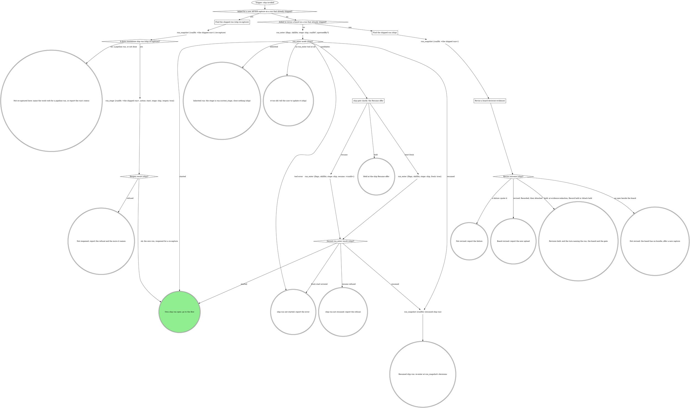
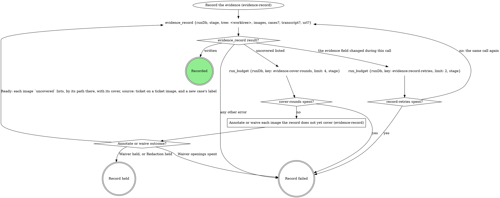
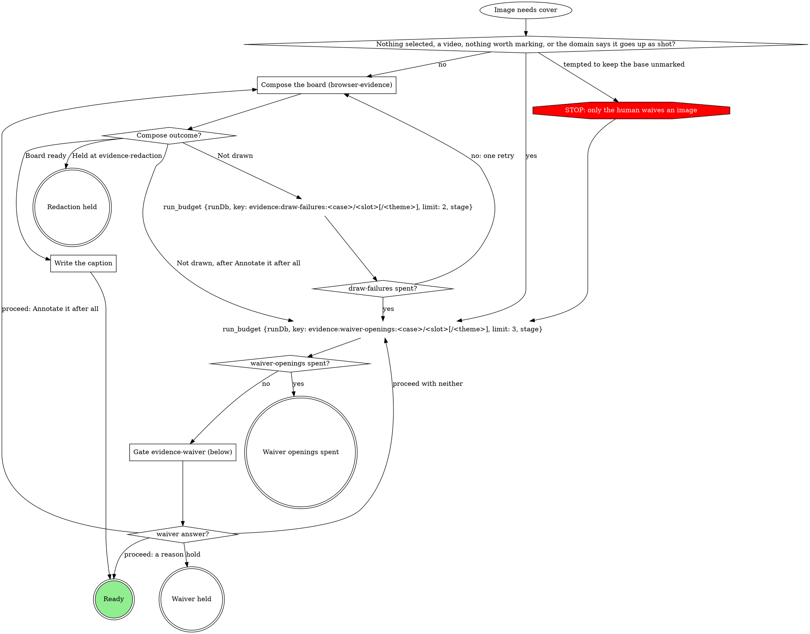
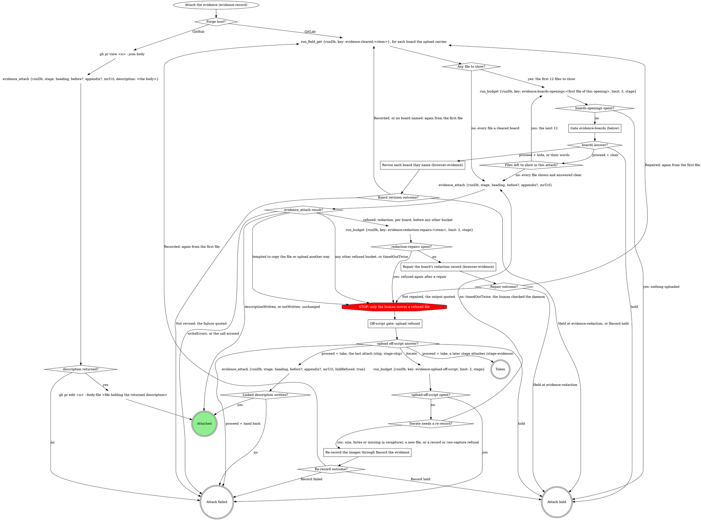

<!-- compiled by rt skills compile from the sources below; slots pre-resolved; edits here are working-tree drift (rt skills promote) -->

<!-- part: step source=mattstack:ship version=0.32.21 path=attachments/pipeline/ship/SKILL.md lines=10-796 -->

# ship

The pipeline's ship stage, reached directly: the target comes from the
checkout. The run graph opens or inherits the run; the flow graph ships
and closes it, and is where every mechanical move of the domain rules
lands.

## Run



An own run is a fresh, resumed or reopened one: it records identity and
closes at the end. An inherited run records no identity, closes nothing, and hands
back to the verb that invoked it.

The flags, rendered by the compiler:

```json
{
  "ship": "--repo widgets-repo --work-type ship --pipeline ship --mattstack-sha 0.32.21 --mattstack-dirty 0 --pack-sha widgets=0.1.0"
}
```

`run_enter` takes `flags` = the `ship` flag string above, verbatim (the
value, never its key), `skillDir` = `${CLAUDE_SKILL_DIR}` as an absolute
path, `stage: ship`, `runDb` only when a caller handed one, and `spawnedBy`
only when a board or another surface launched this pane. It opens the stage
itself. Pass the returned `runDb` to every `run_*` call; nothing is
exported. A handed `runDb` that comes back `handedRunDb: "not-running"`
counts as not handed. Every gate write and `stage` argument is `"ship"` in
an own run and `run.current_stage` in an inherited one.

### ship gate clarify: the Resume offer

`run_enter` returned `candidates`; never read the run dbs by hand. Gate
`clarify`: one sentence naming each candidate's `spawnedBy`, `startedAt`
and `currentStage`, then one **Resume** option per candidate (`Resume
(Recommended)` when `ownSession` is true; a run another live pane owns is
not yours) / **Start fresh**, and **Hold** in `next`. Resume passes that
candidate's `runId`.

### Asked for a new AFTER capture on a run that already shipped?

Yes when the operator wants the AFTER captured again (a stale state, a
fixed view) or the evidence re-attached on a run whose MR is open. A change
to an existing board with no new capture (a label, a redaction) is a
revision, below.

### Find the shipped run (ship re-capture)

As in Find the shipped run (ship).

### A done standalone ship run (ship re-capture)?

Yes when `run_snapshot`'s run is `done`, its work type is `ship` and its
`mr` field is set. A pipeline run's ship stage reopens through the work
verb, so the no exit names it; a run that is not done is reported with its
status.

### Find the shipped run (ship)

The operator asks to change a board on a run that already shipped
(reword a label, widen a redaction). A `runDb` a caller handed is the
shipped run. Otherwise it is the run the operator names: `run_list
{repo}`, the row with that run id, or the newest row whose `branch`
matches when they name only the branch. Its `runDb` is
`<runs root>/<the row's repo>/<its id>/state.db`, the runs root
`~/.mattstack/runs` unless `RT_RUNS_ROOT` sets it.

### Revise a board (browser-evidence)

Take `evidence` and `mr` from the shipped run's `run_snapshot` fields,
find the case's board in the record (the image's `annotated` path in `value`), and run
browser-evidence's Revise a board steps 1 to 7, with `stage: ship` on
every write and `mrUrl` = `mr`. Step 6 is `Record the evidence
(evidence-record)` and step 7 is `Attach the evidence (evidence-record)`;
the operator's ask is the attach consent, and step 7's Gate
evidence-boards shows every file to show (evidence-record, Any file to
show?), the revised board included unless its revision cleared it, before
anything uploads. The first `evidence_attach`
carries no `linkRefused`; this is the last attach, so only a Take at its
upload off-script gate resends with `linkRefused: true`.

`Revise outcome (ship)?`: revised is Recorded, then Attached. Held is a
Hold at Gate evidence-redaction (step 5, nothing recorded), Record held
or Attach held; the run is already closed, so no `run_hold`. A board with
no spec beside it is the no-spec exit. A compose error, a re-render that
still reads wrong after its two tries, a refused confirm, a recapture that
is not drawn, Record failed or Attach failed is a failure, quoted.

This path starts no run and closes none: no `run_enter`, no `run_stage`,
no `run_close`. A shipped run stays `done`.

### Resumed ship run: re-enter at run_snapshot's decisions

Before passing the ship gate again, call `branch_stack {tree: <root>}`,
then `run_field_get {key: shipTarget}`. An unset key (an error) or `-` is
no consent: the gate opens. A fresh target equal to the recorded one
continues on the earlier Proceed, its answers read from the ship gate
decision in `run_snapshot`. A fresh target that differs, or a store
unreadable now, reopens the gate naming both; Proceed records the fresh
one.

<!-- part: include:run-identity source=mattstack:run-identity version=0.32.21 path=attachments/run-identity/SKILL.md lines=6-26 -->
# Run identity

A run's identity is three fields: `ticket`, `branch`, `mr`. They are the
same keys the pipeline stages produce, and the console reads them from
every run: the board row shows `ticket` and `branch`, the run detail card
shows all three. Nothing backfills them: a field not recorded while the
run is live reads "not recorded" forever.

Record identity only when the run is this verb's own: `run_enter`
returned `mode: "started"` or `mode: "resumed"`. On `mode: "inherited"`
the run's identity belongs to the verb that started it, and must not be
overwritten with the target of a review or a watch invoked mid-run.

When the run is yours, record each key the moment the target-resolution
step produces it: the `run_field_set` tool with the `runDb` that
`run_enter` returned, `key`, `value`, and `stage` = `<verb>`. The stage
is always the verb's own name; identity is own-run only, so the
inherited-run stage form never applies here.

Skip a key the target does not have: a branch with no ticket records no
`ticket`. Never guess a value, and never block on a missing one.

## Flow

`<root>` is the worktree root, the absolute path
`git rev-parse --show-toplevel` prints. `<default>` is the repo's default
branch, `git symbolic-ref --short refs/remotes/origin/HEAD` minus
`origin/`, never guessed.

```dot
digraph ship {
    rankdir=TB;

    run_open [label="Trigger: a ship run is open (own or inherited)" shape=ellipse];
    reopened_recapture [label="Reopened for a re-capture (ship)?" shape=diamond];
    git_status_recapture [label="git status --porcelain; git log --oneline @{upstream}.. (ship re-capture)" shape=plaintext];
    nothing_to_push [label="Nothing to push (ship re-capture)?" shape=diamond];
    git_branch_current [label="git branch --show-current (ship)" shape=plaintext];
    on_default_branch [label="On the default branch (ship)?" shape=diamond];
    own_run_default_branch [label="Own run (default branch)?" shape=diamond];
    run_close_default_branch [label="run_close {workType: ship, stage: ship, outcome: failed, reason: the default branch}" shape=plaintext];
    stop_ship_default_branch [label="STOP: never ship the default branch" shape=octagon style=filled fillcolor=red fontcolor=white];
    stop_ship_default_inherited [label="STOP: never ship the default branch (inherited)" shape=octagon style=filled fillcolor=red fontcolor=white];
    own_run_identity [label="Own run (ship identity)?" shape=diamond];
    run_field_set_branch [label="run_field_set {key: branch, value: <branch>, stage: ship}" shape=plaintext];
    domain_steps_before_gate [label="Run the domain steps before the gate (none when unbound)" shape=box];
    git_status_log [label="git status --porcelain; git log --oneline @{upstream}.. or -5" shape=plaintext];
    branch_stack [label="branch_stack {tree: <root>} (ship)" shape=plaintext];
    stack_parent_read [label="Stack parent read (ship)?" shape=diamond];
    gate_ship [label="ship gate ship" shape=box];
    run_field_set_target [label="run_field_set {key: shipTarget, value: <resolved target>, stage}" shape=plaintext];
    run_field_set_target_iterate [label="run_field_set {key: shipTarget, value: -, stage} (iterate)" shape=plaintext];
    run_field_set_target_hold [label="run_field_set {key: shipTarget, value: -, stage} (hold)" shape=plaintext];
    run_budget_gate_rounds [label="run_budget {key: ship:ship-gate-rounds, limit: 2, stage}" shape=plaintext];
    gate_rounds_spent [label="ship-gate-rounds spent (ship)?" shape=diamond];
    run_budget_gate_reopenings [label="run_budget {key: ship:ship-gate-reopenings, limit: 2, stage}" shape=plaintext];
    gate_reopenings_spent [label="ship-gate-reopenings spent (ship)?" shape=diamond];
    rebase_in_progress [label="Rebase in progress (ship exit)?" shape=diamond];
    git_rebase_abort [label="git_rebase {tree: <root>, abort: true}" shape=plaintext];
    dirty_answer [label="dirty answer (ship)?" shape=diamond];
    commit_named_files [label="Commit named files (ship)" shape=box];
    stash_them [label="Stash them (ship)" shape=box];
    domain_fast_checks [label="Run the domain's fast checks (none when unbound)" shape=box];
    checks_pass [label="Checks pass (ship)?" shape=diamond];
    run_budget_fix_rounds [label="run_budget {key: ship:fix-rounds, limit: 4, stage}" shape=plaintext];
    fix_rounds_spent [label="fix-rounds spent (ship)?" shape=diamond];
    fix_test_first [label="Fix test-first, commit, rerun (ship)" shape=box];
    domain_rebases_unfinished [label="Domain rebases, and no rebase finished this pass (ship)?" shape=diamond];
    git_rebase_onto [label="git_rebase {tree: <root>, onto: origin/<resolved target>}" shape=plaintext];
    rebase_status [label="Rebase status (ship)?" shape=diamond];
    run_budget_conflict_rounds [label="run_budget {key: ship:conflict-rounds, limit: 4, stage}" shape=plaintext];
    conflict_rounds_spent [label="conflict-rounds spent (ship)?" shape=diamond];
    resolve_conflict_files [label="Resolve the files, then git rebase --continue on Bash (ship)" shape=box];
    continue_result [label="Continue result (ship)?" shape=diamond];

    needs_force_lease [label="Push needs force-with-lease (ship)?" shape=diamond];
    git_push_upstream [label="git_push {tree: <root>, setUpstream: true}" shape=plaintext];
    git_push_lease [label="git_push {tree: <root>, forceWithLease: true}" shape=plaintext];
    push_result [label="git_push result (ship)?" shape=diamond];
    stop_shell_push [label="STOP: push only with git_push (ship)" shape=octagon style=filled fillcolor=red fontcolor=white];
    gate_push_refused [label="ship off-script gate: git_push refused" shape=box];
    confirm_human_push [label="Confirm the human's push landed (ship)" shape=box];
    push_landed [label="Push landed (ship)?" shape=diamond];
    run_budget_landing_checks [label="run_budget {key: ship:landing-checks, limit: 2, stage}" shape=plaintext];
    landing_checks_spent [label="landing-checks spent (ship)?" shape=diamond];

    git_remote_origin [label="git remote get-url origin (ship)" shape=plaintext];
    create_forge_host [label="Forge host (ship, create)?" shape=diamond];
    run_budget_forge_clarify [label="run_budget {key: ship:forge-clarify-rounds, limit: 2, stage}" shape=plaintext];
    forge_clarify_spent [label="forge-clarify-rounds spent (ship)?" shape=diamond];
    gate_which_forge [label="ship gate clarify: which forge?" shape=box];
    mr_create [label="mr_create {repoName: <root>, sourceBranch, targetBranch: <resolved target>, title, description, draft, squash?, labels?, ifExists: return}" shape=plaintext];
    mr_create_result [label="mr_create result (ship)?" shape=diamond];
    run_budget_mr_recalls [label="run_budget {key: ship:mr-create-recalls, limit: 2, stage}" shape=plaintext];
    mr_recalls_spent [label="mr-create-recalls spent (ship)?" shape=diamond];
    mr_update_squash [label="mr_update {mrUrl, squash: true}" shape=plaintext];
    stop_gitlab_shortcut [label="STOP: GitLab moves go through gitlab_get, the read tools and mr_* (ship)" shape=octagon style=filled fillcolor=red fontcolor=white];
    gh_pr_create [label="gh pr create --fill --base <resolved target> [--draft]" shape=plaintext];
    gh_create_result [label="gh pr create result (ship)?" shape=diamond];
    own_run_mr [label="Own run (MR identity)?" shape=diamond];
    run_field_set_mr [label="run_field_set {key: mr, value: <url>, stage: ship}" shape=plaintext];

    run_field_get_evidence [label="run_field_get {key: evidence} (ship)" shape=plaintext];
    browser_case [label="Browser screenshot for this case (ship)?" shape=diamond];
    capture_after_browser [label="Capture the AFTER with the browser (ship, browser-evidence)" shape=box];
    capture_after_case [label="Capture the AFTER for the next case the domain names (ship)" shape=box];
    after_result [label="AFTER result (ship)?" shape=diamond];
    run_budget_after_attempts [label="run_budget {key: ship:after-attempts:<case id>, limit: 3, stage}" shape=plaintext];
    after_attempts_spent [label="after-attempts spent (ship)?" shape=diamond];
    every_case_tried [label="Every named case tried (ship)?" shape=diamond];
    after_captured [label="AFTER captured this pass (ship)?" shape=diamond];
    record_evidence [label="Record the evidence (evidence-record)" shape=box];
    record_outcome [label="Record outcome (ship)?" shape=diamond];
    run_has_evidence [label="Run has an evidence record (ship)?" shape=diamond];
    attach_evidence [label="Attach the evidence (evidence-record)" shape=box];
    attach_outcome [label="Attach outcome (ship)?" shape=diamond];
    domain_owns_title [label="Domain owns the title or description (ship)?" shape=diamond];
    read_forge_host [label="Forge host (ship, read back)?" shape=diamond];
    mr_view_url [label="mr_view {mrUrl}" shape=plaintext];
    gh_pr_view_body [label="gh pr view <mr> --json title,body" shape=plaintext];
    write_title_description [label="Write the title and description (ship)" shape=box];
    write_forge_host [label="Forge host (ship, write back)?" shape=diamond];
    mr_update_description [label="mr_update {mrUrl, title, description}" shape=plaintext];
    gh_pr_edit [label="gh pr edit <mr> --title <title> --body <description>" shape=plaintext];

    domain_runs_ci [label="Domain runs CI after the MR (ship)?" shape=diamond];
    run_watch_ci [label="Run watch-ci inheriting this run" shape=box];
    watch_ci_result [label="watch-ci result (ship)?" shape=diamond];
    draft_forge_host [label="Forge host (ship, draft check)?" shape=diamond];
    mr_view_draft [label="mr_view {repoName, iid} (draft check)" shape=plaintext];
    gh_pr_view_draft [label="gh pr view <mr> --json isDraft (draft check)" shape=plaintext];
    mr_still_draft [label="MR still a draft (ship)?" shape=diamond];
    gate_mark_ready [label="ship gate mark-ready" shape=box];
    run_budget_mark_ready [label="run_budget {key: ship:mark-ready-rounds, limit: 2, stage}" shape=plaintext];
    mark_ready_spent [label="mark-ready-rounds spent (ship)?" shape=diamond];
    mark_ready_forge_host [label="Forge host (ship, mark-ready)?" shape=diamond];
    mr_ready [label="mr_ready {repoName: <root>, iid}" shape=plaintext];
    gh_pr_ready [label="gh pr ready <number>" shape=plaintext];

    which_exit [label="Which exit (ship)?" shape=diamond];
    run_close_done [label="run_close {workType: ship, stage: ship, outcome: done}" shape=plaintext];
    run_close_abandoned [label="run_close {workType: ship, stage: ship, outcome: abandoned}" shape=plaintext];
    run_close_failed [label="run_close {workType: ship, stage: ship, outcome: failed, reason}" shape=plaintext];
    run_hold [label="run_hold {stage, reason, decidedBy}" shape=plaintext];
    hand_back_caller [label="Hand back to the caller (ship)" shape=doublecircle];
    held_in_watch_ci [label="Held in watch-ci: the turn ends naming it (ship)" shape=doublecircle];
    held_run_open [label="Held in ship: the run stays open" shape=doublecircle];
    abandoned [label="ship run abandoned" shape=doublecircle];
    failed [label="ship failed" shape=doublecircle];
    shipped [label="Shipped" shape=doublecircle style=filled fillcolor=lightgreen];

    run_open -> reopened_recapture;
    reopened_recapture -> git_branch_current [label="no"];
    reopened_recapture -> git_status_recapture [label="yes"];
    git_status_recapture -> nothing_to_push;
    nothing_to_push -> run_field_get_evidence [label="yes: no push, no mr_create"];
    nothing_to_push -> git_branch_current [label="no: ship the new commits first"];
    git_branch_current -> on_default_branch;
    on_default_branch -> own_run_default_branch [label="yes"];
    on_default_branch -> own_run_identity [label="no"];
    own_run_default_branch -> run_close_default_branch [label="yes"];
    own_run_default_branch -> stop_ship_default_inherited [label="no: inherited"];
    stop_ship_default_inherited -> hand_back_caller;
    run_close_default_branch -> stop_ship_default_branch;
    own_run_identity -> run_field_set_branch [label="yes"];
    own_run_identity -> domain_steps_before_gate [label="no: inherited"];
    run_field_set_branch -> domain_steps_before_gate;
    domain_steps_before_gate -> git_status_log;
    git_status_log -> branch_stack;
    branch_stack -> stack_parent_read;
    stack_parent_read -> gate_ship [label="yes: the stack parent"];
    stack_parent_read -> gate_ship [label="no: the default branch"];
    gate_ship -> run_field_set_target [label="proceed"];
    gate_ship -> run_field_set_target_iterate [label="iterate"];
    gate_ship -> run_field_set_target_hold [label="hold"];
    gate_ship -> rebase_in_progress [label="dirty = abort"];
    run_field_set_target -> dirty_answer;
    run_field_set_target_iterate -> run_budget_gate_rounds;
    run_budget_gate_rounds -> gate_rounds_spent;
    gate_rounds_spent -> domain_steps_before_gate [label="no: redo with their note"];
    gate_rounds_spent -> rebase_in_progress [label="yes: a failure"];
    run_field_set_target_hold -> which_exit;
    rebase_in_progress -> git_rebase_abort [label="yes"];
    rebase_in_progress -> which_exit [label="no"];
    git_rebase_abort -> which_exit;
    dirty_answer -> commit_named_files [label="commit"];
    dirty_answer -> stash_them [label="stash"];
    dirty_answer -> domain_fast_checks [label="clean tree"];
    commit_named_files -> domain_fast_checks;
    stash_them -> domain_fast_checks;
    domain_fast_checks -> checks_pass;
    checks_pass -> domain_rebases_unfinished [label="yes"];
    checks_pass -> run_budget_fix_rounds [label="no"];
    run_budget_fix_rounds -> fix_rounds_spent;
    fix_rounds_spent -> fix_test_first [label="no"];
    fix_rounds_spent -> run_budget_gate_reopenings [label="yes"];
    fix_test_first -> domain_fast_checks;
    domain_rebases_unfinished -> git_rebase_onto [label="yes"];
    domain_rebases_unfinished -> needs_force_lease [label="no"];
    git_rebase_onto -> rebase_status;
    rebase_status -> domain_fast_checks [label="clean"];
    rebase_status -> run_budget_conflict_rounds [label="conflict"];
    rebase_status -> which_exit [label="error: a failure"];
    run_budget_conflict_rounds -> conflict_rounds_spent;
    conflict_rounds_spent -> resolve_conflict_files [label="no"];
    conflict_rounds_spent -> run_budget_gate_reopenings [label="yes"];
    run_budget_gate_reopenings -> gate_reopenings_spent;
    gate_reopenings_spent -> gate_ship [label="no: reopen"];
    gate_reopenings_spent -> rebase_in_progress [label="yes: a failure"];
    resolve_conflict_files -> continue_result;
    continue_result -> run_budget_conflict_rounds [label="another commit conflicted"];
    continue_result -> domain_fast_checks [label="rebase finished"];
    continue_result -> git_rebase_abort [label="error: a failure"];

    needs_force_lease -> git_push_upstream [label="no"];
    needs_force_lease -> git_push_lease [label="yes"];
    git_push_upstream -> push_result;
    git_push_lease -> push_result;
    push_result -> git_remote_origin [label="ok: keep sha, mr, priorPipelineId"];
    push_result -> stop_shell_push [label="refused or errored"];
    stop_shell_push -> gate_push_refused;
    gate_push_refused -> confirm_human_push [label="take: the human pushed"];
    gate_push_refused -> needs_force_lease [label="iterate: push again"];
    gate_push_refused -> which_exit [label="hand back or hold"];
    confirm_human_push -> push_landed;
    push_landed -> git_remote_origin [label="yes"];
    push_landed -> run_budget_landing_checks [label="no"];
    run_budget_landing_checks -> landing_checks_spent;
    landing_checks_spent -> gate_push_refused [label="no: reopen with the comparison"];
    landing_checks_spent -> which_exit [label="yes: a failure"];

    git_remote_origin -> create_forge_host;
    create_forge_host -> mr_create [label="GitLab"];
    create_forge_host -> gh_pr_create [label="GitHub"];
    create_forge_host -> run_budget_forge_clarify [label="anything else"];
    run_budget_forge_clarify -> forge_clarify_spent;
    forge_clarify_spent -> gate_which_forge [label="no"];
    forge_clarify_spent -> which_exit [label="yes: a failure"];
    gate_which_forge -> create_forge_host [label="answered: that forge"];
    gate_which_forge -> which_exit [label="hold or hand back"];
    mr_create -> mr_create_result;
    mr_create_result -> own_run_mr [label="created or existing: keep its url"];
    mr_create_result -> mr_update_squash [label="squashApplied: false"];
    mr_create_result -> run_budget_mr_recalls [label="url: null"];
    mr_create_result -> which_exit [label="error: a failure"];
    mr_create_result -> stop_gitlab_shortcut [label="tempted to use the GitLab CLI"];
    stop_gitlab_shortcut -> mr_create;
    run_budget_mr_recalls -> mr_recalls_spent;
    mr_recalls_spent -> mr_create [label="no: call again"];
    mr_recalls_spent -> which_exit [label="yes: a failure"];
    mr_update_squash -> own_run_mr;
    gh_pr_create -> gh_create_result;
    gh_create_result -> own_run_mr [label="url printed or existing: keep it"];
    gh_create_result -> which_exit [label="error: a failure"];
    own_run_mr -> run_field_set_mr [label="yes"];
    own_run_mr -> run_field_get_evidence [label="no: inherited"];
    run_field_set_mr -> run_field_get_evidence;

    run_field_get_evidence -> browser_case;
    browser_case -> capture_after_browser [label="yes"];
    browser_case -> capture_after_case [label="no: the domain's own method, or no case named"];
    capture_after_browser -> after_result;
    capture_after_case -> after_result;
    after_result -> every_case_tried [label="captured, or Board ready"];
    after_result -> after_captured [label="none named"];
    after_result -> every_case_tried [label="skipped: unbound, not a browser case"];
    after_result -> run_budget_after_attempts [label="the capture failed, or Not drawn: a failed brief or spent re-renders"];
    after_result -> every_case_tried [label="Not drawn for a reason no retry fixes: go on without it"];
    after_result -> which_exit [label="Held at evidence-redaction: hold"];
    run_budget_after_attempts -> after_attempts_spent;
    after_attempts_spent -> browser_case [label="no: another attempt, same case"];
    after_attempts_spent -> every_case_tried [label="yes: go on without it"];
    every_case_tried -> browser_case [label="no"];
    every_case_tried -> after_captured [label="yes"];
    after_captured -> record_evidence [label="yes"];
    after_captured -> run_has_evidence [label="no"];
    record_evidence -> record_outcome;
    record_outcome -> attach_evidence [label="Recorded"];
    record_outcome -> which_exit [label="Record held at evidence-waiver or evidence-redaction: hold"];
    record_outcome -> which_exit [label="Record failed: a failure naming the images or quoting the error"];
    run_has_evidence -> attach_evidence [label="yes"];
    run_has_evidence -> domain_owns_title [label="no: the field is unset"];
    attach_evidence -> attach_outcome;
    attach_outcome -> domain_owns_title [label="Attached (never Taken: Take links)"];
    attach_outcome -> which_exit [label="Attach held: hold"];
    attach_outcome -> which_exit [label="Attach failed: a failure quoting the reason"];
    domain_owns_title -> read_forge_host [label="yes"];
    domain_owns_title -> domain_runs_ci [label="no"];
    read_forge_host -> mr_view_url [label="GitLab"];
    read_forge_host -> gh_pr_view_body [label="GitHub"];
    mr_view_url -> write_title_description;
    gh_pr_view_body -> write_title_description;
    write_title_description -> write_forge_host;
    write_forge_host -> mr_update_description [label="GitLab"];
    write_forge_host -> gh_pr_edit [label="GitHub"];
    mr_update_description -> domain_runs_ci;
    gh_pr_edit -> domain_runs_ci;

    domain_runs_ci -> run_watch_ci [label="yes"];
    domain_runs_ci -> which_exit [label="no, or a re-capture: done"];
    run_watch_ci -> watch_ci_result;
    watch_ci_result -> draft_forge_host [label="green"];
    watch_ci_result -> which_exit [label="red (done), off-script, failure or stand-down"];
    watch_ci_result -> held_in_watch_ci [label="held"];
    draft_forge_host -> mr_view_draft [label="GitLab"];
    draft_forge_host -> gh_pr_view_draft [label="GitHub"];
    mr_view_draft -> mr_still_draft;
    gh_pr_view_draft -> mr_still_draft;
    mr_still_draft -> gate_mark_ready [label="yes"];
    mr_still_draft -> which_exit [label="no: done"];
    gate_mark_ready -> mark_ready_forge_host [label="mark ready now"];
    gate_mark_ready -> which_exit [label="keep it draft (done), go back, or hold"];
    gate_mark_ready -> run_budget_mark_ready [label="iterate"];
    run_budget_mark_ready -> mark_ready_spent;
    mark_ready_spent -> gate_mark_ready [label="no: a new gate"];
    mark_ready_spent -> which_exit [label="yes: done, a draft"];
    mark_ready_forge_host -> mr_ready [label="GitLab"];
    mark_ready_forge_host -> gh_pr_ready [label="GitHub"];
    mr_ready -> which_exit;
    gh_pr_ready -> which_exit;

    which_exit -> run_close_done [label="own run: done, stood down, or a re-capture's failure"];
    which_exit -> run_close_abandoned [label="own run: abort"];
    which_exit -> run_close_failed [label="own run: a failure or a hand back, not on a re-capture"];
    which_exit -> hand_back_caller [label="inherited: any exit but hold"];
    which_exit -> run_hold [label="hold"];
    run_close_done -> shipped;
    run_close_abandoned -> abandoned;
    run_close_failed -> failed;
    run_hold -> held_run_open;
}
```

### Reopened for a re-capture (ship)?

Yes when the run graph reopened the shipped run for the operator's new
AFTER. Nothing to push is a clean tree and an empty `git log
@{upstream}..`: the MR already carries HEAD, so the flow goes straight to
the AFTER with no gate, no `git_push` and no `mr_create`. The operator's
ask is the attach consent and covers the title and description write
after it, `mrUrl` is the run's `mr`, and the capture's `page:` is on HEAD.
The run is running again, so a hold is `run_hold` and the end is
`run_close`. A re-capture's failure still closes `done`, its reason in the
report: the MR shipped, and only a done run reopens for the next try.
Anything to push takes the usual route.

### Run the domain steps before the gate (none when unbound)

The domain's gathering steps: the diff against the ticket, the branch and
ticket checks, an existing-MR lookup, any mandatory pre-ship review. Each
question they raise goes on the `ship` gate.

### Reading a GitLab fact no read tool returns

At any step, read it with `gitlab_get {repoName: <root>, path}`, `path`
relative to the API root with `:id` for this project
(`projects/:id/merge_requests/<iid>/approvals`). The read is part of the
step and opens no gate. Quote a GitLab error as written; its refusal of a
credential path is final.

### ship gate ship

One sentence above the form: the branch, the commits about to go, whether
the tree is dirty, and the resolved target (the stack parent, the default
branch, or "the stack could not be read, so the default branch"), so
Proceed is consent to that target. A reopening with a rebase in progress
says so, and Abort aborts that rebase first.

| Question | Options (recommended first) | Shown when |
|---|---|---|
| `dirty` (write-in) | **Commit the changes (Recommended)** / **Stash them** / **Abort** | the tree is dirty |
| `open_as` (write-in) | **Push and open as draft (Recommended)** / **Push and open ready** | always |
| the domain's own | as the domain rules word them (a ticket mismatch, an MR already open) | the domain declares them |
| `next` | **Proceed** / **Iterate here** / **Hold** | always |

Scope `ship`. Selection: `{"dirty":"commit|stash|abort|null","open_as":"draft|ready","domain":{<answers>},"next":"proceed|iterate|hold","note":"<their words or null>"}`.
Iterate and Hold clear `shipTarget` first, so
a resume re-asks. With the stack store unreadable, Proceed records
`<default branch> (stack store unreadable)`, telling consent to the
fallback from a real read; the rebase and `mr_create` use the plain name.

Running out of fix or conflict rounds reopens this gate (not an
Iterate), quoting the failing output or conflicted files; a second time
fails the verb. Fix and conflict rounds carry over a reopen (the human's
turn to fix), so a Proceed whose checks still fail reopens again with no
new fix rounds.

### Commit named files (ship)

Stage the files by name, never everything; the subject follows the
domain's commit rules, else the branch's own style.

### Stash them (ship)

A tagged stash (`git stash push -u -m "<unique tag>"`), which nothing in
this verb pops; the stash stack is shared by every worktree, so never pop
by position. The final report names the stash.

### Run the domain's fast checks (none when unbound)

Only the checks the domain names, on the changed files; revert generated
drift they leave. A full suite the domain rules out stays out. A finished
rebase, clean or resolved, sends the checks round again; the "no rebase
finished this pass" guard stops that round rebasing again, so a
force-with-lease push always follows checks on the rewritten tree.

### Fix test-first, commit, rerun (ship)

Each fix gets its failing test first, then the fix, then a commit.

### Resolve the files, then git rebase --continue on Bash (ship)

Resolve each conflicted file `git_rebase` returned, then continue on Bash
(no tool continues a rebase).

### ship gate clarify: which forge?

The branch is already pushed. Context: the `git remote get-url origin`
line. Options: **GitLab** /
**GitHub** / **Hand back**, and `next`: **Proceed** / **Hold**. The named
forge is the host from here on: every later forge diamond reads it, never
the origin URL.

### ship off-script gate: git_push refused

The gate protocol's Off-script gate, scope `off-script:<stage>:<n>`,
`context` quoting the refusal. Take: only the human pushing. Read `next`
first: Hold ends the turn with nothing pushed by this verb; Iterate means
the human fixed the cause (a tree registration, the daemon) and ignores
`action`; only Proceed applies `action`. Retrying `git_push` is Iterate,
never Take. Iterate counts nothing: each retry needs a new answer at this
gate; a refused retry reopens this gate with the Iterate note in its context.

### Confirm the human's push landed (ship)

Compare `git rev-parse HEAD` with the remote branch and report it; never
push from here. It landed when the remote carries HEAD, which becomes the
watched sha with no prior pipeline id.

### Capture the AFTER with the browser (ship, browser-evidence)

Ship captures no BEFORE: a BEFORE is only what the evidence record
already holds, taken before implementation changed the surface, so a case
with no bundled BEFORE gets an AFTER board alone.

`Browser screenshot for this case (ship)?` is yes when the domain has a
`## Browser target` section (in its rules, or in the file they point at
for it) and either its What proves a change names a view for this case's
kind of change, or it has no What proves a change block and the plan's
evidence for the case is a screenshot of a web page. A bound domain with
no browser target always answers no. Unbound, it is yes when the case's
BEFORE in the record is a browser board (a `<stem>.spec.json` beside it)
or the plan's evidence for the case is a screenshot of a web page.

A case already in the record keeps its `id`; a new case gets its `id` and
`label` first, since the brief's stem needs the id. Write the case's after
brief (browser-evidence's `Write one brief per board`), stem
`<run id>-<case id>-after[-<theme>]`:

- The case's BEFORE has a bundle (a `<stem>.spec.json` beside its board):
  a pair, `state: BEFORE → AFTER`, with `before:` that spec's absolute
  path. The pair board covers the BEFORE image too, unless the BEFORE's
  board is an import board (Record the evidence).
- Otherwise (a different screen, a ticket link or text, a new case): its
  own `AFTER` board, with no `before:`.

`page:` comes from Reach the view, on the sha just pushed; `show` and
`point at` from What proves a change, the wording from Captions and
`hide` from Personal data. Unbound, every block takes its default.

The first browser case of this pass takes every named browser case not
yet tried into one hand-off: write all their after briefs, then walk
browser-evidence's `Draw the boards` (Browser evidence below) once for
them, so its redaction gate asks about them together. A later browser case
already in that hand-off reads its own terminal from it, with no new
spawn. A retry after `ship:after-attempts` is a hand-off of that case
alone. A browser case named after that hand-off was made starts a hand-off
of its own.

Its terminals answer `AFTER result (ship)?`. Board ready is captured; the
board is recorded with the rest in `Record the evidence (evidence-record)`.
Held at evidence-redaction is the verb's hold. Not drawn splits by its
reason: the developer left it uncaptured, the doctor stayed red, no
compose on PATH, sign-in asks spent, no driver to spawn, redaction rounds
or openings spent, or confirm refused twice goes on without the AFTER,
and the description names the gap. A failed brief or spent re-renders is
a failed capture, counted against `ship:after-attempts:<case id>`.

A yes case follows browser-evidence alone: the domain's own capture
steps (its AFTER capture, any preview, any draw or annotate step) apply
only to its other evidence kinds.

### Capture the AFTER for the next case the domain names (ship)

For each case in the record, the same view as its BEFORE, on the sha just
pushed; a v1 record's BEFORE is the case `case`. Any other capture the
domain names is a new case with its own `id` and `label`, as is each AFTER
when the record has no BEFORE. A case whose third capture fails goes on
without its AFTER, and the description says what was tried. The record is
this run's (own or inherited `runDb`). Unbound, a case that is not a
browser case (above) has no AFTER: it is skipped, so a later browser case
still runs.

### Record the evidence (evidence-record)

`images` are the AFTERs just captured (`slot: after`, a new case's
`label`), `tree` is `<root>`. A browser board's images carry it as
`annotated` (`~/.fast-browser/screenshots/<stem>.png`) with the brief's
claim as `caption`, as browser-evidence's Record the board says; a pair
board also covers the case's BEFORE, named by its `value` path, unless that
BEFORE's board is an import board (its `<stem>.c1.capture.json` in the
record's folder says `"source": "import"`): the BEFORE keeps that board and
stays out of this call, so the pair covers the AFTER alone. Recorded
goes straight to the attach: this verb writes no `evidence` of its own.

### Attach the evidence (evidence-record)

The ship gate's Proceed is the attach consent (on a re-capture, the
operator's ask). On GitLab, Gate evidence-boards then shows every file
about to go up but a cleared board before anything uploads. This is the last attach, so a
Take at the upload off-script gate (never the first call) sends
`linkRefused: true`; the off-script gate shares the push gate's
`n`.

### Write the title and description (ship)

Title from the ticket or the first commit subject; the body links the
ticket. The update replaces the whole body, so start from the one read
back and keep everything else: a teammate's edits, and the evidence
section `Attach the evidence` wrote, byte for byte, never a second
evidence block. The domain's title, template and voice rules win over this
paragraph.

### Run watch-ci inheriting this run

Invoke the `watch-ci` verb with this run's `runDb`, so it inherits the run
and fires no gate beyond `ci` and its off-script gates. Hand it `mr` (its
URL), `sha` (`git_push`'s, or the HEAD a confirmed human push carries),
and `git_push`'s `priorPipelineId` only when the push moved the branch:
`git log @{upstream}..` listed commits before the push (before the gate,
or committed by this verb since), or the push forced. Otherwise that
pipeline is the sha's own and the watch would wait for one that never
comes. A push that moved nothing relies on the sha's own pipeline matching
by sha; on a fast-forward merge train that pipeline is unprovable, and
watch-ci's waiting budget ends the watch.

A stand-down means another attendant (the doctor or another watch-ci
session) holds the MR's lease: an own run closes `done`, since the MR
exists, the report names the `holder`, and nothing releases that lease; an
inherited run hands the stand-down back. A hold is already recorded by
watch-ci: end the turn naming it, with no second `run_hold`.

### ship gate mark-ready

One sentence above the form: CI is green; the attachments are there (or
are not).

| Question | Options (recommended first) | Shown when |
|---|---|---|
| `ready` (write-in) | **Mark ready now (Recommended)** (CI green, evidence attached) / **Keep it draft** | always |
| `next` | **Proceed** / **Iterate here** / **Go back** / **Hold** | always; **Go back** only in an inherited run |
| `to` | one option per earlier stage; with one candidate, **Go back to `<stage>`** in `next` instead | Go back, with more than one earlier stage in `run_snapshot` |

Scope `mark-ready`. Selection: `{"ready":true|false,"next":"proceed|iterate|go-back|hold","to":"<stage or null>","note":"<their words or null>"}`.
The first Iterate opens a new gate with the note; the second ends the
verb done, the MR a draft, the note quoted in the report.

## What the graph cannot show

- **Force** only on the "yes" edge of "Push needs force-with-lease
  (ship)?": a rebase finished this pass and the upstream already held the
  commits it rewrote.
- **`targetBranch`** is the target `branch_stack` resolved before the
  gate (on `stackStore: "unavailable"` or an error, the default branch),
  never guessed. A GitHub PR takes it as `--base`. The domain rebase goes
  onto `origin/<target>`, so a stack member never replays its parent's
  unmerged commits.
- **The MR.** Keep `mr_create`'s `url` as `mrUrl` for every later write,
  and print it. `draft: false`, or no `--draft`, only when the gate said
  ready; the title comes from the branch's commits. `existing: true` is an
  MR already open on the branch, left as found (nothing this call passed
  applied); a `targetBranch` other than the resolved one is named in the
  report. After `url: null`, the re-call's `existing: true` MR is the first
  call's: the report says squash is unset when it was asked and no result
  said it applied.
- **Hold** at any gate records `run_hold`: the gate-write stage, the gate
  as `reason`, `decidedBy` as the answer recorded it. The turn ends naming
  the run and the gate.
- **A board revision asked at a gate** (a note at the ship gate, say) runs
  browser-evidence's Revise a board steps 1 to 5; the record and the
  attach (its steps 6 and 7) follow this graph's own `Record the evidence
  (evidence-record)` and `Attach the evidence (evidence-record)` boxes. On
  a run that already shipped, the run graph's revise entry runs every
  step.

## Budgets in this verb

Each `run_budget` counts one as its loop is entered, so budgets survive
compaction and resume within the stage attempt. The `spent` diamond after
it is yes when that call returns `exhausted: true` (`spent >= limit`: the count that
reaches `limit` takes yes). A
failure quotes what it last saw (the error, the note, the
comparison, the origin URL and answer, the refusal) as its reason.

## Domain rules

If a rule below asks for a move this graph marks STOP, take the off-script
edge instead. A rule that keeps a capture out of the record, or keeps a
base with no waiver, yields to the evidence record. A browser target the
domain points at supplies facts, never steps: on a browser case,
browser-evidence below does the capture, the board, the gates and the
bundle.

<!-- part: slot:domain binding=widgets:ship-domain version=0.1.0 path=attachments/ship-domain/SKILL.md lines=8-12 -->
- Fast checks: run `bun run widgets:lint --changed`, then `bun run widgets:typecheck`. Never run `bun run widgets:test`, the full suite: CI runs it.
- `widgets:lint --changed` rewrites `src/generated/gizmo-index.ts`; revert it with `git checkout -- src/generated/gizmo-index.ts` after the checks.

- Commit subject: `widgets(<area>): <summary> [WID-<n>]`, the ticket number taken from the branch name.
- Never stage anything under `src/generated/`: CI rebuilds it.

When nothing is inlined above, the graph alone is the flow: no steps before
the gate, no fast checks, no rebase, no AFTER beyond a browser case's, no
CI watch.

## Browser evidence

<!-- part: include:browser-evidence source=mattstack:browser-evidence version=0.32.21 path=attachments/browser-evidence/SKILL.md lines=6-538 -->
# Browser evidence

Fast Browser captures pages and composes boards; this page owns that
evidence inside a run, and the pack's browser target says how to reach its
app. A board is one cropped, labelled image: this verb writes the words, the
driver measures and draws. Each board is a bundle (board, spec, captures,
and for a gated board its redaction record and crops) under one stem in
`~/.fast-browser/screenshots/`, and `evidence_record` copies the whole
bundle into the run's evidence folder, so any later session re-renders it
without a browser. A `<slug> spent?` diamond is yes when the `run_budget`
before it returns `exhausted: true` (`spent >= limit`: the count that
reaches `limit` takes yes).

A case enters this page only when the domain's fill picks a browser
screenshot for it, or when evidence-record composes a board over any other
image. Evidence that is not a browser screenshot (script output, backend
data) is captured by the domain's own method.

## The browser target

The four blocks come from the `## Browser target` section in this verb's
domain rules, or from the file those rules point at for it. A missing block
takes its default:

| Block | Feeds | Default when the block is missing |
|---|---|---|
| Reach the view | Get ready, the brief's `page:` | the URL the plan or intake gives; the developer signs in |
| What proves a change | `show`, `point at`, intake | the plan's words for the case |
| Captions | the claim and every label's wording | plain words |
| Personal data | `hide` | every personal detail on screen that is not being verified |

The pack's block wins over this page only on facts about its app, never on a
STOP below.

A board is a mock-data board only when all three hold:

- Personal data says the page's source holds only mock data (seeded test
  records, no real person), read from where the page is served from, never
  from how the names on screen look;
- its brief has `page:`, never `import:`: an imported image (a ticket
  screenshot) can come from anywhere;
- a pair's `before:` names a board that was itself a mock-data board (its
  `evidence-cleared:<before stem>` field reads `<sha> no redact marks:
  mock data from ...`, `<sha>` matching `shasum -a 256` of the before
  bundle's `<stem>.png`), never an import board or one a human approved.

Its brief's `hide:` line reads `no redact marks: mock data from <source>`,
`<source>` being the source as Personal data names it (a database class, a
site), written before the driver spawns, and its empty record is confirmed
without a question (Confirm a mock-data board).

## Draw the boards

```dot
digraph browser_evidence {
    boards_to_draw [label="Boards to draw" shape=ellipse];
    get_ready_ran [label="Get ready already ran this stage pass?" shape=diamond];
    get_ready [label="Get ready" shape=box];
    fast_browser_doctor [label="fast-browser doctor" shape=plaintext];
    doctor_green [label="Doctor green?" shape=diamond];
    run_budget_doctor [label="run_budget {runDb, key: evidence:doctor-reds, limit: 2, stage}" shape=plaintext];
    doctor_reds_spent [label="doctor-reds spent?" shape=diamond];
    fix_doctor [label="Fix what the doctor reports" shape=box];
    fast_browser_compose_help [label="fast-browser compose --help" shape=plaintext];
    compose_usage [label="Compose usage shown?" shape=diamond];
    write_briefs [label="Write one brief per board" shape=box];
    agent_driver [label="Agent {subagent_type: fast-browser:browser-driver, model: sonnet, effort: medium, prompt: <the briefs>}" shape=plaintext];
    driver_result [label="Driver result?" shape=diamond];
    stop_draw_yourself [label="STOP: the driver captures and composes; never drive the browser, draw or place marks yourself" shape=octagon style=filled fillcolor=red fontcolor=white];
    run_budget_sign_in [label="run_budget {runDb, key: evidence:sign-in-asks, limit: 3, stage}" shape=plaintext];
    sign_in_asks_spent [label="sign-in-asks spent?" shape=diamond];
    stop_credential [label="STOP: never type or ask for a credential; only a saved login" shape=octagon style=filled fillcolor=red fontcolor=white];
    ask_sign_in [label="Ask the developer to sign in" shape=box];
    sign_in_answer [label="Sign-in answer?" shape=diamond];
    read_board [label="Read the board yourself" shape=box];
    reads_right [label="Reads right?" shape=diamond];
    run_budget_rerender [label="run_budget {runDb, key: evidence:rerenders:<stem>, limit: 3, stage}" shape=plaintext];
    rerenders_spent [label="rerenders spent?" shape=diamond];
    redaction_record [label="Redaction record?" shape=diamond];
    stop_self_confirm [label="STOP: confirming is the human's answer, never the agent's, except a mock-data board's empty record" shape=octagon style=filled fillcolor=red fontcolor=white];
    fast_browser_confirm_mock [label="fast-browser compose --confirm ~/.fast-browser/screenshots/<stem>.spec.json (mock-data board)" shape=plaintext];
    mock_confirm_result [label="Mock-data confirm result?" shape=diamond];
    run_field_set_mock [label="run_field_set {runDb, key: evidence-cleared:<stem>, value: <boardSha256 of the confirmed record> <the hide line>, stage}" shape=plaintext];
    run_field_set_approved [label="run_field_set {runDb, key: evidence-cleared:<stem>, value: <boardSha256 of the confirmed record> approved at <the last opening that showed it>, stage}" shape=plaintext];
    explicit_confirm [label="Answered confirm for this opening itself?" shape=diamond];
    hand_off_at_gate [label="Every board of this hand-off at the redaction gate or done?" shape=diamond];
    wait_for_hand_off [label="Wait for this hand-off's other boards" shape=box];
    run_budget_redaction_gate [label="run_budget {runDb, key: evidence:redaction-openings:<first entry of this opening>:<first crop of this opening, or board>, limit: 4, stage}" shape=plaintext];
    redaction_openings_spent [label="redaction-openings spent?" shape=diamond];
    gate_evidence_redaction [label="Gate evidence-redaction (below)" shape=box];
    redaction_answer [label="Redaction answer?" shape=diamond];
    boards_named [label="Their words name the boards?" shape=diamond];
    ask_which_board [label="Ask which board" shape=box];
    which_answer [label="Which-board answer?" shape=diamond];
    named_boards [label="Split the opening: named boards re-render, the rest confirm" shape=box];
    crops_left [label="Crops left for this board?" shape=diamond];
    fast_browser_confirm [label="fast-browser compose --confirm ~/.fast-browser/screenshots/<stem>.spec.json" shape=plaintext];
    confirm_result [label="Confirm result?" shape=diamond];
    run_budget_confirm [label="run_budget {runDb, key: evidence:confirm-refusals:<stem>, limit: 2, stage}" shape=plaintext];
    confirm_refusals_spent [label="confirm-refusals spent?" shape=diamond];
    run_budget_redaction [label="run_budget {runDb, key: evidence:redaction-rounds:<stem>, limit: 3, stage}" shape=plaintext];
    redaction_rounds_spent [label="redaction-rounds spent?" shape=diamond];
    board_ready [label="Board ready" shape=doublecircle style=filled fillcolor=lightgreen];
    not_drawn [label="Not drawn" shape=doublecircle];
    held_redaction [label="Held at evidence-redaction" shape=doublecircle];

    boards_to_draw -> get_ready_ran;
    get_ready_ran -> get_ready [label="no"];
    get_ready_ran -> write_briefs [label="yes: the doctor was green and compose showed its usage"];
    get_ready_ran -> not_drawn [label="yes: it ended red or without compose; every board of this hand-off, that output quoted"];
    get_ready -> fast_browser_doctor -> doctor_green;
    doctor_green -> fast_browser_compose_help [label="yes"];
    doctor_green -> run_budget_doctor [label="no"];
    run_budget_doctor -> doctor_reds_spent;
    doctor_reds_spent -> fix_doctor [label="no"];
    doctor_reds_spent -> not_drawn [label="yes: every board this pass, the output quoted"];
    fix_doctor -> fast_browser_doctor;
    fast_browser_compose_help -> compose_usage;
    compose_usage -> write_briefs [label="yes"];
    compose_usage -> not_drawn [label="no: an older fast-browser first on PATH; every board this pass, the output quoted"];
    write_briefs -> agent_driver -> driver_result;
    driver_result -> read_board [label="a board"];
    driver_result -> run_budget_sign_in [label="failed: needs-login"];
    driver_result -> not_drawn [label="failed for another reason, or no driver to spawn"];
    driver_result -> stop_draw_yourself [label="tempted to capture, mark up or compose it yourself"];
    driver_result -> stop_credential [label="tempted to sign in by hand"];
    stop_draw_yourself -> agent_driver;
    stop_credential -> run_budget_sign_in;
    run_budget_sign_in -> sign_in_asks_spent;
    sign_in_asks_spent -> ask_sign_in [label="no"];
    sign_in_asks_spent -> not_drawn [label="yes: the reason quoted"];
    ask_sign_in -> sign_in_answer;
    sign_in_answer -> agent_driver [label="Logged in, retry"];
    sign_in_answer -> not_drawn [label="Leave it uncaptured"];
    read_board -> reads_right;
    reads_right -> redaction_record [label="yes"];
    reads_right -> run_budget_rerender [label="no"];
    run_budget_rerender -> rerenders_spent;
    rerenders_spent -> agent_driver [label="no: the brief and what reads wrong"];
    rerenders_spent -> not_drawn [label="yes"];
    redaction_record -> hand_off_at_gate [label="crops: <stem>.redactions.json lists a crop"];
    redaction_record -> fast_browser_confirm_mock [label="empty, on a mock-data board: a page: brief, no import"];
    redaction_record -> hand_off_at_gate [label="empty, on any other board"];
    redaction_record -> board_ready [label="none: no <stem>.redactions.json"];
    redaction_record -> stop_self_confirm [label="tempted to run --confirm without a yes on any other board"];
    stop_self_confirm -> hand_off_at_gate;
    fast_browser_confirm_mock -> mock_confirm_result;
    mock_confirm_result -> run_field_set_mock [label="ok: the record reads confirmed"];
    mock_confirm_result -> hand_off_at_gate [label="refused, or still not confirmed: the human looks"];
    run_field_set_mock -> board_ready;
    hand_off_at_gate -> run_budget_redaction_gate [label="yes: every waiting board, one opening"];
    hand_off_at_gate -> wait_for_hand_off [label="no"];
    wait_for_hand_off -> hand_off_at_gate;
    run_budget_redaction_gate -> redaction_openings_spent;
    redaction_openings_spent -> gate_evidence_redaction [label="no"];
    redaction_openings_spent -> not_drawn [label="yes: redaction openings spent, every board of this opening"];
    gate_evidence_redaction -> redaction_answer;
    redaction_answer -> crops_left [label="proceed: confirmed, every board of this opening"];
    redaction_answer -> boards_named [label="proceed: something needs hiding"];
    redaction_answer -> held_redaction [label="hold"];
    boards_named -> named_boards [label="yes"];
    boards_named -> ask_which_board [label="no"];
    ask_which_board -> which_answer;
    which_answer -> named_boards [label="boards picked"];
    which_answer -> crops_left [label="none picked: every board of this opening confirmed"];
    which_answer -> held_redaction [label="hold"];
    named_boards -> run_budget_redaction [label="each board they name, with their words"];
    named_boards -> crops_left [label="each other board of this opening"];
    crops_left -> run_budget_redaction_gate [label="yes: the next 11 crops"];
    crops_left -> fast_browser_confirm [label="no: every opening of this board confirmed"];
    fast_browser_confirm -> confirm_result;
    confirm_result -> explicit_confirm [label="ok: the record reads confirmed"];
    explicit_confirm -> run_field_set_approved [label="yes: redaction is confirm"];
    explicit_confirm -> board_ready [label="no: confirmed by inference, no field"];
    run_field_set_approved -> board_ready;
    confirm_result -> not_drawn [label="clean exit, but an empty record still not confirmed: the output quoted, update Fast Browser"];
    confirm_result -> run_budget_confirm [label="refused"];
    run_budget_confirm -> confirm_refusals_spent;
    confirm_refusals_spent -> run_budget_redaction [label="no: re-render with the refusal quoted"];
    confirm_refusals_spent -> not_drawn [label="yes: confirm refused twice, the output quoted"];
    run_budget_redaction -> redaction_rounds_spent;
    redaction_rounds_spent -> agent_driver [label="no: the brief, and their words or the refusal"];
    redaction_rounds_spent -> not_drawn [label="yes: redaction rounds spent"];
}
```



Each hand-off from the verb is one pass and one spawn for the boards it
hands over (a verb hands over all of a pass's browser cases at once, and
spawns again only for a retried case; a re-render inside this graph stays
in its hand-off, so the boards waiting at the gate wait for it);
each returned board then walks the rest of the graph on its own, except
at the redaction gate, which waits for the hand-off's boards and asks about
them together. Get ready runs once per stage pass, before the first spawn.

`Board ready` returns the board to the box that called this flow, which
records it (Record the board, below). `Not drawn` returns with the reason;
it is never a board drawn by hand. No retry can fix these reasons: the
developer left it uncaptured, the doctor stayed red, no compose on PATH,
the sign-in asks were spent, no driver to spawn, redaction rounds or
openings spent, confirm refused twice, or a confirm that left an empty
record unconfirmed. A failed brief (the driver's
other failures) or spent re-renders may draw on a retry. `Held at
evidence-redaction` is the verb's hold path.

## Get ready

Once per stage pass, before the first spawn:

- Start what Reach the view says must run (its servers), for this worktree
  only.
- Build each case's URL from Reach the view.
- Never reconstruct a before by reverting code on a running server.
- Run `fast-browser doctor` on Bash.

### Fix what the doctor reports

Follow the fix the doctor prints, then run it again: at most two runs in
all. Still red, every board this pass is not drawn, with the doctor's
output quoted.

`fast-browser compose --help` that does not print compose's usage (an
older `fast-browser` earlier on PATH says "expected a command") leaves
every board this pass not drawn, with that output quoted and the advice
to update Fast Browser.

## Write one brief per board

One entry per board, in plain words, with exactly these fields:

```
case: <evidence case id>
stem: <run id>-<case id>-<before|after>[-<theme>]
claim: one sentence, what this board proves (the board's title and every image's caption)
show: the region, named in words ("the job row's header")
point at: one line per label: <TAG> | <title> | <description>
hide: what Personal data names, plus every other personal detail on screen that is not being verified; never "nothing"; for a mock-data board, `no redact marks: mock data from <source>`
state: FOUND | AFTER | BEFORE → AFTER | FLOW
page: the URL, the sign-in Reach the view names, and the steps to the state (a live page), or
import: <absolute path of a saved image> from <its link> (a ticket before, or any image that is not a browser capture)
before: <the before board's folder>/<its stem>.spec.json (BEFORE → AFTER only)
```

- `stem`: the theme (`light` or `dark`) only for an image in a
  `{light, dark}` slot, so the two themes never share a stem.
- `state`: a before alone is `FOUND`; an after alone is `AFTER`; a pair
  built from the case's before bundle is `BEFORE → AFTER`; several screens
  are `FLOW` (a `steps` board).
- `point at`: the labels the operator kept at an annotations question, or
  the ones you propose from What proves a change when no such question ran.
  On a `FLOW` board, one line per step.
- `import:` an image already in the record names its `value` path. A
  ticket that embeds the before as an image: save the image and brief it
  as `import:` with the ticket link; its board is the case's before.
- `before:` names the before board's spec where the record holds it: the
  folder of that image's `annotated` path in the record's `value`.

## Labels

The pipeline's rule, stricter than the composing skill: every label carries
a tag and a description, and the description asserts the outcome in one
line. On `single` and `pair` boards a label is a mark (every mark except
`redact`); on a `steps` board a label is a step, and a mark inside a step
may carry no text. The brief says what each label carries; the driver's
composing skill decides where it goes.

- **After**: what was added that was not there before, or which bug is
  fixed that did not work before, and whether verification is complete.
  Tags `NEW`, `CHANGED`, `REMOVED`, `OK`; `PENDING` when verification is
  not complete, and the description names what is left. Examples:
  - `NEW | Retries | Added: the badge counts every retry, which it did not before. Verified.`
  - `OK | Totals row | Fixed: the export total now matches the rows; it was off by one before. Verified.`
  - `PENDING | Dark theme | Added in light theme; dark theme not verified yet.`
- **Before**: what is broken or missing, and that it was reproduced. Tags
  `ISSUE` for a bug, `PENDING` for something not built yet. Examples:
  - `ISSUE | Retries | Bug reproduced: the badge reads 0 after a retry.`
  - `PENDING | Export button | Not there before the change: no export on this page.`

A label never just repeats the board's title. The Captions block's wording
applies to the claim and to every label.

## Delegate to the driver

The `Agent` node: one call per hand-off from the verb, for the boards it
hands over, with `description: "Capture and compose evidence boards"` and
as `prompt` this text followed by the briefs:

> Follow the fast-browser:composing-evidence skill to turn each brief below into one board. For a brief with page:, open it and sign in only with a saved login for the login page's origin, which you look up yourself with rt logins list --json (fast-browser:fast-browsing); if signing in needs a person, stop that brief and return it failed with reason needs-login; never type or ask for a credential. Follow the page's steps to the state, then capture. Name files by the brief's stem in ~/.fast-browser/screenshots/: captures <stem>.c1, <stem>.c2, and so on, numbering only the captures you take for this brief and starting at <stem>.c1 (captures copied in for before: keep their own names, so a pair's after capture is <stem>.c1), the spec <stem>.spec.json, the board <stem>.png. Use the brief's claim as the board's title, word for word. Give every label the tag and description its point at line gives, word for word, wherever the composing skill puts them for this layout. For a brief with import:, import that file as <stem>.c1 with its link as the origin. For a brief with before:, copy every capture that spec names, with its PNG, from the before's folder into ~/.fast-browser/screenshots/ unchanged and use them as the BEFORE panel; never recapture the before. Hide what hide: names. Read every board you render. Never run fast-browser compose --confirm. Close every tab you opened. Return one JSON line per brief: {"case", "board", "spec", "captures", "crops", "warnings"}, where crops is the list of redaction crop paths compose printed, or [] when it printed none, or {"case", "failed": true, "reason"}.

Signing in is the driver's alone: it looks up the saved login itself, and
the verb that spawns it looks up none and passes none.

A re-render is the same call with that board's brief and what read wrong,
or the human's words from the redaction gate. When the `Agent` tool or that
agent type is missing, every board is not drawn, never drawn by hand.

## Ask the developer to sign in

A clarify question through gate-protocol, scope `clarify:browser-login:<n>`.
The question says the saved login could not sign in, and offers exactly two
options, each with one sentence and no free text and no Hold:

- **Logged in, retry**: the developer has signed in for this origin;
  spawn the driver again for these briefs.
- **Leave it uncaptured**: the board is not drawn.

At most two asks per stage pass (`sign-in-asks`, counted at each
needs-login before the ask).

## Read the board yourself

Read each returned PNG with the image-reading tool. It reads right when:

- the crop shows what `show` names;
- each label sits on what its `point at` line names and shows its tag and
  description (on a `steps` board, each step shows its tag and outcome);
- nothing `hide` names, and no other personal detail, is readable;
- the title is the brief's `claim`, word for word.

A wrong view (a blank page, the change missing from the page) is a Reach
the view problem: apply that block's fixes, then re-render. At most two
re-renders per board (`rerenders:<stem>`).

`Redaction record?` reads the record compose wrote,
`~/.fast-browser/screenshots/<stem>.redactions.json`, never the driver's
`crops` list: crops when that record lists one or more crops, empty when
its `redactions` is `[]`, none when there is no record. Compose writes
no record for a board whose redact marks all sit on live captures (the
page was hidden before the capture left it), so none is expected there.
An empty record
means no panel of the board carries a redact mark, and the upload refuses
it until `fast-browser compose --confirm` marks it confirmed, so it takes
the redaction gate like a record with crops: the human looks at the board
itself and confirms nothing on it needs hiding. The one exception is a
mock-data board (Confirm a mock-data board).

### Confirm a mock-data board

An empty record on a mock-data board (all three conditions under The
browser target) skips the gate: its page holds no real person, so there is
nothing for the human to check. Run the confirm, and only once the record
reads `"confirmed": true` write the run field `evidence-cleared:<stem>`
with the record's `boardSha256`, a space, and the brief's `hide:` line as
its value. evidence-record trusts the field only for those exact bytes, so
any later render of the stem (a re-capture, a revision, another source)
is shown again until it earns a field of its own. A confirm that is refused
or leaves the record unconfirmed sends the board to the gate instead: the
human looks. A board with crops, or one whose source is not mock data,
never takes this path.

### Record the clearance

`evidence-cleared:<stem>` tells evidence-record and the verbs' `boards`
question that nobody needs to look at these bytes again. It is written in
exactly two places, each only after the record reads `"confirmed": true`:

- a mock-data board: `<boardSha256> <the hide line>` (Confirm a
  mock-data board);
- a board in an opening the human answered with `redaction: "confirm"`
  itself (the Confirmed option, never free text read as a yes, and no note
  naming a board): `<boardSha256> approved at <scope>`, `<scope>` the last opening
  that showed it, since the human has already looked at these exact bytes.

Only that explicit answer clears. A board confirmed by inference (one
their words did not name when something needed hiding, one left unpicked
at Ask which board) still runs its confirm but gets no field, and so does
a board that reaches Board ready without a record (its redact marks all
on live captures): the human has not answered for it, so the upload shows
it. A `run_field_set` that errors leaves the field unset, which also shows
the board.

### Every board of this hand-off at the redaction gate or done?

The gate asks about the hand-off's boards together, never one board at a
time. Yes once every board of this hand-off has reached the gate or ended
(ready, not drawn, held); the boards waiting then go into one opening. A
board re-rendered after the gate waits for the others re-rendered with it.

## Gate evidence-redaction (below)

Scope `evidence-redaction:<stage>:<n>`, where `<n>` counts this gate's
openings in this stage pass from 1;
`redaction-openings:<first entry of this opening>:<first crop of this
opening, or board>` (file names) budgets each opening, so a long
hand-off's later openings, and the later openings of one board's long run
of crops, are not charged to the first. Open it with `gate_open` (gate-protocol,
Structured context): the source's `context` is a `boards@1` object, so the
human sees the whole board, not only its crops.

- `summary`: one sentence asking the human to look at every board and
  crop in this opening and check that nothing on any of them should stay
  private: no personal detail, token, internal link or other customer's
  data is readable.
- `boards`: for each waiting board, the board itself, then each crop
  `<stem>.redactions.json` lists. Every entry's `path` is absolute (the
  home directory written out, never `~`) and its `case` is the brief's
  case. The board's `slot` is its stem's `before` or `after`, its `theme`
  the stem's when it has one, and its `caption` the brief's claim; each
  crop's `slot` is `crop` and its `caption` names the crop and its board
  (`Crop 1 of the badge board`).
- At most 12 entries per opening: fill each opening with whole boards (a
  board and its crops) in case order, and open the next with the boards
  left. A board with more than 11 crops spreads them over consecutive
  openings, the board first in each with the next 11 crops, until every
  crop has been shown (Crops left for this board?); its confirm waits
  until every one of those openings is answered.

| Question | Options (recommended first) | Shown when |
|---|---|---|
| `redaction` (write-in) | **Confirmed: nothing here should stay private (Recommended)** / **Something needs hiding**, with free text naming the board and what shows | always, once per opening |
| `next` | **Proceed** / **Hold** | always |

Selection: `{"redaction":"confirm|<their words>","next":"proceed|hold","note":"<their words or null>"}`.

### Their words name the boards?

Yes when their words (or the note) pick out one or more boards of this
opening, by case, claim or what the board shows. Those boards re-render
with their words; every other board of the opening counts as confirmed by
that answer and goes on to its confirm at once, without waiting for the
re-renders.

### Ask which board

A clarify question through gate-protocol, scope
`clarify:redaction-which:<n>`, in a form of its own with no `next`
question: which boards of the opening need something hidden, multiple
choice, one option per board (its case and claim), at most four options
per question, so more boards spread over consecutive questions in that
form. The form's one-line context says that boards left unpicked count as
confirmed, and that picking none confirms them all. Their earlier words
travel with each board they pick. A Hold in the form is Held at
evidence-redaction.

### Crops left for this board?

Yes while this board has crops after the ones the last opening showed:
open the next opening with the board first and the next 11 crops. No once
every crop has been in an opening answered confirmed, and at once for a
board with an empty record; only then does
`fast-browser compose --confirm` run. A re-render in any opening starts
the board again from its first crop.

- Confirm runs `fast-browser compose --confirm` on Bash on the spec that
  rendered the board, `~/.fast-browser/screenshots/<stem>.spec.json`, and
  only a board that passed it is recorded.
- `Confirm result?`: a confirm that exits clean is ok, except on an empty
  record that still lacks a top-level `"confirmed": true` afterwards (Fast
  Browser before 0.1.16 exits clean without confirming it): that board is
  not drawn, with the output quoted and the advice to update Fast
  Browser. The first refusal for a board re-renders it through the driver
  with the refusal quoted, counted against `redaction-rounds:<stem>`; a
  second refusal for the same board is not drawn, with the output quoted.
- A named board re-renders, and the new render opens this gate again.
- Every render with a redaction record (crops or empty) that a verb
  records, during a run or in a revision, passes this gate first, or, for
  a mock-data board's empty record, Confirm a mock-data board.

## Record the board

A board ready goes into the record through evidence-record's
`evidence_record` call, which copies its whole bundle from
`~/.fast-browser/screenshots/` into the run's evidence folder:

- `annotated` is the board, `~/.fast-browser/screenshots/<stem>.png`, on
  every image the board shows, and `caption` is the brief's `claim` on each
  of them. A pair board covers both the before and the after image of its
  case, unless the before's board is an import board (its
  `<stem>.c1.capture.json` says `"source": "import"`): that board stays the
  before's cover, so the pair covers the after alone and the before stays
  out of the call.
- Each image's `path` is its own capture: `<stem>.c1.png` for a single
  board, each panel's own capture for a pair, the last step's capture for a
  steps board, and for an import the image the brief imported (its `value`
  path when the record already holds it).
- An import's link goes on the record as run-level `url`.
- The domain's own preview, if any, is never a record path.

Draw on, brief and revise from the paths in the returned `value`, never
the screenshots folder, once a board is recorded.

## Revise a board

A change that needs a recapture (a new crop, new targets) goes back
through `Draw the boards` with the edited brief. Never a browser tool
yourself. Every other change needs no browser, and works in
`~/.fast-browser/screenshots/`; the run's evidence folder is never written
by hand:

1. Find the image in the record's `value`; its `annotated` path's folder
   holds the bundle. No `<stem>.spec.json` there: say so and offer a new
   capture.
2. Bring the recorded bundle back into the screenshots folder, then clear
   its redaction files there so no stale record rides into the new render,
   each as its own command (a glob that matches nothing stops a whole zsh
   command):
   `cp <bundle folder>/<stem>.* ~/.fast-browser/screenshots/`
   then, for a pair, each capture the spec's `panels` name, with its PNG,
   from the bundle folder, then
   `find ~/.fast-browser/screenshots -maxdepth 1 \( -name '<stem>.redact-*.png' -o -name '<stem>.redactions.json' \) -delete`
3. Edit `~/.fast-browser/screenshots/<stem>.spec.json`: the wording, tags,
   marks or redactions asked for, keeping the Labels rule, and append
   `{ "asked": "<their words>", "changed": "<what you changed>" }` to its
   top-level `revisions` list (create it if absent). On a return from step
   5, add their words to this revision's entry instead of appending one,
   so `<k>` stays the same for the whole revision.
4. `fast-browser compose ~/.fast-browser/screenshots/<stem>.spec.json`, and
   read the board as in Read the board yourself.
5. A redaction record beside it (`<stem>.redactions.json`, with crops or
   empty): Gate evidence-redaction, then `fast-browser compose --confirm`
   on that spec. An empty record takes Confirm a mock-data board instead
   only when the board's `evidence-cleared:<stem>` field read `<sha> no
   redact marks: mock data from ...` before this revision and nobody asked
   for anything to be hidden in it; the hide line comes from that field. A
   confirm either way writes the field anew (Record the clearance). Naming this board returns to step 3
   with their words, counted against `redaction-rounds:<stem>:r<k>`. A Hold there
   holds the revision with nothing recorded; a refused confirm, a confirm
   that left an empty record unconfirmed, or spent redaction rounds or
   openings ends the revision, the output or the spent budget quoted.
6. Record the board (above) for every image the board shows, the claim as
   `caption` (changed or not), through evidence-record's `Record the
   evidence`. The changed bundle lands in a content folder beside the old
   one and the record moves to it.
7. Attach the evidence (evidence-record): `evidence_attach` uploads the
   changed board and rewrites the evidence section.

A revision counts its own budgets and gates: every `evidence:*` key used
while walking it (re-renders, redaction openings and rounds, confirm
refusals, and on a recapture sign-in asks and doctor reds, and
evidence-record's `redaction-repairs:<stem>` in step 7) ends in `:r<k>`,
and its redaction gate's scope is `evidence-redaction:<stage>:r<k>:<n>`,
where `<k>` is the length of the spec's `revisions` list after step 3. A
run that already spent them drawing the board still gets a fresh
allowance, and no earlier gate answer reads as this one.

## Evidence record

<!-- part: include:evidence-record source=mattstack:evidence-record version=0.32.21 path=attachments/evidence-record/SKILL.md lines=6-388 -->
# Evidence record

The `evidence` run field is what this run verified and the only list of
what may leave the machine. `evidence_record` writes it; `evidence_attach`
uploads from it and writes the MR's evidence section. Never write
`evidence` with `run_field_set`, upload evidence with `mr_upload`, or edit
the evidence section by hand. A `<slug> spent?` diamond is yes when the
`run_budget` before it returns `exhausted: true` (`spent >= limit`: the count that
reaches `limit` takes yes).

## The record

- One case per thing verified, in reading order: `id` a stable slug
  (`^[a-z0-9][a-z0-9-]{0,63}$`), `label` what a reader sees. A case has a
  before, an after, or both: one image each, or a `{light, dark}` pair
  (`theme` on each) when the plan or the domain says the theme matters.
- Every image is annotated (a composed board plus a caption, the claim the
  board proves) or waived (its own reason, or its case's, which covers only
  the images the case holds when written). One board may be the
  `annotated` of several images: a pair board covers its case's before and
  after, except a before whose board is an import board, which keeps it.
- `transcript` (a text file, never uploaded or waived) and `url` (where
  the ticket shows the broken state) are run-level; a run with no image
  is recorded the same way.
- Captures stay where they were written. `evidence_record` copies each,
  with its board's whole bundle, into `~/.mattstack/work/<run id>/evidence/`:
  brief, compose and name files by the paths in its returned `value`,
  never the source.
- A file in the run folder is never rewritten: a recapture lands in a
  content folder beside it.

## Record the evidence



The first call names each capture by the `path` it was written to, with
`case` and `slot` (and `theme`), and `source: "ticket"` on a saved ticket
image. Every later call names the same images by the paths in the last
returned `value`, each with:

- its cover: `annotated` (the board's path) plus `caption`, or `waiver`
  (a case waiver rides in `cases`);
- `source: "ticket"` again on every image whose entry in that `value`
  carries `"source": "ticket"`.

The call that first writes a new case carries its `label`, on the image or
in `cases`, so every call until the record is written carries each new
case's `label`. `tree` is the run's worktree root. Record held is the
verb's hold path; Record failed fails the verb, naming the images or
quoting the error.

## Annotate or waive each image the record does not yet cover

For each image `evidence_record` lists in `uncovered` (`{case, slot,
theme?, path, why}`); images that need the gate in one pass share one
opening. Waiver held and Redaction held are the verb's hold path; Waiver
openings spent fails the verb, naming the images.



### Compose the board (browser-evidence)

Every board comes from browser-evidence's `Draw the boards`: an image
taken by another method (a script capture, a screenshot the user
provides) is an `import:` brief of its `value` path. A gate that asked
which marks to draw (`evidence-attach`, a domain form) decides the brief's
`point at` lines; else browser-evidence's Labels rule proposes them. The
board is `<stem>.png` in `~/.fast-browser/screenshots/`, never a
`-annotated` copy, and it goes on the image as `annotated`. An image the
domain says goes up as shot takes the yes edge to the waiver question,
with the domain's reason as the recommended reason. A ticket image never
does: it is likely a production screenshot with personal data on it, so
it always gets an `import:` board that hides what Personal data names.

`Not drawn` is a draw failure, whatever its reason; `Held at
evidence-redaction` is Redaction held.

### Write the caption

The brief's `claim` is the `caption` of every image the board shows; no
other caption is written.

### Gate evidence-waiver (below)

Scope `evidence-waiver:<stage>:<n>`, `<n>` counting this stage pass's
waiver gates from 1. One sentence above the form: which images need a
waiver and why; a ticket image is named as one. A reason rides on the
image as `waiver`, or on the case in `cases`; free text is the reason, word
for word. A ticket image (`source: "ticket"`) can never be waived (the
record refuses it), so its question offers no reason.

| Question | Options (recommended first) | Shown when |
|---|---|---|
| `waiver-<case>-<slot>[-<theme>]` | **`<your proposed reason>` (Recommended)** / **Annotate it after all**, with free text for a reason in the human's words | per image; the second opening for an image drops **Annotate it after all** |
| `waiver-<case>-<slot>[-<theme>]` for a ticket image | **Annotate it after all (Recommended)** only, no free text, on every opening | per ticket image |
| `waiver-<case>` | the same options, one reason for the whole case | instead of the per-image questions when every image in the case needs one and none is a ticket image |
| `next` | **Proceed** / **Hold** | always |

Selection: `{"waivers":{"<case>/<slot>[/<theme>]":"<reason>|annotate","<case>":"<reason>|annotate"},"next":"proceed|hold","note":"<their words or null>"}`.

## Attach the evidence

Entered only after the verb's attach gate proceeds. On GitLab, nothing
uploads until the human has looked at every file the upload carries
but a cleared board (Gate evidence-boards). The domain supplies `heading`, `before` and
`appendix`; unbound, `heading` is the repo MR template's evidence
heading, else `## Evidence`, always the full line with its `##`. On
GitHub nothing uploads; `<n>` is the PR number in `mrUrl`. Attach held is
the verb's hold path; Attach failed fails it, quoting the reason (a failed
`gh pr edit` too); Taken writes nothing, and a later attach sends the
refused files.



### Any file to show?

A file to show is each distinct `annotated` board and each waived image's
own `path` the upload carries, except a cleared board. A board is cleared
here only when its `evidence-cleared:<stem>` run field (browser-evidence,
Record the clearance) starts with the sha256 of the very board file this
upload carries (`shasum -a 256 <its annotated path>` on Bash): either it
holds no real person, or the human already looked at these exact bytes at
the redaction gate and approved them. An unset field (an error or an empty
value), or one whose sha names other bytes (a re-capture, a revision),
means the board is shown, and so is every board that never passed the
redaction gate (its redact marks all on live captures). No when every file
is a cleared board: the upload goes up without this gate.

A field that reads `approved at <scope>` clears only when the run backs
it: `run_snapshot {runDb}` lists a decision on that `<scope>` whose
selection has `redaction: "confirm"` and whose decider is a human (not
this agent, not a shepherd). A field the run does not back is treated as
unset and the board is shown.

### Files left to show in this attach?

Every attach shows every file to show, 12 to an opening, in the
record's case order. A file an earlier gate showed (the verb's attach gate,
an earlier attach) is shown again, and so is one a redaction gate showed
unless that gate cleared it (Any file to show?): only an answer given
while looking at these exact files lets them go up. Yes while files after
this opening's are left; when you cannot tell which openings were answered
(a compaction, a resume), start again from the first file.

### Gate evidence-boards (below)

Scope `evidence-boards:<stage>:<n>`, `<n>` counting this gate's openings
in this stage pass from 1. Open it with `gate_open` (gate-protocol,
Structured context): the source's `context` is a `boards@1` object.

- `summary`: one sentence naming the MR and how many files go up.
- `boards`: this opening's 12 files (Files left to show in this attach?).
  `case` and `slot` are
  the image's (a pair board's slot is `after`); `theme` when the image has
  one; `path` the absolute path in `value`; `caption` the image's caption,
  or `Waived: <its waiver>` for a waived capture, which goes up as shot.

`gate_open` refuses a `boards@1` source with more than 12 boards. Each
opening's budget is keyed by its first file's name, so a long upload's
later openings are not charged to the first.

| Question | Options | Shown when |
|---|---|---|
| `boards` (write-in) | **Nothing here should stay private** / **Hide something first**, with free text naming the board and what shows | always |
| `next` | **Proceed** / **Hold** | always |

No option is recommended: whether a file may go public is the human's
call, made by looking at it. Selection: `{"boards":"clear|hide|<their words>","next":"proceed|hold","note":"<their words or null>"}`.

### Revise each board they name (browser-evidence)

For each board their words (or the note beside **Hide something first**)
name, walk browser-evidence's Revise a board steps 1 to 6, adding a
`redact` mark over what they name; step 3's `revisions` entry has their
words as `asked`. A waived capture they name goes back through `Record the
evidence` with no waiver, so its annotate pass draws a board that hides
what they name. Recorded reopens this gate with the new files. Words that
name no board reopen it too, the context asking which board. A Hold at the
redaction gate or Record held is Held at evidence-redaction; no spec
beside the board, a compose error, a refused confirm, a confirm that left
an empty record unconfirmed, spent redaction rounds or openings, or Record
failed is Not revised.

### Off-script gate: upload refused

Scope `off-script:<stage>:<n>`, `n` shared with the verb's other
off-script gates; `context` quotes each refusal and its path. Only the
human moves or copies a file.

### Repair the board's redaction record (browser-evidence)

A `redaction` refusal names a board whose redaction record is missing,
unconfirmed, stale or malformed, or whose crop changed: its redaction gate
was skipped, or the board changed after it. Walk browser-evidence's Revise
a board steps 1 to 6 on that board with no wording change (step 3's
`revisions` entry: `asked` is the refusal quoted, `changed` is
"re-rendered and re-confirmed"): they re-render
it, pass Gate evidence-redaction, confirm after a yes and record the new
bundle. Recorded is Repaired, and a repaired board is new bytes: Gate
evidence-boards shows every file to show again from the first opening before the
next `evidence_attach`. A Hold at the gate, or Record held, is
Held at evidence-redaction, with nothing uploaded; no spec beside the
board, a compose error, a refused confirm, a confirm that left an empty
record unconfirmed, spent redaction rounds or openings, or Record failed
is Not repaired. When the result also refuses files in
other buckets, repair the redaction boards first, then show the files and attach again; the
other buckets reach the off-script gate on that next result. An `import` refusal (an imported original is in the record as
uploadable) goes to the off-script gate with every other bucket.

### Re-record the images through Record the evidence

Run `Record the evidence` with the new file at its new path, or the last recorded images
by their `value` paths with covers.

## Domain precedence

A domain rule that keeps a base capture with no waiver, uploads outside
`evidence_attach`, writes the record outside `evidence_record`, or draws,
annotates or places marks itself is overridden by this page:
browser-evidence composes every board.

## Gate protocol

<!-- part: include:gate-protocol source=mattstack:gate-protocol version=0.32.21 path=attachments/gate-protocol/SKILL.md lines=7-320 -->
# Gate protocol

The daemon's gate registry is the single arbiter; under a run the gate
tools record the decision.

If a site's questions or a rule in the including verb ask for a move this
graph marks STOP, open the Off-script gate (below) instead.

```dot
digraph gate_protocol {
    trigger_site_reaches [label="Trigger: a site reaches its gate" shape=ellipse];
    trigger_site_opened [label="Trigger: a site opened its gate with gate_open" shape=ellipse];
    build_questions [label="Build the gate's questions and context" shape=box];
    gate_ask [label="gate_ask {questions, kind: <scope>, context?, subject?, runDb?, stage?}" shape=plaintext];
    gate_ask_result [label="gate_ask result?" shape=diamond];
    ask_under_run [label="Under a run (gate_ask fix)?" shape=diamond];
    run_budget_fix [label="run_budget {key: gate-fix:<scope>, limit: 2, stage}" shape=plaintext];
    fixed_ask_once [label="Fixed this gate_ask call once already?" shape=diamond];
    fix_refusal [label="Fix what the gate_ask refusal names" shape=box];
    daemon_down_unattended [label="Daemon down: is the gated pane unattended?" shape=diamond];
    fail_stage_at_gate [label="Under a run: fail the stage at the gate?" shape=diamond];
    run_stage_fail [label="run_stage {action: fail, stage, reason: <the gate_ask refusal, verbatim>}" shape=plaintext];
    present_form_no_registry [label="Present the gate form with no registry" shape=box];
    no_registry_under_run [label="Under a run (no-registry answer)?" shape=diamond];
    gate_record [label="gate_record {runDb, stage, scope, shape: answers, answers, decidedBy: pane}" shape=plaintext];
    pane_action [label="paneAction?" shape=diamond];
    boards_to_open [label="A boards@1 context in an attended session, with a board not yet opened?" shape=diamond];
    open_board [label="open <board path>" shape=plaintext];
    present_pane_form [label="Present the in-pane gate form" shape=box];
    form_result [label="Gate form result?" shape=diamond];
    map_answer [label="Map the gate answer to exact option values" shape=box];
    gate_answer [label="gate_answer {id, answers, runDb?, stage?}" shape=plaintext];
    gate_answer_result [label="gate_answer result?" shape=diamond];
    remap_under_run [label="Under a run (answer remap)?" shape=diamond];
    run_budget_remap [label="run_budget {key: gate-remap:<scope>, limit: 2, stage}" shape=plaintext];
    resubmitted_once [label="Resubmitted this gate_answer once already?" shape=diamond];
    say_surface [label="Say which surface won" shape=box];
    hold_under_run [label="Holding an open gate: under a run?" shape=diamond];
    run_field_set [label="run_field_set {key: waiting-gate, value: <id>, stage}" shape=plaintext];
    rt_gate_wait [label="rt gate wait <id> as a background Bash task" shape=plaintext];
    end_turn_holding [label="End the turn: holding at gate <id>" shape=box];
    trigger_wait_finished [label="Trigger: the gate wait finished" shape=ellipse];
    trigger_human_words [label="Trigger: the human answers in words" shape=ellipse];
    trigger_doorbell [label="Trigger: a doorbell push arrives" shape=ellipse];
    gate_reconcile [label="gate_reconcile {id, runDb?, stage?}" shape=plaintext];
    reconcile_status [label="gate_reconcile status?" shape=diamond];
    write_in_to_act [label="A write-in to act on (actOnWriteIn)?" shape=diamond];
    act_write_in [label="Act on a write-in" shape=box];
    stop_no_invented_answer [label="STOP: never invent an answer or re-ask a closed gate" shape=octagon style=filled fillcolor=red fontcolor=white];
    stage_failed [label="Gate stage failed" shape=doublecircle];
    verb_ends [label="Verb ends quoting the refusal" shape=doublecircle];
    held_no_run [label="No run: held at the open gate" shape=doublecircle];
    late_signal [label="Late gate signal discarded" shape=doublecircle];
    path_ended [label="Path ended per the verb's policy" shape=doublecircle];
    write_in_new_gate [label="Write-in acted on: a new gate opens" shape=doublecircle];
    act_on_answer [label="Act on the gate answer at the site" shape=doublecircle style=filled fillcolor=lightgreen];

    trigger_site_reaches -> build_questions -> gate_ask -> gate_ask_result;
    gate_ask_result -> pane_action [label="ok"];
    gate_ask_result -> daemon_down_unattended [label="refused: daemon unreachable"];
    gate_ask_result -> ask_under_run [label="refused: other"];
    ask_under_run -> run_budget_fix [label="yes"];
    ask_under_run -> fixed_ask_once [label="no"];
    run_budget_fix -> fixed_ask_once;
    fixed_ask_once -> fix_refusal [label="no"];
    fixed_ask_once -> fail_stage_at_gate [label="yes"];
    fix_refusal -> gate_ask;
    daemon_down_unattended -> present_form_no_registry [label="no"];
    daemon_down_unattended -> fail_stage_at_gate [label="yes"];
    fail_stage_at_gate -> run_stage_fail [label="yes"];
    fail_stage_at_gate -> verb_ends [label="no"];
    run_stage_fail -> stage_failed;
    present_form_no_registry -> no_registry_under_run;
    no_registry_under_run -> gate_record [label="yes"];
    no_registry_under_run -> write_in_to_act [label="no"];
    gate_record -> write_in_to_act;
    trigger_site_opened -> pane_action;
    pane_action -> boards_to_open [label="form"];
    boards_to_open -> open_board [label="yes: the next board"];
    boards_to_open -> present_pane_form [label="no, or every board opened"];
    open_board -> boards_to_open;
    pane_action -> rt_gate_wait [label="wait"];
    present_pane_form -> form_result;
    form_result -> map_answer [label="answered"];
    form_result -> trigger_doorbell [label="dismissed" style=dashed];
    form_result -> hold_under_run [label="cancelled"];
    map_answer -> gate_answer -> gate_answer_result;
    gate_answer_result -> write_in_to_act [label="this answer won"];
    gate_answer_result -> say_surface [label="conflict: true"];
    gate_answer_result -> remap_under_run [label="refused: not an option"];
    gate_answer_result -> stop_no_invented_answer [label="refused: closed or not found"];
    remap_under_run -> run_budget_remap [label="yes"];
    remap_under_run -> resubmitted_once [label="no"];
    run_budget_remap -> resubmitted_once;
    resubmitted_once -> map_answer [label="no"];
    resubmitted_once -> hold_under_run [label="yes"];
    say_surface -> write_in_to_act;
    hold_under_run -> run_field_set [label="yes"];
    hold_under_run -> held_no_run [label="no"];
    run_field_set -> rt_gate_wait -> end_turn_holding;
    end_turn_holding -> trigger_wait_finished [style=dashed];
    trigger_wait_finished -> gate_reconcile -> reconcile_status;
    trigger_human_words -> gate_reconcile;
    trigger_doorbell -> gate_reconcile;
    reconcile_status -> late_signal [label="late: reconciled, stale, or acted on"];
    reconcile_status -> say_surface [label="answered"];
    reconcile_status -> stop_no_invented_answer [label="closed or not found"];
    reconcile_status -> map_answer [label="open, words"];
    reconcile_status -> end_turn_holding [label="open, no words"];
    reconcile_status -> daemon_down_unattended [label="refused: daemon unreachable"];
    stop_no_invented_answer -> path_ended;
    write_in_to_act -> act_write_in [label="yes"];
    write_in_to_act -> act_on_answer [label="no"];
    act_write_in -> write_in_new_gate;
}
```



### Build the gate's questions and context

Open before anything that depends on the answer. A question is `{"id",
"label", "multi", "options"}`, plus `"writeIn": true` where the site marks
`(write-in)`; `kind` is the gate's scope. Pass `subject` only for a subject
not your own.

- **Context** is a VERBATIM QUOTE of the material under decision (the
  brief's task, the plan section, the failing output), never a fresh
  summary, and never sent empty. Lay it out as Markdown that reads the same
  unrendered: a framing line, then label lines (`Important:`) with one `-`
  bullet per item. Never trim it; the daemon drops what overflows. A
  question's own `context` sets up that question alone; an option's
  `description` is its one-line why.
- **Options** are `{value, label}` objects when values are not
  human-readable; a recommended pick's `label` ends ` (Recommended)`, its
  `value` bare. In a site table headed `Options (recommended first)`, mark
  the option the table writes; a row with none, such as the stage-end
  `next`, marks none.
- **`next` values** are exactly `proceed`, `iterate`, `go-back`, `hold`,
  and `abandon` or `done` where offered; the tools read `proceed` and
  `iterate`.
- **Write-ins** go only on a decision question whose free text you can act
  on, never on `next` or a review-post, respond, doctor or pane-attention
  question.
- **At most 4 options per question**, or the whole gate goes to the wait.
  Navigation (Iterate here, Go back, Hold, Abandon) is its own `next`
  question; a longer list splits into `<id>-1`, `<id>-2`, ... read as one
  union.

### Trigger: a site opened its gate with gate_open

A site opening a structured gate calls `gate_open` itself and enters here.
Its result carries what `gate_ask`'s does (see gate_ask result?), and under
a run it has already written `gate` and, on `wait`, armed `waiting-gate`.

### gate_ask result?

**ok:** keep `id`, `paneAction`, `formContext` and `formChunks`;
`labelsTruncated` lists labels the tool shortened, so never shorten one
yourself. **`runErrors`:** the gate is open but a run write failed: quote it
in one line and carry on at `paneAction?`, never re-asking the gate or
writing that field yourself.

### Fix what the gate_ask refusal names

Fix exactly what it names (a blank context, several running runs, a bad
`runDb`) and ask again, once. Under a run each counter diamond reads
`run_budget`'s `exhausted` and a `run_budget` error counts as exhausted;
with no run, count in context. A second refusal fails the stage or ends the
verb, quoting it verbatim; never off-script, which opens through `gate_ask`
too.

### Present the gate form with no registry

Form-only, with no other gate call: the answer is the decision (no CAS),
`decidedBy` `pane`, and under a run `gate_record` records it.

### A boards@1 context in an attended session, with a board not yet opened?

A terminal form cannot show an image, so in an attended session (see
Attendance) a gate whose context is `boards@1` opens each board on Bash
before its form: `open '<path>'`, once per entry, the path as the entry
gives it. Unattended, the human answers in the console, which shows every
board as a thumbnail, so nothing opens on this machine's screen.

### Present the in-pane gate form

The `paneAction: form` branch (older sites say the
`presentation: "form"` branch). Show `formContext`, when present, in the
pane before the first chunk, then ask `formChunks` in order, one
AskUserQuestion call per chunk, rendering each chunk as given; answer once,
after the last. Dismissed: another surface answered, and the doorbell is
your next input. Cancelled: the gate stays open; never re-present it
yourself.

### Map the gate answer to exact option values

`answers` is one object keyed by question id, values per Answers are option
values (below); a question with no options takes the human's text, and
words at a held gate map the same way. On a `writeIn` question, "Other"
text with nothing ticked is `{"writeIn": "<text>"}`, never the nearest
option; beside ticks on a multi it is `{"value": [<ticks>], "note":
"<text>"}`. A refused value is remapped once, counted as in Fix what the
gate_ask refusal names, then left open for another surface.

### Say which surface won

Say in one line which answer won and from where (`decidedBy`), drop the
pane's own answer or words, and go on with the result's `answers`.

### End the turn: holding at gate <id>

Never launch a second wait for this gate. End the turn in one line,
`holding at gate <id>`. Under a run a turn ends only with `waiting-gate`
set.

### gate_reconcile status?

It re-reads the gate (up to 2 seconds), records the answer under a run and
clears `waiting-gate`; never a timed `rt gate wait` or a hand record. Late
means `alreadyReconciled`, a `skipped` naming a stale gate, or, with no run,
a gate this pane already acted on. Otherwise `answered` is the decision, and
words in hand lose to it. `open` with words: map them and let
`gate_answer`'s CAS decide; with none, end the turn again (the wait and
marker stand). A daemon-unreachable refusal takes the daemon-down branch,
quoting it.

### A write-in to act on (actOnWriteIn)?

Read `actOnWriteIn` off the tool result: it is the deliberate-pick rule. A
write-in is acted on only when `next` is absent, Proceed or Iterate here;
any other `next` (Hold, Go back, Abandon) was picked on purpose, and the
site takes it with the write-in as its note. With no tool result, apply the
rule yourself.

### Act on a write-in

Handle the gate like Iterate here: skip the site's own branch (a Proceed
beside it is the form's preselection), do what the write-in asks, reading
the whole answer set, then open a NEW gate at the same site so the human
sees the result first. One too unclear to act on goes straight to that new
gate, which asks about it.

## Attendance

Attendance comes from the invocation context, never from asking: under a
run, `spawnedBy` set means unattended; with no run, the launch instruction
says (a pane a surface launched is unattended).

## Runs integration

A site that says "run gate-protocol's Runs integration with kind `<k>` and
these questions" enters at the trigger and walks every branch. Under a run
every gate tool call passes `runDb` and the site's `stage`: the tools
bracket the gate, arm `waiting-gate` on a wait, record the answers map
(`decidedBy` the CAS winner) and clear the marker. Without them the stop
hook bounces the turn. With no run, omit both; nothing here calls a `run_*`
tool.

- **Every site is on the tools.** No host brackets a gate with
  `run_field_set {key: gate}` or records its answer with a `run_decision`
  gate@1 line: the tools record the answers map (a write-in as `{"writeIn": "<their
  words>"}` in that question's slot), and `Selection:` lines only name its
  keys. The board's wrappers run under no run, so they pass neither.
- **Review shapes.** `gate_answer` and `gate_reconcile` record nothing on a
  review gate (`respond-plan`, `respond-post`, `review-post`, scope `post`)
  unless passed `record: true`; the site records with `gate_record`.

## Off-script gate

A host STOP opens it through the graph: scope `off-script:<site>:<n>` (`n`
from 1 within the site's attempt), `context` quoting the refusal or the
line asking for the move.

| Question | Options |
|---|---|
| `action` | **Take the proposed move** (its value spells the whole move) / **Hand back** |
| `next` | **Proceed** (Recommended) / **Iterate here** / **Hold** |

Take: make exactly that move once, then continue from the node it led to.
Hand back: under a run, `run_stage {action: fail}` with the why as reason;
with no run, end the verb quoting it.

## Structured context (gate-ctx@1)

A site that opens a structured gate builds its source per
`${CLAUDE_SKILL_DIR}/parts/include-gate-protocol/structured-context.txt` and opens it with
`gate_open {kind: <scope>, source: {context: <the object>, questions}, runDb?, stage?}`:
the context is the object itself, never a string of it. A gate that asks the human about evidence boards (`evidence-attach`,
`evidence-boards`, `evidence-redaction`) carries them as a `boards@1`
context, so the console shows each board itself rather than its path.

## Answers are option values

An answer to a question with options is one of its option VALUES verbatim
(an array on a multi), never an index, label or paraphrase. Nuance rides
`{"value": ..., "note": "..."}`; an edited replacement for offered text
rides `text`, which the in-pane form never sends. The verb's act step
decides what either changes. A `writeIn: true` question may instead take
`{"writeIn": "<their words>"}` alone.

## Closed gates, Hold / Iterate

`closed` ends that path per the verb's policy. The verb handles Hold and
Iterate in the pane once the answer is recorded; a re-ask opens a NEW gate.

## Doorbell

Verify-only: it never carries the answer, only "re-read the registry",
which is `gate_reconcile`.

## Red flags

| Thought | Reality |
|---|---|
| "The doorbell says what they picked" | Call `gate_reconcile`. |

## Wrap-up form contract

<!-- part: include:wrap-up-form source=mattstack:wrap-up-form version=0.32.21 path=attachments/wrap-up-form/SKILL.md lines=7-33 -->
# Wrap-up

The reply is one optional sentence of context, then a form, then stop. Wait
for the answers before doing more work.

The form is this runtime's structured-question tool (`AskUserQuestion` in
Claude Code). One question per open item, in three buckets; omit an empty
bucket:

| Bucket | The question is | Options |
|---|---|---|
| Important details | a confirmation or pick among facts that still matter | concrete values |
| Decisions | a choice only the user can make | the real alternatives, recommended first and labelled `(Recommended)` |
| Next steps | whether or in what order to do remaining work | do now / later / skip |

Single or multiple choice as the item needs. If the tool caps how many
questions fit in one call, fill the first call and wait; the rest go in the
next call after the answers return, never into the context sentence.

| Thought | Reality |
|---|---|
| "A summary with the options listed is just as clear" | A list is text the user has to type back. The form is the answer channel. |
| "They asked me to be quick, so a compact list" | The form is the quick version: one tap per item. |
| "The options are obvious, prose is faster" | Obvious to you. The form records which one they picked. |
| "Next steps can go in prose after the form" | Next steps are questions: do now / later / skip. |
| "I can hand them a default to save them answering" | Recommended options already do that in the form; a typed reply still costs more than a tap and leaves no record of the pick. |
| "The context sentence, then a line introducing the form" | Two sentences. The form needs no introduction; the sentence is the whole preamble. |
