<!-- compiled by rt skills compile from the sources below; slots pre-resolved; edits here are working-tree drift (rt skills promote) -->

<!-- part: block:stage-provision source=mattstack:stage-provision version=0.32.21 path=attachments/pipeline/stage-provision/index.block.md lines=13-126 -->
# stage: provision

You consume `ticket`, `repo`. You must produce `branch`, `worktree`.

The orchestrator owns this stage's rows: read consumes with
`run_field_get`, write produces with `run_field_set {stage: "provision"}`,
and end a failure with `run_stage {action: fail, stage: "provision",
reason}`.

```dot
digraph provision {
    rankdir=TB;

    provision_entered [label="Provision stage entered" shape=ellipse];
    run_field_get_mode [label="run_field_get {key: mode}" shape=plaintext];
    mode_is_worker [label="mode is worker?" shape=diamond];
    git_status_pwd [label="git status in $PWD" shape=plaintext];
    clean_run [label="Clean run?" shape=diamond];
    domain_rules_inlined [label="Any domain rule inlined in this stage?" shape=diamond];
    follow_domain_flow [label="Follow the domain's provision flow" shape=box];
    domain_flow_result [label="Domain flow result?" shape=diamond];
    worktree_provision_precheck [label="worktree_provision {repoName, ticket | branch, ticketTitle?, precheck: true}" shape=plaintext];
    precheck_result [label="Precheck result?" shape=diamond];
    worktree_provision_codes [label="worktree_provision {repoName, ticket | branch, ticketTitle?, codes: true, runDb, stage: provision, budget: {key: provision-refusals, limit: 2}}" shape=plaintext];
    provision_result [label="worktree_provision result?" shape=diamond];
    whoami [label="whoami {}" shape=plaintext];
    gate_provision [label="Gate provision (table below)" shape=box];
    provision_answer [label="provision answer?" shape=diamond];
    fresh_tree_budget_spent [label="Fresh trees this attempt = 2?" shape=diamond];
    picked_tree_held [label="Picked tree read held?" shape=diamond];
    worktree_provision_reuse [label="worktree_provision {repoName, branch: <the picked branch>, reuse: true, runDb, stage: provision}" shape=plaintext];
    worktree_provision_take_over [label="worktree_provision {repoName, branch: <the picked branch>, reuse: true, takeOver: true, runDb, stage: provision}" shape=plaintext];
    reuse_result [label="Reuse result?" shape=diamond];
    run_budget_fresh_tree [label="run_budget {key: fresh-tree, limit: 2, stage: provision}" shape=plaintext];
    git_branch_list [label="git -C <repo> branch --list <slug>-*" shape=plaintext];
    enter_worktree [label="EnterWorktree {path}" shape=plaintext];
    recorded_on_run [label="Recorded on the run?" shape=diamond];
    git_rev_parse [label="git -C <repo> rev-parse --git-dir" shape=plaintext];
    git_status_porcelain [label="git -C <repo> status --porcelain" shape=plaintext];
    checkout_clean [label="Checkout clean?" shape=diamond];
    git_switch_create [label="git -C <repo> switch -c <branch> <default>" shape=plaintext];
    stop_hand_rolled_worktree [label="STOP: never hand-roll a worktree; worktree_provision or the plain branch fallback" shape=octagon style=filled fillcolor=red fontcolor=white];
    run_field_set_branch [label="run_field_set {key: branch, value: <branch>, stage: provision}" shape=plaintext];
    run_field_set_worktree [label="run_field_set {key: worktree, value: <absolute path>, stage: provision}" shape=plaintext];
    stage_made_ticket [label="This stage found or created the ticket?" shape=diamond];
    run_field_set_ticket [label="run_field_set {key: ticket, value: <id>, stage: provision}" shape=plaintext];
    run_stage_fail [label="run_stage {action: fail, stage: provision, reason}" shape=plaintext];
    run_hold [label="run_hold {runDb, stage: provision, reason, decidedBy}" shape=plaintext];
    held_end_turn [label="Held: end the turn naming run and stage" shape=doublecircle];
    stage_failed [label="Stage failed" shape=doublecircle];
    provision_done [label="Provision done: return to the orchestrator" shape=doublecircle style=filled fillcolor=lightgreen];

    provision_entered -> run_field_get_mode;
    run_field_get_mode -> mode_is_worker;
    mode_is_worker -> git_status_pwd [label="worker"];
    mode_is_worker -> domain_rules_inlined [label="interactive, or the key is not set"];
    git_status_pwd -> clean_run;
    clean_run -> run_field_set_branch [label="yes: $PWD and its branch"];
    clean_run -> run_stage_fail [label="no"];
    domain_rules_inlined -> follow_domain_flow [label="yes"];
    domain_rules_inlined -> worktree_provision_precheck [label="no"];
    follow_domain_flow -> domain_flow_result;
    domain_flow_result -> worktree_provision_precheck [label="it provisions a tree"];
    domain_flow_result -> gate_provision [label="it raises a question"];
    domain_flow_result -> run_field_set_branch [label="already provisioned: this tree and its branch"];
    worktree_provision_precheck -> precheck_result;
    precheck_result -> whoami [label="trees to resume"];
    whoami -> gate_provision;
    precheck_result -> worktree_provision_codes [label="nothing in the way"];
    precheck_result -> worktree_provision_codes [label="refused daemon-outdated"];
    precheck_result -> git_rev_parse [label="refused daemon-unreachable or repo-unknown"];
    precheck_result -> run_stage_fail [label="refused otherwise"];
    worktree_provision_codes -> provision_result;
    provision_result -> enter_worktree [label="provisioned: the result's path"];
    provision_result -> whoami [label="refused branch-attached"];
    provision_result -> git_rev_parse [label="refused daemon-unreachable or repo-unknown"];
    provision_result -> worktree_provision_codes [label="refused busy, budget not exhausted"];
    provision_result -> run_stage_fail [label="any other refusal, or busy with the budget exhausted"];
    provision_result -> stop_hand_rolled_worktree [label="tempted to hand-roll one"];
    stop_hand_rolled_worktree -> run_stage_fail;
    git_rev_parse -> git_status_porcelain;
    git_status_porcelain -> checkout_clean;
    checkout_clean -> git_switch_create [label="yes"];
    checkout_clean -> run_stage_fail [label="no: quote the dirty paths as the reason"];
    git_switch_create -> run_field_set_branch [label="worktree = the checkout"];
    gate_provision -> provision_answer;
    provision_answer -> picked_tree_held [label="resume in <tree or branch>"];
    picked_tree_held -> worktree_provision_reuse [label="no"];
    picked_tree_held -> worktree_provision_take_over [label="yes: the human picked it anyway"];
    provision_answer -> run_budget_fresh_tree [label="fresh tree"];
    provision_answer -> follow_domain_flow [label="ticket: create one"];
    provision_answer -> follow_domain_flow [label="ticket: recheck the id"];
    provision_answer -> follow_domain_flow [label="slug: their typed text"];
    provision_answer -> follow_domain_flow [label="a domain answer"];
    provision_answer -> follow_domain_flow [label="iterate: redo with their note"];
    provision_answer -> run_hold [label="hold"];
    run_hold -> held_end_turn;
    worktree_provision_reuse -> reuse_result;
    worktree_provision_take_over -> reuse_result;
    reuse_result -> enter_worktree [label="reused or provisioned: the result's path"];
    reuse_result -> run_stage_fail [label="refused: quote it"];
    run_budget_fresh_tree -> fresh_tree_budget_spent;
    fresh_tree_budget_spent -> worktree_provision_codes [label="no, ticket mode: provision fresh, no precheck"];
    fresh_tree_budget_spent -> git_branch_list [label="no, branch mode"];
    git_branch_list -> worktree_provision_codes [label="branch = <slug>-<n>"];
    fresh_tree_budget_spent -> run_stage_fail [label="yes: exhausted"];
    enter_worktree -> recorded_on_run;
    recorded_on_run -> stage_made_ticket [label="yes: recorded true"];
    recorded_on_run -> run_field_set_branch [label="no: recordError"];
    run_field_set_branch -> run_field_set_worktree;
    run_field_set_worktree -> stage_made_ticket;
    stage_made_ticket -> run_field_set_ticket [label="yes"];
    stage_made_ticket -> provision_done [label="no, or it came in known"];
    run_field_set_ticket -> provision_done;
    run_stage_fail -> stage_failed;
}
```

<!-- part: block:stage-provision/follow-domain-flow source=mattstack:stage-provision version=0.32.21 path=attachments/pipeline/stage-provision/follow-domain-flow.block.md lines=9-16 -->
## Follow the domain's provision flow

The domain's own acquisition: finding or creating the ticket, choosing the
branch name, provisioning its way. Each question it raises goes to the
`provision` gate, never asked on its own. A pane already on the ticket's
branch in a worktree is confirmed, not provisioned again.

<!-- part: block:stage-provision/precheck-result source=mattstack:stage-provision version=0.32.21 path=attachments/pipeline/stage-provision/precheck-result.block.md lines=5-28 -->
## Precheck result?

**Trees to resume** are, each tree once and in this order:

1. the `attached` tree, only when exactly one is listed (two or more make
   `reuse` refuse `branch-duplicated`, so offer none of them);
2. the surviving local branch (`localBranch: true` with no `attached`
   tree), offered as resume on `base`;
3. every `sameTicket` tree, but only when no domain rule is inlined in
   this stage (a domain flow asks its own slug question for those).

All of them go in the gate's one `resume_in` question, the first 3 in that
order plus **Fresh tree**; provisioning adds no other gate or question.
A claimed tree whose `owner` is set is held by someone else unless that
owner is `herd:<id>`, where `<id>` is `herd.id` from `whoami` (this pane's
own herd). A tree the EnterWorktree hook claimed has owner `claude`, which
names no session, so it reads as held. A held tree's option reads **Resume
in `<tree>` (held by `<owner>` since `<claimedAt>`)** and is never the
recommended one; when every offered tree is held, **Fresh tree** is
recommended.
Two or more `attached` trees with nothing else to offer still go to the
gate, offering **Fresh tree** alone. **Nothing in the way** means no
`attached` tree and no other offer. A refused precheck routes on its
`code`; `daemon-outdated` never retries the precheck.

<!-- part: block:stage-provision/provision-result source=mattstack:stage-provision version=0.32.21 path=attachments/pipeline/stage-provision/provision-result.block.md lines=5-11 -->
## worktree_provision result?

Route on the refusal's `code`, never its prose. `branch-attached` offers
its `tree` on the gate. `budget.exhausted` decides a `busy` retry; a
`budget.error` reads as exhausted. The budget counts every refusal this
attempt, so `busy` is retried only if no other refusal came first. A
failed stage quotes `error`.

<!-- part: block:stage-provision/fresh-tree-budget-spent source=mattstack:stage-provision version=0.32.21 path=attachments/pipeline/stage-provision/fresh-tree-budget-spent.block.md lines=5-8 -->
## Fresh trees this attempt = 2?

Read `run_budget`'s `exhausted`; an error reads as exhausted. Branch mode
takes the lowest `n` from 2 that the branch list lacks.

<!-- part: block:stage-provision/picked-tree-held source=mattstack:stage-provision version=0.32.21 path=attachments/pipeline/stage-provision/picked-tree-held.block.md lines=5-9 -->
## Picked tree read held?

Yes when the option the human picked read **(held by ...)** on the gate.
Picking it is the human's consent to take the tree over, so that call
passes `takeOver: true`; without it the tool refuses `tree-held`.

<!-- part: block:stage-provision/reuse-result source=mattstack:stage-provision version=0.32.21 path=attachments/pipeline/stage-provision/reuse-result.block.md lines=5-9 -->
## Reuse result?

A refusal fails the stage quoting `error`, `tree-held` included (another
owner claimed the tree after the gate); the human can pick Fresh tree on a
retry.

<!-- part: block:stage-provision/recorded-on-run source=mattstack:stage-provision version=0.32.21 path=attachments/pipeline/stage-provision/recorded-on-run.block.md lines=5-9 -->
## Recorded on the run?

`recorded: true` means the tool wrote `branch` and `worktree`: write
neither. `recordError` keeps the tree: quote it in one line and write both
by hand.

<!-- part: block:stage-provision/what-the-graph-cannot-show source=mattstack:stage-provision version=0.32.21 path=attachments/pipeline/stage-provision/what-the-graph-cannot-show.block.md lines=5-18 -->
## What the graph cannot show

- `worktree_provision` takes `repoName` (the repo's checkout path) and
  `ticket`, plus `ticketTitle` whenever a title is known: without it the
  branch gets no slug. With no ticket, pass `branch` = a short kebab slug
  of the task description instead. A cold create can take minutes; say
  that it is provisioning.
- The plain branch fallback derives the branch from the ticket id and a
  kebab slug of its title (or of the task description). Never commit to
  the default branch.
- `worktree` is always an absolute path: the checkout itself when no
  separate worktree is used.
- `ticket` is not a declared produce: a ticketless run is a finished run.
  Write it only when this stage is what found or created it.

<!-- part: block:stage-provision/gate-provision source=mattstack:stage-provision version=0.32.21 path=attachments/pipeline/stage-provision/gate-provision.block.md lines=9-27 -->
## Gate `provision`

Walk gate-protocol's Runs integration with kind `provision`, `runDb` and
`stage: "provision"`; the gate tools record the answers. One sentence
above the form: what was found (the tree, the missing ticket, the title).

| Question | Options (recommended first) | Shown when |
|---|---|---|
| `resume_in` (write-in) | **Resume in `<tree>` (Recommended)**, one per tree to resume, at most 3; a tree another session holds reads **(held by `<owner>` since `<claimedAt>`)** instead / **Fresh tree** | the precheck lists trees to resume, or provision refused `branch-attached` |
| `ticket` (write-in) | **Create one (Recommended)** / **I will recheck the id** | a ticket was not found |
| `slug` | the slug as their text (a typed slug arrives as the note, or as `text`) | the title is too generic for a slug |
| the domain's own | as the domain words them | the domain declares them |
| `next` | **Proceed** / **Iterate here** / **Hold** | always |

The picked branch for a resume is that tree's `branch`, `base` for a
surviving local branch, or after a `branch-attached` refusal the branch
the provision passed.

<!-- part: prop:stage-provision/gate-provision.rules binding=widgets:stage-provision-rules version=0.1.0 path=attachments/stage-provision-rules/SKILL.md lines=8-8 -->
- Add a `squad` question to the provision gate on every provision: which widgets squad owns the work, **Badges (Recommended)** / **Billing**. Record the answer as the run's squad.

<!-- part: block:stage-provision/domain-rules source=mattstack:stage-provision version=0.32.21 path=attachments/pipeline/stage-provision/domain-rules.block.md lines=9-18 -->
## Domain rules

The domain rules below supply the provision flow, the ticket lookup and
extra gate questions. Where a domain step names a move the graph above
marks STOP (hand-rolling a worktree), the STOP node wins.

<!-- part: block:stage-provision/domain-rules source=mattstack:stage-provision version=0.32.21 path=attachments/pipeline/stage-provision/domain-rules.block.md lines=17-18 -->
Rules sit above or in a step's own section. A step no rule names runs as
the graph alone draws it.

<!-- part: block:stage-provision/gate-protocol source=mattstack:stage-provision version=0.32.21 path=attachments/pipeline/stage-provision/gate-protocol.block.md lines=5-7 -->
## Gate protocol

<!-- part: block:gate-protocol source=mattstack:gate-protocol version=0.32.21 path=attachments/gate-protocol/index.block.md lines=9-126 -->
The daemon's gate registry is the single arbiter; under a run the gate
tools record the decision.

If a site's questions or a rule in the including verb ask for a move this
graph marks STOP, open the Off-script gate (below) instead.

```dot
digraph gate_protocol {
    rankdir=TB;

    trigger_site_reaches [label="Trigger: a site reaches its gate" shape=ellipse];
    build_questions [label="Build the gate's questions and context" shape=box];
    trigger_site_opened [label="Trigger: a site opened its gate with gate_open" shape=ellipse];
    gate_ask [label="gate_ask {questions, kind: <scope>, context?, subject?, runDb?, stage?}" shape=plaintext];
    gate_ask_result [label="gate_ask result?" shape=diamond];
    ask_under_run [label="Under a run (gate_ask fix)?" shape=diamond];
    run_budget_fix [label="run_budget {key: gate-fix:<scope>, limit: 2, stage}" shape=plaintext];
    fixed_ask_once [label="Fixed this gate_ask call once already?" shape=diamond];
    fix_refusal [label="Fix what the gate_ask refusal names" shape=box];
    daemon_down_unattended [label="Daemon down: is the gated pane unattended?" shape=diamond];
    fail_stage_at_gate [label="Under a run: fail the stage at the gate?" shape=diamond];
    run_stage_fail [label="run_stage {action: fail, stage, reason: <the gate_ask refusal, verbatim>}" shape=plaintext];
    present_form_no_registry [label="Present the gate form with no registry" shape=box];
    no_registry_under_run [label="Under a run (no-registry answer)?" shape=diamond];
    gate_record [label="gate_record {runDb, stage, scope, shape: answers, answers, decidedBy: pane}" shape=plaintext];
    pane_action [label="paneAction?" shape=diamond];
    boards_to_open [label="A boards@1 context in an attended session, with a board not yet opened?" shape=diamond];
    open_board [label="open <board path>" shape=plaintext];
    present_pane_form [label="Present the in-pane gate form" shape=box];
    form_result [label="Gate form result?" shape=diamond];
    map_answer [label="Map the gate answer to exact option values" shape=box];
    gate_answer [label="gate_answer {id, answers, runDb?, stage?}" shape=plaintext];
    gate_answer_result [label="gate_answer result?" shape=diamond];
    remap_under_run [label="Under a run (answer remap)?" shape=diamond];
    run_budget_remap [label="run_budget {key: gate-remap:<scope>, limit: 2, stage}" shape=plaintext];
    resubmitted_once [label="Resubmitted this gate_answer once already?" shape=diamond];
    say_surface [label="Say which surface won" shape=box];
    hold_under_run [label="Holding an open gate: under a run?" shape=diamond];
    run_field_set [label="run_field_set {key: waiting-gate, value: <id>, stage}" shape=plaintext];
    rt_gate_wait [label="rt gate wait <id> as a background Bash task" shape=plaintext];
    end_turn_holding [label="End the turn: holding at gate <id>" shape=box];
    trigger_wait_finished [label="Trigger: the gate wait finished" shape=ellipse];
    trigger_human_words [label="Trigger: the human answers in words" shape=ellipse];
    trigger_doorbell [label="Trigger: a doorbell push arrives" shape=ellipse];
    gate_reconcile [label="gate_reconcile {id, runDb?, stage?}" shape=plaintext];
    reconcile_status [label="gate_reconcile status?" shape=diamond];
    write_in_to_act [label="A write-in to act on (actOnWriteIn)?" shape=diamond];
    act_write_in [label="Act on a write-in" shape=box];
    stop_no_invented_answer [label="STOP: never invent an answer or re-ask a closed gate" shape=octagon style=filled fillcolor=red fontcolor=white];
    stage_failed [label="Gate stage failed" shape=doublecircle];
    verb_ends [label="Verb ends quoting the refusal" shape=doublecircle];
    held_no_run [label="No run: held at the open gate" shape=doublecircle];
    late_signal [label="Late gate signal discarded" shape=doublecircle];
    path_ended [label="Path ended per the verb's policy" shape=doublecircle];
    write_in_new_gate [label="Write-in acted on: a new gate opens" shape=doublecircle];
    act_on_answer [label="Act on the gate answer at the site" shape=doublecircle style=filled fillcolor=lightgreen];

    trigger_site_reaches -> build_questions;
    build_questions -> gate_ask;
    gate_ask -> gate_ask_result;
    gate_ask_result -> pane_action [label="ok"];
    gate_ask_result -> daemon_down_unattended [label="refused: daemon unreachable"];
    gate_ask_result -> ask_under_run [label="refused: other"];
    ask_under_run -> run_budget_fix [label="yes"];
    ask_under_run -> fixed_ask_once [label="no"];
    run_budget_fix -> fixed_ask_once;
    fixed_ask_once -> fix_refusal [label="no"];
    fixed_ask_once -> fail_stage_at_gate [label="yes"];
    fix_refusal -> gate_ask;
    daemon_down_unattended -> present_form_no_registry [label="no"];
    daemon_down_unattended -> fail_stage_at_gate [label="yes"];
    fail_stage_at_gate -> run_stage_fail [label="yes"];
    fail_stage_at_gate -> verb_ends [label="no"];
    run_stage_fail -> stage_failed;
    present_form_no_registry -> no_registry_under_run;
    no_registry_under_run -> gate_record [label="yes"];
    no_registry_under_run -> write_in_to_act [label="no"];
    gate_record -> write_in_to_act;
    trigger_site_opened -> pane_action;
    pane_action -> boards_to_open [label="form"];
    boards_to_open -> open_board [label="yes: the next board"];
    boards_to_open -> present_pane_form [label="no, or every board opened"];
    open_board -> boards_to_open;
    pane_action -> rt_gate_wait [label="wait"];
    present_pane_form -> form_result;
    form_result -> map_answer [label="answered"];
    form_result -> trigger_doorbell [label="dismissed" style=dashed];
    form_result -> hold_under_run [label="cancelled"];
    map_answer -> gate_answer;
    gate_answer -> gate_answer_result;
    gate_answer_result -> write_in_to_act [label="this answer won"];
    gate_answer_result -> say_surface [label="conflict: true"];
    gate_answer_result -> remap_under_run [label="refused: not an option"];
    gate_answer_result -> stop_no_invented_answer [label="refused: closed or not found"];
    remap_under_run -> run_budget_remap [label="yes"];
    remap_under_run -> resubmitted_once [label="no"];
    run_budget_remap -> resubmitted_once;
    resubmitted_once -> map_answer [label="no"];
    resubmitted_once -> hold_under_run [label="yes"];
    say_surface -> write_in_to_act;
    hold_under_run -> run_field_set [label="yes"];
    hold_under_run -> held_no_run [label="no"];
    run_field_set -> rt_gate_wait;
    rt_gate_wait -> end_turn_holding;
    end_turn_holding -> trigger_wait_finished [style=dashed];
    trigger_wait_finished -> gate_reconcile;
    gate_reconcile -> reconcile_status;
    trigger_human_words -> gate_reconcile;
    trigger_doorbell -> gate_reconcile;
    reconcile_status -> late_signal [label="late: reconciled, stale, or acted on"];
    reconcile_status -> say_surface [label="answered"];
    reconcile_status -> stop_no_invented_answer [label="closed or not found"];
    reconcile_status -> map_answer [label="open, words"];
    reconcile_status -> end_turn_holding [label="open, no words"];
    reconcile_status -> daemon_down_unattended [label="refused: daemon unreachable"];
    stop_no_invented_answer -> path_ended;
    write_in_to_act -> act_write_in [label="yes"];
    write_in_to_act -> act_on_answer [label="no"];
    act_write_in -> write_in_new_gate;
}
```

<!-- part: block:gate-protocol/build-questions source=mattstack:gate-protocol version=0.32.21 path=attachments/gate-protocol/build-questions.block.md lines=5-33 -->
### Build the gate's questions and context

Open before anything that depends on the answer. A question is `{"id",
"label", "multi", "options"}`, plus `"writeIn": true` where the site marks
`(write-in)`; `kind` is the gate's scope. Pass `subject` only for a subject
not your own.

- **Context** is a VERBATIM QUOTE of the material under decision (the
  brief's task, the plan section, the failing output), never a fresh
  summary, and never sent empty. Lay it out as Markdown that reads the same
  unrendered: a framing line, then label lines (`Important:`) with one `-`
  bullet per item. Never trim it; the daemon drops what overflows. A
  question's own `context` sets up that question alone; an option's
  `description` is its one-line why.
- **Options** are `{value, label}` objects when values are not
  human-readable; a recommended pick's `label` ends ` (Recommended)`, its
  `value` bare. In a site table headed `Options (recommended first)`, mark
  the option the table writes; a row with none, such as the stage-end
  `next`, marks none.
- **`next` values** are exactly `proceed`, `iterate`, `go-back`, `hold`,
  and `abandon` or `done` where offered; the tools read `proceed` and
  `iterate`.
- **Write-ins** go only on a decision question whose free text you can act
  on, never on `next` or a review-post, respond, doctor or pane-attention
  question.
- **At most 4 options per question**, or the whole gate goes to the wait.
  Navigation (Iterate here, Go back, Hold, Abandon) is its own `next`
  question; a longer list splits into `<id>-1`, `<id>-2`, ... read as one
  union.

<!-- part: block:gate-protocol/trigger-site-opened source=mattstack:gate-protocol version=0.32.21 path=attachments/gate-protocol/trigger-site-opened.block.md lines=5-9 -->
### Trigger: a site opened its gate with gate_open

A site opening a structured gate calls `gate_open` itself and enters here.
Its result carries what `gate_ask`'s does (see gate_ask result?), and under
a run it has already written `gate` and, on `wait`, armed `waiting-gate`.

<!-- part: block:gate-protocol/gate-ask-result source=mattstack:gate-protocol version=0.32.21 path=attachments/gate-protocol/gate-ask-result.block.md lines=5-11 -->
### gate_ask result?

**ok:** keep `id`, `paneAction`, `formContext` and `formChunks`;
`labelsTruncated` lists labels the tool shortened, so never shorten one
yourself. **`runErrors`:** the gate is open but a run write failed: quote it
in one line and carry on at `paneAction?`, never re-asking the gate or
writing that field yourself.

<!-- part: block:gate-protocol/fix-refusal source=mattstack:gate-protocol version=0.32.21 path=attachments/gate-protocol/fix-refusal.block.md lines=5-12 -->
### Fix what the gate_ask refusal names

Fix exactly what it names (a blank context, several running runs, a bad
`runDb`) and ask again, once. Under a run each counter diamond reads
`run_budget`'s `exhausted` and a `run_budget` error counts as exhausted;
with no run, count in context. A second refusal fails the stage or ends the
verb, quoting it verbatim; never off-script, which opens through `gate_ask`
too.

<!-- part: block:gate-protocol/present-form-no-registry source=mattstack:gate-protocol version=0.32.21 path=attachments/gate-protocol/present-form-no-registry.block.md lines=5-8 -->
### Present the gate form with no registry

Form-only, with no other gate call: the answer is the decision (no CAS),
`decidedBy` `pane`, and under a run `gate_record` records it.

<!-- part: block:gate-protocol/boards-to-open source=mattstack:gate-protocol version=0.32.21 path=attachments/gate-protocol/boards-to-open.block.md lines=5-11 -->
### A boards@1 context in an attended session, with a board not yet opened?

A terminal form cannot show an image, so in an attended session (see
Attendance) a gate whose context is `boards@1` opens each board on Bash
before its form: `open '<path>'`, once per entry, the path as the entry
gives it. Unattended, the human answers in the console, which shows every
board as a thumbnail, so nothing opens on this machine's screen.

<!-- part: block:gate-protocol/present-pane-form source=mattstack:gate-protocol version=0.32.21 path=attachments/gate-protocol/present-pane-form.block.md lines=5-13 -->
### Present the in-pane gate form

The `paneAction: form` branch (older sites say the
`presentation: "form"` branch). Show `formContext`, when present, in the
pane before the first chunk, then ask `formChunks` in order, one
AskUserQuestion call per chunk, rendering each chunk as given; answer once,
after the last. Dismissed: another surface answered, and the doorbell is
your next input. Cancelled: the gate stays open; never re-present it
yourself.

<!-- part: block:gate-protocol/map-answer source=mattstack:gate-protocol version=0.32.21 path=attachments/gate-protocol/map-answer.block.md lines=5-13 -->
### Map the gate answer to exact option values

`answers` is one object keyed by question id, values per Answers are option
values (below); a question with no options takes the human's text, and
words at a held gate map the same way. On a `writeIn` question, "Other"
text with nothing ticked is `{"writeIn": "<text>"}`, never the nearest
option; beside ticks on a multi it is `{"value": [<ticks>], "note":
"<text>"}`. A refused value is remapped once, counted as in Fix what the
gate_ask refusal names, then left open for another surface.

<!-- part: block:gate-protocol/say-surface source=mattstack:gate-protocol version=0.32.21 path=attachments/gate-protocol/say-surface.block.md lines=5-8 -->
### Say which surface won

Say in one line which answer won and from where (`decidedBy`), drop the
pane's own answer or words, and go on with the result's `answers`.

<!-- part: block:gate-protocol/end-turn-holding source=mattstack:gate-protocol version=0.32.21 path=attachments/gate-protocol/end-turn-holding.block.md lines=5-9 -->
### End the turn: holding at gate <id>

Never launch a second wait for this gate. End the turn in one line,
`holding at gate <id>`. Under a run a turn ends only with `waiting-gate`
set.

<!-- part: block:gate-protocol/reconcile-status source=mattstack:gate-protocol version=0.32.21 path=attachments/gate-protocol/reconcile-status.block.md lines=5-14 -->
### gate_reconcile status?

It re-reads the gate (up to 2 seconds), records the answer under a run and
clears `waiting-gate`; never a timed `rt gate wait` or a hand record. Late
means `alreadyReconciled`, a `skipped` naming a stale gate, or, with no run,
a gate this pane already acted on. Otherwise `answered` is the decision, and
words in hand lose to it. `open` with words: map them and let
`gate_answer`'s CAS decide; with none, end the turn again (the wait and
marker stand). A daemon-unreachable refusal takes the daemon-down branch,
quoting it.

<!-- part: block:gate-protocol/write-in-to-act source=mattstack:gate-protocol version=0.32.21 path=attachments/gate-protocol/write-in-to-act.block.md lines=5-11 -->
### A write-in to act on (actOnWriteIn)?

Read `actOnWriteIn` off the tool result: it is the deliberate-pick rule. A
write-in is acted on only when `next` is absent, Proceed or Iterate here;
any other `next` (Hold, Go back, Abandon) was picked on purpose, and the
site takes it with the write-in as its note. With no tool result, apply the
rule yourself.

<!-- part: block:gate-protocol/act-write-in source=mattstack:gate-protocol version=0.32.21 path=attachments/gate-protocol/act-write-in.block.md lines=5-11 -->
### Act on a write-in

Handle the gate like Iterate here: skip the site's own branch (a Proceed
beside it is the form's preselection), do what the write-in asks, reading
the whole answer set, then open a NEW gate at the same site so the human
sees the result first. One too unclear to act on goes straight to that new
gate, which asks about it.

<!-- part: block:gate-protocol/attendance source=mattstack:gate-protocol version=0.32.21 path=attachments/gate-protocol/attendance.block.md lines=5-9 -->
### Attendance

Attendance comes from the invocation context, never from asking: under a
run, `spawnedBy` set means unattended; with no run, the launch instruction
says (a pane a surface launched is unattended).

<!-- part: block:gate-protocol/runs-integration source=mattstack:gate-protocol version=0.32.21 path=attachments/gate-protocol/runs-integration.block.md lines=5-22 -->
### Runs integration

A site that says "run gate-protocol's Runs integration with kind `<k>` and
these questions" enters at the trigger and walks every branch. Under a run
every gate tool call passes `runDb` and the site's `stage`: the tools
bracket the gate, arm `waiting-gate` on a wait, record the answers map
(`decidedBy` the CAS winner) and clear the marker. Without them the stop
hook bounces the turn. With no run, omit both; nothing here calls a `run_*`
tool.

- **Every site is on the tools.** No host brackets a gate with
  `run_field_set {key: gate}` or records its answer with a `run_decision`
  gate@1 line: the tools record the answers map (a write-in as `{"writeIn": "<their
  words>"}` in that question's slot), and `Selection:` lines only name its
  keys. The board's wrappers run under no run, so they pass neither.
- **Review shapes.** `gate_answer` and `gate_reconcile` record nothing on a
  review gate (`respond-plan`, `respond-post`, `review-post`, scope `post`)
  unless passed `record: true`; the site records with `gate_record`.

<!-- part: block:gate-protocol/off-script-gate source=mattstack:gate-protocol version=0.32.21 path=attachments/gate-protocol/off-script-gate.block.md lines=5-18 -->
### Off-script gate

A host STOP opens it through the graph: scope `off-script:<site>:<n>` (`n`
from 1 within the site's attempt), `context` quoting the refusal or the
line asking for the move.

| Question | Options |
|---|---|
| `action` | **Take the proposed move** (its value spells the whole move) / **Hand back** |
| `next` | **Proceed** (Recommended) / **Iterate here** / **Hold** |

Take: make exactly that move once, then continue from the node it led to.
Hand back: under a run, `run_stage {action: fail}` with the why as reason;
with no run, end the verb quoting it.

<!-- part: block:gate-protocol/structured-context-gate-ctx-1 source=mattstack:gate-protocol version=0.32.21 path=attachments/gate-protocol/structured-context-gate-ctx-1.block.md lines=5-12 -->
### Structured context (gate-ctx@1)

A site that opens a structured gate builds its source per
`${CLAUDE_SKILL_DIR}/../../attachments/stage-provision/parts/include-gate-protocol/structured-context.txt` and opens it with
`gate_open {kind: <scope>, source: {context: <the object>, questions}, runDb?, stage?}`:
the context is the object itself, never a string of it. A gate that asks the human about evidence boards (`evidence-attach`,
`evidence-boards`, `evidence-redaction`) carries them as a `boards@1`
context, so the console shows each board itself rather than its path.

<!-- part: block:gate-protocol/answers-are-option-values source=mattstack:gate-protocol version=0.32.21 path=attachments/gate-protocol/answers-are-option-values.block.md lines=5-12 -->
### Answers are option values

An answer to a question with options is one of its option VALUES verbatim
(an array on a multi), never an index, label or paraphrase. Nuance rides
`{"value": ..., "note": "..."}`; an edited replacement for offered text
rides `text`, which the in-pane form never sends. The verb's act step
decides what either changes. A `writeIn: true` question may instead take
`{"writeIn": "<their words>"}` alone.

<!-- part: block:gate-protocol/closed-gates-hold-iterate source=mattstack:gate-protocol version=0.32.21 path=attachments/gate-protocol/closed-gates-hold-iterate.block.md lines=5-8 -->
### Closed gates, Hold / Iterate

`closed` ends that path per the verb's policy. The verb handles Hold and
Iterate in the pane once the answer is recorded; a re-ask opens a NEW gate.

<!-- part: block:gate-protocol/doorbell source=mattstack:gate-protocol version=0.32.21 path=attachments/gate-protocol/doorbell.block.md lines=5-8 -->
### Doorbell

Verify-only: it never carries the answer, only "re-read the registry",
which is `gate_reconcile`.

<!-- part: block:gate-protocol/red-flags source=mattstack:gate-protocol version=0.32.21 path=attachments/gate-protocol/red-flags.block.md lines=5-9 -->
### Red flags

| Thought | Reality |
|---|---|
| "The doorbell says what they picked" | Call `gate_reconcile`. |

<!-- part: block:stage-provision/wrap-up-form-contract source=mattstack:stage-provision version=0.32.21 path=attachments/pipeline/stage-provision/wrap-up-form-contract.block.md lines=5-7 -->
## Wrap-up form contract

<!-- part: block:wrap-up-form source=mattstack:wrap-up-form version=0.32.21 path=attachments/wrap-up-form/index.block.md lines=7-33 -->
### Wrap-up

The reply is one optional sentence of context, then a form, then stop. Wait
for the answers before doing more work.

The form is this runtime's structured-question tool (`AskUserQuestion` in
Claude Code). One question per open item, in three buckets; omit an empty
bucket:

| Bucket | The question is | Options |
|---|---|---|
| Important details | a confirmation or pick among facts that still matter | concrete values |
| Decisions | a choice only the user can make | the real alternatives, recommended first and labelled `(Recommended)` |
| Next steps | whether or in what order to do remaining work | do now / later / skip |

Single or multiple choice as the item needs. If the tool caps how many
questions fit in one call, fill the first call and wait; the rest go in the
next call after the answers return, never into the context sentence.

| Thought | Reality |
|---|---|
| "A summary with the options listed is just as clear" | A list is text the user has to type back. The form is the answer channel. |
| "They asked me to be quick, so a compact list" | The form is the quick version: one tap per item. |
| "The options are obvious, prose is faster" | Obvious to you. The form records which one they picked. |
| "Next steps can go in prose after the form" | Next steps are questions: do now / later / skip. |
| "I can hand them a default to save them answering" | Recommended options already do that in the form; a typed reply still costs more than a tap and leaves no record of the pick. |
| "The context sentence, then a line introducing the form" | Two sentences. The form needs no introduction; the sentence is the whole preamble. |
