# Extending a pack

One ask per round. The ask lands in exactly one of four places; the rule
itself is written by the author, in their words, as a real skill.

**REQUIRED SUB-SKILL:** `superpowers:writing-skills` for every `context`
skill and every fill. Baseline first, then write, then re-run.

Walk this map once per ask; the round is not done until GREEN is recorded or the ask needs no rule.

```dot
digraph extend_pack {
    rankdir=TB;

    pack_needs_knowledge [label="Trigger: a pack exists and should know something new" shape=ellipse];
    sort_ask [label="Sort the ask" shape=box];
    ask_lands [label="Where does the ask land?" shape=diamond];
    add_roster_entry [label="Add the roster entry in pack/stubs.jsonc" shape=box];
    declare_pipeline [label="Declare the pipeline in pack/skills.jsonc" shape=box];
    rt_skills_materialize [label="rt skills materialize" shape=plaintext];
    add_work_verb [label="Add the work-<kind> verb in pack/stubs.jsonc" shape=box];
    rt_verb_surface_set [label="rt_verb {args: [\"skills\", \"surface\", \"set\", \"<verb>\", \"--public\", \"--pack\", \"<pack>\"]}" shape=plaintext];
    shepherdr_door [label="A shepherdr door?" shape=diamond];
    rt_verb_bind_tiering [label="rt_verb {args: [\"skills\", \"bind\", \"shepherdr\", \"tiering\", \"mattstack:model-tiering\", \"--pack\", \"<pack>\"]}" shape=plaintext];
    rt_verb_bind_strategy [label="rt_verb {args: [\"skills\", \"bind\", \"shepherdr\", \"strategy\", \"mattstack:execution-strategy\", \"--pack\", \"<pack>\"]}" shape=plaintext];
    reword_description [label="Reword the description in pack/stubs.jsonc" shape=box];
    rt_verb_compile_pack [label="rt_verb {args: [\"skills\", \"compile\", \"--pack\", \"<pack>\"]}" shape=plaintext];
    round_change [label="What did this round change?" shape=diamond];
    red_run_stage [label="RED: run the stage or verb without the rule" shape=box];
    miss_reproduced [label="The miss reproduced?" shape=diamond];
    named_fill_exists [label="The named fill exists?" shape=diamond];
    edit_lands [label="Where does the edit land?" shape=diamond];
    stop_edit_compiled [label="STOP: edit the pack source, never compiled output or the cache" shape=octagon style=filled fillcolor=red fontcolor=white];
    write_rule [label="Write the rule in the author's words" shape=box];
    is_fill [label="A fill?" shape=diamond];
    one_pipeline_fill [label="One pipeline's fill only?" shape=diamond];
    rt_verb_bind_fill [label="rt_verb {args: [\"skills\", \"bind\", \"<stage-or-verb>\", \"<slot>\", \"<pack>:<fill>\", \"--pack\", \"<pack>\"]}" shape=plaintext];
    rt_verb_bind_pipeline_fill [label="rt_verb {args: [\"skills\", \"bind\", \"<stage>\", \"<slot>\", \"<pack>:<fill>\", \"--pipeline\", \"<name>\", \"--pack\", \"<pack>\"]}" shape=plaintext];
    rt_verb_bind_unset [label="rt_verb {args: [\"skills\", \"bind\", \"<stage>\", \"<slot>\", \"--pipeline\", \"<name>\", \"--unset\", \"--pack\", \"<pack>\"]}" shape=plaintext];
    unset_result [label="Unset result?" shape=diamond];
    bind_result [label="Bind result?" shape=diamond];
    bind_attempts_spent [label="Bind attempts = 2?" shape=diamond];
    fix_refusal [label="Fix what the refusal names" shape=box];
    gate_bind_refused [label="Gate: bind refused twice" shape=box];
    add_surface_public [label="Add it to pack/surface.jsonc public" shape=box];
    wrote_skill_or_fill [label="Wrote or revised a skill or fill this round?" shape=diamond];
    sh_certify_domain [label="sh ${CLAUDE_PLUGIN_ROOT}/tests/certify.sh <the skill or fill folder> --domain" shape=plaintext];
    rt_verb_check_pack [label="rt_verb {args: [\"skills\", \"check\", \"--pack\", \"<pack>\"]}" shape=plaintext];
    certify_check_pass [label="Certify and check pass?" shape=diamond];
    fix_rounds_spent [label="Fix rounds = 3?" shape=diamond];
    read_what_moved [label="Read what moved on Bash" shape=box];
    fix_failures [label="Fix what failed" shape=box];
    gate_fix_rounds [label="Gate: fix rounds spent" shape=box];
    undid_override [label="Undid an override this round?" shape=diamond];
    bound_fill [label="Bound a fill this round?" shape=diamond];
    declared_pipeline [label="Declared a pipeline this round?" shape=diamond];
    stage_fill_differs [label="A stage's fill differs for this pipeline?" shape=diamond];
    fragment_has_binding [label="The fragment carries the binding?" shape=diamond];
    fragment_checks_spent [label="Fragment checks = 2?" shape=diamond];
    gate_fragment_missing [label="Gate: fragment still missing the binding" shape=box];
    claude_plugin_dir [label="claude --plugin-dir <pack dir>" shape=plaintext];
    rerun_same_stage [label="Re-run the same stage on the same task" shape=box];
    miss_gone [label="The miss is gone?" shape=diamond];
    green_rounds_spent [label="GREEN rounds = 3?" shape=diamond];
    revise_rule [label="Revise the rule" shape=box];
    gate_green_rounds [label="Gate: GREEN rounds spent" shape=box];
    no_miss [label="No miss: nothing to write" shape=doublecircle];
    handed_to_author [label="Handed to the author" shape=doublecircle];
    round_done [label="Round done: hand to editing-skills to publish" shape=doublecircle style=filled fillcolor=lightgreen];

    pack_needs_knowledge -> sort_ask;
    sort_ask -> ask_lands;
    ask_lands -> add_roster_entry [label="a new door"];
    ask_lands -> declare_pipeline [label="a specialized pipeline"];
    declare_pipeline -> rt_skills_materialize;
    rt_skills_materialize -> add_work_verb;
    add_work_verb -> rt_verb_surface_set;
    ask_lands -> reword_description [label="the wording of a verb"];
    ask_lands -> rt_verb_bind_unset [label="undo a pipeline's override"];
    rt_verb_bind_unset -> unset_result;
    unset_result -> rt_verb_check_pack [label="ok"];
    unset_result -> handed_to_author [label="refused: stop and report the refusal"];
    ask_lands -> red_run_stage [label="a context rule, or a fill for one stage or verb"];
    add_roster_entry -> rt_verb_surface_set;
    rt_verb_surface_set -> shepherdr_door;
    shepherdr_door -> rt_verb_bind_tiering [label="yes"];
    shepherdr_door -> round_change [label="no: surface set compiled the pack"];
    rt_verb_bind_tiering -> rt_verb_bind_strategy;
    rt_verb_bind_strategy -> round_change;
    reword_description -> rt_verb_compile_pack;
    rt_verb_compile_pack -> round_change;
    round_change -> round_done [label="a new door or a reworded verb"];
    round_change -> rt_verb_check_pack [label="a new pipeline: nothing hand-written to certify"];
    round_change -> sh_certify_domain [label="a revised rule (GREEN failed)"];
    red_run_stage -> miss_reproduced;
    miss_reproduced -> edit_lands [label="yes: quote it"];
    miss_reproduced -> no_miss [label="no, and nothing else changed this round"];
    miss_reproduced -> round_done [label="no, no fill named, and this round declared a pipeline"];
    miss_reproduced -> named_fill_exists [label="no, but the ask names a pipeline's fill"];
    named_fill_exists -> rt_verb_bind_pipeline_fill [label="yes: the override is the ask"];
    named_fill_exists -> edit_lands [label="no: write it first"];
    edit_lands -> write_rule [label="the pack source"];
    edit_lands -> stop_edit_compiled [label="tempted: compiled output or a cache copy"];
    stop_edit_compiled -> write_rule;
    write_rule -> is_fill;
    is_fill -> one_pipeline_fill [label="yes"];
    one_pipeline_fill -> rt_verb_bind_fill [label="no: the default for every pipeline"];
    one_pipeline_fill -> rt_verb_bind_pipeline_fill [label="yes: a specialized pipeline's override"];
    is_fill -> add_surface_public [label="no: a context skill"];
    rt_verb_bind_fill -> bind_result;
    rt_verb_bind_pipeline_fill -> bind_result;
    bind_result -> wrote_skill_or_fill [label="ok"];
    bind_result -> bind_attempts_spent [label="refused"];
    bind_attempts_spent -> fix_refusal [label="no"];
    bind_attempts_spent -> gate_bind_refused [label="yes"];
    fix_refusal -> one_pipeline_fill;
    gate_bind_refused -> one_pipeline_fill [label="retry: author fixed it"];
    gate_bind_refused -> handed_to_author [label="author takes over"];
    add_surface_public -> sh_certify_domain;
    sh_certify_domain -> rt_verb_check_pack;
    rt_verb_check_pack -> certify_check_pass;
    certify_check_pass -> undid_override [label="yes"];
    undid_override -> round_done [label="yes: no certify, RED or GREEN"];
    undid_override -> bound_fill [label="no"];
    certify_check_pass -> fix_rounds_spent [label="no"];
    fix_rounds_spent -> read_what_moved [label="no"];
    fix_rounds_spent -> gate_fix_rounds [label="yes"];
    read_what_moved -> fix_failures;
    fix_failures -> wrote_skill_or_fill;
    gate_fix_rounds -> wrote_skill_or_fill [label="retry: author fixed it"];
    gate_fix_rounds -> handed_to_author [label="author takes over"];
    wrote_skill_or_fill -> sh_certify_domain [label="yes"];
    wrote_skill_or_fill -> rt_verb_check_pack [label="no: check only"];
    bound_fill -> fragment_has_binding [label="yes"];
    bound_fill -> declared_pipeline [label="no"];
    declared_pipeline -> stage_fill_differs [label="yes"];
    declared_pipeline -> claude_plugin_dir [label="no: a context skill"];
    stage_fill_differs -> red_run_stage [label="yes: same round, with /<pack>:work-<kind>"];
    stage_fill_differs -> round_done [label="no: it only changes the stage list"];
    fragment_has_binding -> claude_plugin_dir [label="yes"];
    fragment_has_binding -> fragment_checks_spent [label="no"];
    fragment_checks_spent -> one_pipeline_fill [label="no: bind again"];
    fragment_checks_spent -> gate_fragment_missing [label="yes"];
    gate_fragment_missing -> one_pipeline_fill [label="retry: author fixed it"];
    gate_fragment_missing -> handed_to_author [label="author takes over"];
    claude_plugin_dir -> rerun_same_stage;
    rerun_same_stage -> miss_gone;
    miss_gone -> round_done [label="yes: record it"];
    miss_gone -> green_rounds_spent [label="no"];
    green_rounds_spent -> revise_rule [label="no"];
    green_rounds_spent -> gate_green_rounds [label="yes"];
    revise_rule -> rt_verb_compile_pack;
    gate_green_rounds -> revise_rule [label="retry with their note"];
    gate_green_rounds -> handed_to_author [label="author takes over"];
}
```



## Where the edits go

Every edit this skill makes (`pack/skills.jsonc`, `pack/stubs.jsonc`,
`pack/surface.jsonc`, a fill, the context skill) goes in the org clone
itself, at the pack dir `rt skills packs` prints (for the widgets team in
the acme org, `~/.mattstack/orgs/acme/mattstack/teams/widgets/plugin`), on
the branch the clone has checked out. Never in a git worktree or another
copy of the org repo: `rt skills materialize` (which every bind runs)
reads the fragment only from the org clone, so a pipeline or binding written in a
copy never reaches the bindings file, and publish syncs the org clone.

The worktree RED and GREEN run in is a worktree of the author's code repo,
where `/<pack>:work` runs on a real task; its `claude --plugin-dir <pack
dir>` points at the pack dir in the org clone.

## Calling the skills verbs

Skills verbs go through `rt_verb {args: [...]}`: `--pack <pack>` sits in
`args`, resolves to the pack dir in the org clone (unless your cwd is
inside another copy of that pack, which then wins), and the call never
carries a `cwd`. `--pack-dir <dir>` rides in `args` for `check` only, and
this skill never needs it. `rt skills composition` and
`rt skills packs` refuse `rt_verb` (not agent-safe); run them as plain
Bash, and only as a one-time lookup, not a per-round call.

## Steps

### Sort the ask

| the ask is about | goes to |
| --- | --- |
| a rule that holds even outside a pipeline (branch names, forbidden ops, where things live) | `skills/context/SKILL.md`, a hand-authored public skill |
| something one stage or verb should do differently | a fill bound to that stage's `domain` slot (or the review cluster's `criteria` / `reply-rules`) |
| a new door: `ship`, `review`, `watch-ci`, `self-review`, `receive-review`, `shepherdr` | a roster entry in `pack/stubs.jsonc` plus `rt_verb {args: ["skills", "surface", "set", "<verb>", "--public", "--pack", "<pack>"]}` |
| the wording of an existing verb | its `description` in `pack/stubs.jsonc` |
| one kind of work (accessibility, a bug fix) that runs its own stages or its own fills | a pipeline in `pack/skills.jsonc` plus a `work-<kind>` verb that names it (see Add a specialized pipeline) |
| taking a pipeline's override back off | one `bind --pipeline <name> --unset`, then check (see Undo a pipeline's override) |

`slots.md` beside this file maps asks to slots and contracts.
An ask for browser screenshot evidence is a `## Browser target` section in
the `evidence-domain@1` fill, facts only: `browser-target.md` beside this
file is its shape.
`rt skills composition --pack <pack>` (Bash, one-time) is the live list; use
it when the table and the pack disagree.

### Add a specialized pipeline

A specialized pipeline and its first fill override fit in one round, with
one publish at the end:

1. `Declare the pipeline in pack/skills.jsonc`, run `rt skills materialize`
   on Bash, then `Add the work-<kind> verb in pack/stubs.jsonc` and put it
   on the surface. Surface set compiles the whole pack, so no separate
   compile follows. Check the pack. There is nothing to certify yet: no
   hand-written skill or fill changed.
2. When one stage's fill differs for this pipeline, stay in the round. Run
   RED with `/<pack>:work-<kind>` in a fresh `claude --plugin-dir <pack dir>`
   session: the installed cache has no such verb until publish. Write the
   fill (or reuse one the pack already has), then bind it with
   `--pipeline <name>` (the `One pipeline's fill only?` yes edge). Bind
   works straight after the materialize in step 1. Certify the fill's
   folder if you wrote it, check, and run GREEN in a second fresh
   `--plugin-dir` session. When the ask names the fill ("accessibility
   runs use `acme:evidence-a11y`"), the override is the ask itself: it
   binds even when RED shows no miss (see `The named fill exists?`).
3. Hand to editing-skills to publish, once.

Stages the pipeline does not override run the pack's default fills, and
plain `/<pack>:work` keeps them all. Each further stage this pipeline
overrides is its own round, entering at `RED`.

Compile, check and bind read the pack's bindings file for the repo
(`~/.mattstack/repos/<slug>/packs/<pack>/skills.jsonc`), never the fragment,
and only materialize writes that file from the fragment. Until it runs,
compile refuses the new verb (`runs pipeline "<name>", which the manifest
does not declare`) and `bind --pipeline` refuses the pipeline. So the
declaration and the materialize always come first. `rt skills materialize`
is not agent-safe: `rt_verb` refuses it, so run it as plain Bash. Later
`bind` calls materialize on their own.

#### Undo a pipeline's override

This is the `undo a pipeline's override` edge: unset, check, hand off. The
form is `<stage> <slot> --pipeline <name> --unset`, with no fill. To put the
accessibility pipeline's evidence back on the default fill, run
`rt_verb {args: ["skills", "bind", "stage-evidence", "domain", "--pipeline",
"accessibility", "--unset", "--pack", "<pack>"]}`. The bare stage name works
on every rt, including one older than the plugin. It needs no materialize
first. It removes the override from the fragment, rebuilds the bindings
file and recompiles the pack:

- When this was the pipeline's last override, `pipelines.accessibility` in
  the fragment goes back to a plain stage list. A pipeline that keeps
  other overrides keeps its object form.
- The recompile removes the stage copy
  (`attachments/stage-evidence--accessibility/`) once that stage's fills
  match the default again. Never delete the copy by hand.

Bind refuses an unset when the pipeline has no override at that slot
(`<pipeline> has no override for <stage>.<slot>`) or the override comes
from another layer (`... comes from <layer>; remove it there`). A refused
unset changed nothing: stop, quote the refusal to the author, and publish
nothing (the `Unset result?` refused edge).

After an ok unset, run
`rt_verb {args: ["skills", "check", "--pack", "<pack>"]}`: it passes
with every verb and stage current and no stage copy left over. The undo
writes no rule, so there is no certify, RED or GREEN: the
`Undid an override this round?` yes edge goes straight to the hand-off.
Hand to editing-skills to publish: it enters at `What changed?` with no RED
baseline and takes the `no skill folder written` edge (see Publish).

### Declare the pipeline in pack/skills.jsonc

Add a key under `pipelines` in the fragment. The name matches
`^[a-z][a-z0-9-]*$` (`accessibility`, `bugfix`). Its value is a plain stage
list; `bind --pipeline` turns it into the object form when it writes the
first override. For the same stages as `feature`, copy `feature`'s list
from the fragment. The seeded `feature` list is these eight, in this order:

```jsonc
"pipelines": {
  "feature": ["mattstack:stage-provision", "...", "mattstack:stage-watch-ci"],
  "accessibility": [
    "mattstack:stage-provision",
    "mattstack:stage-plan",
    "mattstack:stage-gates",
    "mattstack:stage-evidence",
    "mattstack:stage-implement",
    "mattstack:stage-self-review",
    "mattstack:stage-ship",
    "mattstack:stage-watch-ci"
  ]
}
```

Change only what differs for this kind of work. A pipeline a work verb runs
starts with `mattstack:stage-provision`, ends with
`mattstack:stage-watch-ci`, and lists `mattstack:stage-implement` and
`mattstack:stage-ship`; in between, any order the consumes/produces chain
check accepts. Keep the `feature` pipeline: plain `work` runs it.

### Add the work-<kind> verb in pack/stubs.jsonc

One roster entry on the `work` engine, naming the pipeline it runs, with a
trigger-only description in the team's words. It goes inside the `verbs`
object, next to `work`; rt reads no entry outside `verbs`:

```jsonc
{
  "verbs": {
    "work": {
      "engine": "work",
      "description": "..."
    },
    "work-a11y": {
      "engine": "work",
      "pipeline": "accessibility",
      "description": "Use when running accessibility work end to end"
    }
  }
}
```

Name it `work-<kind>` so it groups under `/<pack>:work` in autocomplete.
Plain `work` keeps running the default pipeline. Each verb resumes only
runs of its own pipeline.

### Add the roster entry in pack/stubs.jsonc

The entry names the engine and carries a trigger-only description in the
team's words.

### Reword the description in pack/stubs.jsonc

Change only the verb's `description`: trigger-only, in the team's words.
The verb is already on the surface.

### RED: run the stage or verb without the rule

In a worktree of the author's code repo (the pack edits stay in the org
clone, see Where the edits go): run the stage or verb without the rule
on a small real task (`/<pack>:work` for a stage, `/<pack>:ship` for a
door) and record verbatim where it missed the rule.

A worktree isolates files, not the remote. When the ask concerns `ship`,
answer the ship gate with proceed and stop at the push or MR-create command
itself (a ship fill's rules run after the gate). When it concerns
`watch-ci`, run against a branch and MR that already exist on the remote.

Running the tool the rule is about (the linter, the test runner) in the
checkout is not the RED pass; it tests the tool, not the pipeline.

For a fill only a specialized pipeline should run, RED runs that
pipeline's verb (`/<pack>:work-a11y`), not plain `work`. A verb declared
this round is not in the installed cache yet, so run that RED in a fresh
`claude --plugin-dir <pack dir>` session, the same way as GREEN.

### The named fill exists?

You reach this when RED showed no miss but the ask names a fill for one
pipeline. An explicit override is the requirement, so it binds whether or
not RED reproduces a miss; only a fill the ask leaves unnamed needs RED to
justify it. When the fill exists, bind it with `--pipeline` straight away.
When it does not, write it first: RED and GREEN still apply to the fill's
own content. Either way GREEN then records that `/<pack>:work-<kind>`
runs the named fill and plain `/<pack>:work` does not.

### Write the rule in the author's words

Paths, for the widgets team in the acme org (the pack carries its team's
name): `~/.mattstack/orgs/acme/mattstack/teams/widgets/plugin/skills/context/SKILL.md`
for context, `.../plugin/attachments/<fill>/SKILL.md` for a fill. The org
clone's `.claude-plugin/marketplace.json` lists the pack with the source
`./mattstack/teams/widgets/plugin`.
`rt skills packs` (Bash, one-time) prints the pack dir.

A fill has this frontmatter and nothing else in it:

```markdown
---
name: <fill>
description: "Use when mattstack:<engine> resolves its <slot> slot here; the pack manifest binds <contract> to this skill. Not for manual invocation."
disable-model-invocation: true
metadata:
  provides: "<contract>"
---
```

The body: the rule, its reason, and the decision it changes. The stage
keeps its own flow; the fill carries only what the team adds.

Before a fill tells an agent to run a command, open
`${CLAUDE_SKILL_DIR}/../../../attachments/mcp-tools/reference.md` (the
`mcp-tools` reference): every rt call, forge call and git write a pipeline
needs has a tool there, except the few its header lists as staying on Bash
(`git commit` is one). The fill's sentence names that tool (a push is
`git_push {tree: <checkout>}`), not the command, and `rt skills check` <!-- mcp-lint: allow -->
flags the shell form. `rt skills audit --pack <pack>` is the slower read
for plain-words instructions.

A fill or pack skill that describes a process of its own (a trigger, steps,
an end) gets a digraph map per mattstack:process-digraphs. A fill that only
adds rules to an engine's steps keys its sections to that step's node text,
and never adds a move the engine's graph marks STOP.

### Fix what the refusal names

The bind validates `provides`, writes the fragment
`pack/skills.jsonc`, regenerates the pack's bindings file for the repo
(`rt skills materialize`), and recompiles. A slot the base pack named by
`extends` already fills is overridden, never an error, and a user override
that still wins is reported. It refuses a fill that does not exist
yet: write it first. Other causes a refusal can name:

- the fill's `provides` needs to match the slot's contract;
- a verb-level bind (`ship`) needs the door rostered first, and names the
  door with no plugin prefix. The stage-level bind (`mattstack:stage-ship`)
  works either way.
- with `--pipeline` (`pipeline "<name>" is not declared in this pack's
  manifest`): the pack's bindings file must declare the pipeline, so declare
  it in the fragment, then run `rt skills materialize` on Bash. Its name
  matches `^[a-z][a-z0-9-]*$`, and its stage list carries the stage. The
  verb is the stage (`mattstack:stage-evidence`), never its compiled copy
  (`stage-evidence--accessibility`).
- a stage under another plugin's prefix (`acme:stage-evidence`): name it as
  the manifest does (`mattstack:stage-evidence`) or bare
  (`stage-evidence`).

`Bind attempts` counts the refused binds this round.

### Add it to pack/surface.jsonc public

`context` needs no bind: it is public by being under `skills/`. Add it to
`pack/surface.jsonc`'s `public` list.

### What did this round change?

Reached after surface set, the shepherdr binds, or a compile. A compile
that follows `Revise the rule` (GREEN failed) is always `a revised rule
(GREEN failed)`, even in a round that also declared a pipeline or added a
door. Only a first pass through this diamond picks the other edges.

### Wrote or revised a skill or fill this round?

Certify takes one skill folder, never the pack folder. Certify the folder
you wrote or revised this round: `<pack dir>/attachments/<fill>` for a
fill, `<pack dir>/skills/context` for the context skill. A round that only
declared a pipeline, added a door, reworded a verb or undid an override
wrote no such folder, so it skips certify and runs check alone. `Certify
and check pass?` then asks only about check.

### Read what moved on Bash

Through `rt_verb`, a check that comes back `failed (exit 1)` is drift, with
only the tail of its output. The bare Bash check names what moved on each
stale line:

`rt skills check --pack <pack>` <!-- mcp-lint: allow -->

### Fix what failed

Fix the source the output names: a certify `FAIL` in the skill or fill you
wrote, a pipeline error in the fragment's stage list or the verb's
`pipeline`, a stale line by compiling again with
`rt_verb {args: ["skills", "compile", "--pack", "<pack>"]}`. `Fix rounds`
counts the fixes made this round.

### Re-run the same stage on the same task

The running session still loads the pack from the installed cache, so GREEN
runs in a fresh `claude --plugin-dir <pack dir>` session in the code-repo
worktree,
where the pack's verbs come from its source, after the fill is bound or
compiled again. In it, re-run the same stage or verb on the same task with
the same stop point, and record that the miss is gone. For an override
bound with no RED miss, `The miss is gone?` asks whether the run follows
the named fill.

### Revise the rule

Revise the same source file against the miss the last run showed. The
session that ran the last GREEN still holds the old text; exit it before the
next `claude --plugin-dir`. `GREEN rounds` counts the GREEN runs this round.

### Gate: bind refused twice

Quote both refusals and propose the fix (write the fill, correct
`provides`, roster the door first). Retry: the author fixed it; bind again,
with `Bind attempts` starting again at zero. Takes over: the fill stays
written and unbound for the author.

### Gate: fix rounds spent

Quote the last certify `FAIL` lines or the bare check's stale lines, and
propose the fix you would try next. Retry: the author fixed it; certify
(when the round wrote a skill or fill) and check again, with `Fix rounds`
starting again at zero. Takes over: the author
finishes the change.

### Gate: fragment still missing the binding

`Fragment checks` counts the fragment checks this round. Quote the bind
results and the `bindings` in `pack/skills.jsonc` (for `--pipeline`,
`pipelines.<name>.bindings`), and propose the next move (the stage-level bind, or the author adds the entry).
Retry: the author fixed it; bind again, with `Fragment checks` starting
again at zero. Takes over: the author finishes the binding.

### Gate: GREEN rounds spent

Quote the miss from each GREEN run and propose the revision you would try
next. Retry: revise with the author's note, with `GREEN rounds` starting
again at zero. Takes over: the author finishes the rule.

## What the graph cannot show

- The write into `pack/skills.jsonc` is what reaches teammates; the
  bindings file
  (`~/.mattstack/repos/<slug>/packs/<pack>/skills.jsonc`) is regenerated on
  every materialize. That is why the fragment, not the generated file, is
  checked for the new `bindings` entry. A `--pipeline` bind lands under
  `pipelines.<name>.bindings.<engine ref>.<slot>` instead.
- Compile writes a stage copy `<stage>--<pipeline>`
  (`attachments/stage-evidence--accessibility/`) only where a pipeline's
  fills differ from the default, and removes it once they match again.
- Two packs on one repo never conflict: each gets its own bindings file.
  A team folder holds one pack, and it claims the team's `board.projects`
  (the org's list unless the team sets its own).
- Bind takes a stage by the name the manifest keys it under
  (`mattstack:stage-evidence`) or bare (`stage-evidence`); both write the
  same binding. A rostered verb takes its roster name with no prefix
  (`ship`, `work-a11y`).
- When the ask has both a stage level and a verb level
  (`mattstack:stage-ship` and the `ship` door), bind both, one bind call
  each.
- A `shepherdr` door compiles only with its two required slots bound:
  `tiering` to `mattstack:model-tiering`, `strategy` to
  `mattstack:execution-strategy`.

## The org base pack

Fills every team shares live in the org's base pack, a folder the org
admin adds by hand at `mattstack/org/packs/acme-base/` in the org repo:

- `pack/skills.jsonc` says `"base": true` and binds the shared fills the
  way a team fragment does:
  `"mattstack:watch-ci": { "domain": "acme-base:watch-ci-rules" }`, plus
  the same entry for `mattstack:stage-watch-ci`.
- `pack/surface.jsonc` is `{ "public": [] }`.
- Its fills sit under `attachments/<fill>/`, never `skills/`: nothing
  installs a base pack, so its fills are inlined into a team's compiled
  verbs. The one exception is a fill that only `board:*` slots bind:
  compile copies it into the team pack too, at `plugin/attachments/<name>/`,
  because the board opens a fill by `<plugin>:<name>` while it runs, and
  materialize points those board bindings at `<team plugin>:<name>`.
  Compile refuses a base that binds a board slot to a fill it has no
  `attachments/<name>/` for, or keeps that fill one group deep: the board
  finds `attachments/<name>` only.

A team pack uses it with `"extends": "acme-base"` in its own
`pack/skills.jsonc`. The base is never listed in `claude.plugins` and has
no marketplace entry, and a compile reads only its own org's base packs.

An org-defined verb reaches a team the same way as any door: the team lists
it in `pack/stubs.jsonc` and compiles. With no team fill for a slot, the
org's fill lands; a team fill bound to the slot overrides it. The verb is
the team's (`/widgets:watch-ci`), and its stages stay internal.

Bindings follow the base at once on every Mac, since materialize reads the
base's `pack/skills.jsonc` from the org folder. Compiled fills follow at
the team owner's next compile, so in between a member's
bindings can be newer than the team's compiled verbs.

### Files the whole org shares

A file a skill opens by path at run time (a reference, a checklist, a
script) is not a fill, and the base is never installed, so compile copies
it into the team pack. When a team pack `extends` a base, each compile:

- copies every base `attachments/<name>/` (or `attachments/<group>/<name>/`)
  that holds a `SKILL.md` and is not a fill (no `metadata.provides`), plus
  every fill that only `board:*` slots bind, to the
  same path in the team pack;
- writes `compiled.json` (the base, its version, the files) into each
  copied folder: that file marks compile's output, which the next compile
  rewrites and
  `rt_verb {args: ["skills", "check", "--pack", "widgets"]}` reports as
  drift;
- expands, in a copied `.md` file only, `{{pack.name}}` to the team pack's
  plugin name (`{{pack.name}}:watch-ci` becomes `widgets:watch-ci`), plus
  `{{verb.path:<verb>}}` and `{{pack.path:<attachment>/<file>}}` as in a
  fill and `{{team.*}}` markers (next section); any other `{{...}}` and
  every non-`.md` file copies as written;
- leaves a team's own `attachments/<name>/` (no `compiled.json` in
  compile's shape) alone and
  copies nothing for that name: to override a base attachment, delete the
  copied folder and author the team's own in its place;
- refuses a base attachment named like a team verb, a hand-written team
  skill, or a team attachment at another path, naming both;
- removes a copied folder whose base attachment is gone, or every copied
  folder once the pack stops extending a base.

Every compile also writes `pack/requires.json`, the engine floor
(`minEngine`) copied from the mattstack it compiled against. It is compile
output like the copies: never hand-edit it, and
`rt_verb {args: ["skills", "check", "--pack", "widgets"]}` reports a stale
one as drift.

A compile with any failing verb writes and removes nothing, copies
included. Edit the base's attachment, never the copy, then bump the base
and compile each team pack.

### Give a base fill a team value or block

When teams run the same flow and differ only in a few facts (a Linear team,
a ticket prefix, an extra block of CI rules), the flow lives once in the
base fill and each team pack supplies its facts as files. Compile fills
them in, so a compiled verb never shows a marker.

1. In the base text (a base fill's body, or a copied `.md` attachment),
   put a marker where the team's fact goes:

   | Marker | Compile puts there |
   | --- | --- |
   | `{{team.<key>}}` | the string at `params.<key>` in the team's `pack/params.jsonc` |
   | `{{team.section:<name>}}` | the team's `pack/sections/<name>.md`, trailing newline trimmed |

   Both are required. A trailing `?` (`{{team.<key>?}}`,
   `{{team.section:<name>?}}`) makes one optional: a team without it gets
   nothing there. Names are lowercase letters, digits and hyphens, and no
   key is named `section`. A section marker sits alone on its line. A
   value marker may sit inside prose or a plain path
   (`../../attachments/{{team.gates-fill}}/SKILL.md`), never inside another
   marker or in frontmatter. Compile refuses each of those, and any
   `{{team.*}}` in a team's own fill.

   ```markdown
   Look up the ticket in the {{team.linear-team}} Linear team. Its id
   starts with {{team.ticket-prefix}}-.

   {{team.section:ci-extra-jobs?}}
   ```

2. In each team pack, beside `pack/skills.jsonc`, write the values:

   ```jsonc
   // pack/params.jsonc
   {
     "version": 1,
     "params": { "linear-team": "Widgets", "ticket-prefix": "WID" }
   }
   ```

   A value is one line. A multi-line block is a section instead:
   `pack/sections/ci-extra-jobs.md`, plain markdown. Neither may contain
   `{{`, and an empty value or a blank section counts as missing.

3. Compile each team pack:
   `rt_verb {args: ["skills", "compile", "--pack", "widgets"]}`. Compile
   asks only for markers in base text this pack emits: the base fills its
   bindings land on (not ones a team fill overrides) in the verbs and
   stages it compiles, plus its copied `.md` attachments. When a required
   one is missing it writes nothing and refuses once, listing every gap:

   ```
   The widgets pack is missing values the acme-base pack asks for
     pack/params.jsonc: linear-team (acme-base:provision-flow)
     pack/sections/ci-extra-jobs.md (acme-base:watch-ci-rules)
   ```

   Add what it lists and compile again. A `params` key no emitted marker
   names compiles with a warning. A new team pack starts with
   `rt skills init --extends acme-base`, which seeds both files
   (`mattstack:creating-a-pack`). <!-- mcp-lint: allow -->

A base edit that adds a required marker makes every extending team's next
compile refuse until that team adds the value. Once a pack's base text uses
any marker, compile raises that pack's `pack/requires.json` `minEngine` to
the first release that resolves them: adopt markers once every member's app
has it.

## Publish

Hand to `mattstack:editing-skills`: bump, commit, push, check and sync each
pack (`rt_verb {args: ["skills", "sync", "--pack", "<pack>"]}`), then
`/reload-plugins`. Every hand-off enters editing-skills at `What changed?`,
with no RED baseline there:

- A round that wrote or revised a skill or fill already passed its RED and
  GREEN here, and certifies that folder.
- A round that wrote no skill folder (a new pipeline, a door, a reworded
  verb, a bind of an existing fill, or an `--unset` undo) needs no RED, and
  takes the `no skill folder written` edge past certify.

The daemon's team snapshot leaves pack
edits to this publish; it is how the edit reaches the team.

A published change does not reach a member whose app is below the pack's
floor (`pack/requires.json`): their Mac holds the pack, and its
`pack.<name>` setup row tells them to update the app. It installs once
they do.

## Red flags

- The STOP node covers compiled output (`skills/<verb>/`,
  `attachments/stage-*/`, stage copies `attachments/<stage>--<pipeline>/`
  included), which the next compile erases, and the engine in
  the plugin cache, which every team's compile reads and the next update
  erases.
- Editing `~/.mattstack/repos/<slug>/packs/<pack>/skills.jsonc` by hand:
  regenerated on the next materialize; the fragment is the source.
- A fill body that restates the engine: the fill carries only what the team
  adds.
- Binding before the fill exists: `rt_verb {args: ["skills", "bind", ...]}` refuses; write first.
- "The next real run is the first live test": that is the RED and GREEN
  pass skipped; run them.
