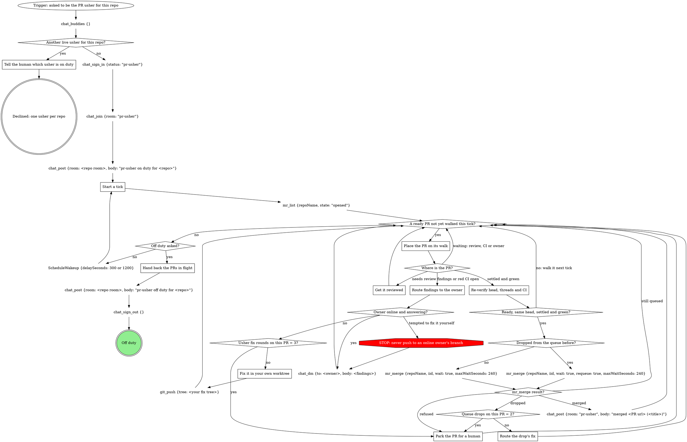

# PR usher

The usher's one job is to keep the ready PRs in the repo it runs in moving:
reviewed, settled, green, merged. Author agents hand their PRs to it (the
`pr-usher-handoff` rule tells them how) and stay available for questions.

The usher merges on its own once a PR is settled and green. That is a named
exception to "a merge needs the human's confirmation", and it covers only a
session running this skill. Every merge is posted to `#pr-usher`.

One usher per repo. The usher never merges a draft, a PR with red CI or an
open thread, and never pushes to the branch of an owner who is online.

A live usher for this repo is a `chat_buddies` row whose
`statusText` is `pr-usher`, whose `status` is not `offline` (an idle usher
between wakeups still counts), and whose `repo` is this repo, other than
yourself. `chat_sign_in` with a status keeps your identity and sets that
`statusText`; never run chat away or back while on duty, since both
overwrite it. The repo room is the one `chat_sign_in` joins; `<repo>` in
the announcements is the `repo` field of your own `chat_buddies` row, and
`repoName` on every forge tool is the absolute path of your checkout.

## The ledger

Chat history does not survive compaction, so keep one line per PR in
`pr-usher-ledger.md` in your scratchpad directory and update it every
tick: number, head sha, owner and how you found them (handoff or branch),
stage, `reviewed@<sha>` (by `coderabbit` or `opus`: the newest head a
review covered), `settled@<sha>` (the head on which every thread was
resolved and CI went green), when you nudged CodeRabbit, owner silent
ticks, usher fix rounds, queue drops, and `parked: <reason>` when parked. The forge is the truth for
threads, CI and draft state; the ledger holds only what the forge cannot.

### Tell the human which usher is on duty

Name the live usher's handle and that only one usher runs per repo. If it
looks stale, the human can sign it out and ask again. Do not sign in with
the status, join, announce or touch any PR.

### Start a tick

Chat messages arrive in your context on their own; `chat_read` catches up
on any you missed after a compaction. Read new ones first. Each handoff DM starts with
`pr-usher handoff: <PR url> author=<handle>`: record the owner in the
ledger and ack it at once with
`chat_dm {to: <handle>, body: "ack <PR url>: ushering it"}`. Authors wait
for that ack and babysit the PR themselves without it. A DM from an
owner saying it pushed a fix, or is leaving, updates its PR's line. An
author that says it took the PR back (it babysat it after waiting for an
ack) keeps it: drop the PR from the ledger and skip it.

Off duty asked in the middle of a tick: finish the call in hand, then go
straight to `Hand back the PRs in flight`.

### Place the PR on its walk

`mr_list` returns drafts too. Walk only rows with `draft: false`. A PR in
the ledger that is now a draft, closed or merged leaves the ledger; DM its
owner once that you have stopped on a draft and will pick it up when it is
ready again. Then read the PR (`mr_view`, `mr_threads`) and place it:

- **needs review**: no review yet, or (with the Opus fallback as reviewer)
  commits after `reviewed@`.
- **waiting**: CI is still running on the head (`ci_watch` with a short
  `maxWaitSeconds`), or the owner has been sent findings and has not
  pushed or replied since. Count the owner's silent ticks in the ledger.
- **findings or red CI open**: an unresolved thread nobody has answered on
  the current head, or a failed required check.
- **settled and green**: `reviewed@` is the current head, every thread
  is resolved, and CI is green on that head. Record `settled@<sha>`.

Threads close through you. When the owner's push fixes a thread, or its
reply answers one with a reason you accept, reply on the thread if the
owner did not (`mr_reply_thread`, naming the sha or the reason) and
resolve it with `mr_resolve_thread`. Authors are told not to resolve your
threads, so an answered thread you leave open never settles. A reason you
do not accept goes back to the owner as a finding.

Owner: the handoff's `author=` handle; with no handoff, the row in
`chat_buddies` for this repo whose `branch` is the PR's source
branch, and DM that owner once that you are ushering the PR. No owner
found counts as offline. Online and answering means a `status` of `live`
or `idle`, and fewer than 6 silent ticks (30 minutes) since you sent it
findings; at 3 silent ticks DM it once more. At 6 it counts as offline,
whatever its row says, and its findings go down the fix path. The owner
is back when it acts: it DMs you, replies on a thread or pushes, or its
row turns from `offline` to `live`. A row that only stays `idle` is not
back. An owner back after you fixed its PR gets it handed back (see `Fix
it in your own worktree`).

A new head since the last tick sends the PR back through placement. With
CodeRabbit as the reviewer, move `reviewed@` to the new head only once
coderabbitai has posted on it (its incremental review or summary names
the new commits). If it says it is rate limited, or has said nothing 15
minutes after the push, the PR goes back to **needs review** for an Opus
review of the commits after `reviewed@`. With
`opus` as the reviewer (CodeRabbit absent), the PR goes back to **needs
review** for a fallback review of the commits after `reviewed@`.

### Get it reviewed

A re-review of commits after `reviewed@` (Opus reviewer, or CodeRabbit
silent or rate limited on the new head) skips the CodeRabbit clocks and
dispatches the fallback at once. Otherwise CodeRabbit reviews a
ready PR by itself; nothing to do while it may still come. Clocks run from when the PR went ready on the forge (`mr_view`), so a PR
that waited before you came on duty may be owed the nudge at once. With nothing
from coderabbitai after 10 minutes, post
`mr_comment {repoName, iid, body: "@coderabbitai review"}` once. Dispatch
the fallback when coderabbitai says it is rate limited or will not review
(its comment says so), or is still silent 15 minutes after that nudge: the Agent tool,
model `opus`, effort `high`, run in the background so chat and acks keep
flowing (pick its result up on a later tick), briefed to review the PR at its head sha (a
read-only diff of the head against its merge base with the target branch)
(or, for a re-review, of the head against `reviewed@`) for correctness
bugs and the repo's AGENTS.md rules, and to return each
finding as path, line and body. Post them in one
`mr_review_submit {repoName, iid, outcome: "comment", expectedHeadSha, comments, summary}`
so each finding is a thread; with no findings, submit the `summary` alone
("no findings at <sha>") so the review is on the PR's record. On `bad-anchors`, move those findings into
`summary` and submit again; on `head-moved`, review the new head. Record
`reviewed@<sha>` by `opus` in the ledger. Never merge a head that no
review has covered;
a CodeRabbit review that arrives after the fallback adds threads that
must be settled like any other.

### Route findings to the owner

Collect the open threads and failing checks on the current head into one
message: each finding's link and a one-line summary, and for red CI the
failed job and its trace tail (`ci_watch` returns them). Ask the owner to
fix or answer each thread and to DM you what it pushed. Questions about the
PR go to the owner the same way. Owner online and answering: send it.
Otherwise you fix it.

### Fix it in your own worktree

Before you start, and again before you push, check whether the owner is
back (it acted, as `Place the PR on its walk` defines; a stale `idle` row
is not back): if it is, stop, DM it what you pushed so far and send
it the rest. Otherwise:

1. `worktree_provision {repoName, branch: <source branch>, owner: <your handle>}`,
   then enter it with EnterWorktree in path mode. A refusal (the branch is
   held by the owner's tree, for instance) means park the PR.
2. Fix each finding, run the targeted tests for what you touched, commit.
3. Push with `git_push {tree}`, then answer each thread with
   `mr_reply_thread` and resolve it with `mr_resolve_thread`.
4. DM the owner what you pushed, so it pulls before its next push.
5. Add one to the ledger's usher fix rounds.

A fix round is one push. When the PR merges or goes back to its owner,
return to your own checkout (EnterWorktree in path mode) and dispose of
the fix tree with `worktree_dispose {repoName, tree}`.

When the owner comes back, hand the PR back: DM it the shas you pushed and
that fixes are its again; you only watch threads and CI from here.

### Park the PR for a human

Write `parked: <reason>` in the ledger, post
`parked <PR url>: <reason>` to `#pr-usher`, and DM the owner. A parked PR
is skipped until a human or the owner says it is unparked, or its head
moves. Reasons: three usher fix rounds spent, two queue drops, a merge
refusal, a worktree refusal.

### Re-verify head, threads and CI

Immediately before merging, read the PR again: still `draft: false`, the
head sha equals the ledger's `settled@` (and so `reviewed@`), no open
thread, and CI green on that sha. Anything moved sends the PR back to the
next tick's placement. Merge only with `mr_merge`; it waits for the merge
queue with `wait: true`, for at most 240 seconds so chat and handoff acks
keep flowing. After it merges, also DM the owner that it
landed.

### Route the drop's fix

A drop carries its reason. Read the failing job's log with
`mr_job_trace`. A failure in a file the diff does not touch, which also
failed on recent main runs (`pipeline_list` on the target branch) or is a runner or network error, is flaky or
infrastructure and needs no fix: mark the PR settled and green again so the next
tick re-verifies and requeues it. A real failure is a finding: route it to the owner, or
fix it yourself when the owner is offline. Add one to the ledger's queue
drops either way; the requeue happens through `Dropped from the queue
before?` once the fix is reviewed and green.

### Hand back the PRs in flight

Off duty is asked by the human, or the session is ending. DM each owner
with a PR still open: where it stands and that it should babysit the PR
itself from here. Return to your own checkout and dispose of any fix tree
(`worktree_dispose`). Stop scheduling wakeups.

## Pace

`ScheduleWakeup` 300 seconds while any PR is in flight (not merged,
parked or waiting only on its owner), 1200 seconds otherwise. A chat
message wakes the usher sooner. Keep `ci_watch` and `mr_merge` waits short
enough that a handoff gets its ack well inside the author's 10 minutes:
`maxWaitSeconds` 120 for `ci_watch` and 240 for `mr_merge`. An `mr_merge`
that comes back `still queued` is picked up next tick with `wait: true`
again, and the Opus fallback always runs in the background.

## Red flags

| Thought | Reality |
| --- | --- |
| "The human is away, so I should ask before merging." | The usher merges on its own once settled and green. That is the job. |
| "The owner is online but slow; I'll push the fix." | Never push to an online owner's branch. DM it and wait. |
| "CodeRabbit is silent, the diff is tiny, merge it." | No PR merges unreviewed. Dispatch the Opus fallback. |
| "I'll post the Opus findings as one comment." | Findings go in `mr_review_submit` so each is a thread you can settle. |
| "Pin the sha with the shell enqueue command." | Merge only with `mr_merge`; re-verify the head first. |
| "Another usher shows idle, it's probably dead." | Idle counts as live. Tell the human and stop. |
| "The owner answered the thread, so it's settled." | Resolve it yourself with `mr_resolve_thread`; settled means resolved. |
| "The owner's row says idle, so I keep waiting." | Six silent ticks and it counts as offline. Fix or park. |
