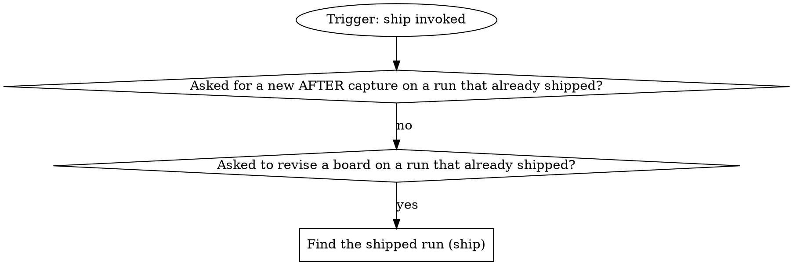

# ship

The pipeline's ship stage, reached directly: the target comes from the
checkout. The run graph opens or inherits the run; the flow graph ships
and closes it, and is where every mechanical move of the domain rules
lands.

## Run

An own run is a fresh, resumed or reopened one: it records identity and
closes at the end. An inherited run records no identity, closes nothing, and hands
back to the verb that invoked it.

### Asked for a new AFTER capture on a run that already shipped?

Yes when the operator wants the AFTER captured again (a stale state, a
fixed view) or the evidence re-attached on a run whose MR is open. A change
to an existing board with no new capture (a label, a redaction) is a
revision, below.

### Find the shipped run (ship)

The operator asks to change a board on a run that already shipped
(reword a label, widen a redaction). A `runDb` a caller handed is the
shipped run. Otherwise it is the run the operator names: `run_list
{repo}`, the row with that run id, or the newest row whose `branch`
matches when they name only the branch. Its `runDb` is
`<runs root>/<the row's repo>/<its id>/state.db`, the runs root
`~/.mattstack/runs` unless `RT_RUNS_ROOT` sets it.

## Domain rules

If a rule below asks for a move this graph marks STOP, take the off-script
edge instead. A rule that keeps a capture out of the record, or keeps a
base with no waiver, yields to the evidence record. A browser target the
domain points at supplies facts, never steps: on a browser case,
browser-evidence below does the capture, the board, the gates and the
bundle.

{{slot:domain}}

When nothing is inlined above, the graph alone is the flow: no steps before
the gate, no fast checks, no rebase, no AFTER beyond a browser case's, no
CI watch.

## Browser evidence

{{include:browser-evidence}}

## Evidence record

{{include:evidence-record}}

## Gate protocol

{{include:gate-protocol}}

## Wrap-up form contract

{{include:wrap-up-form}}
